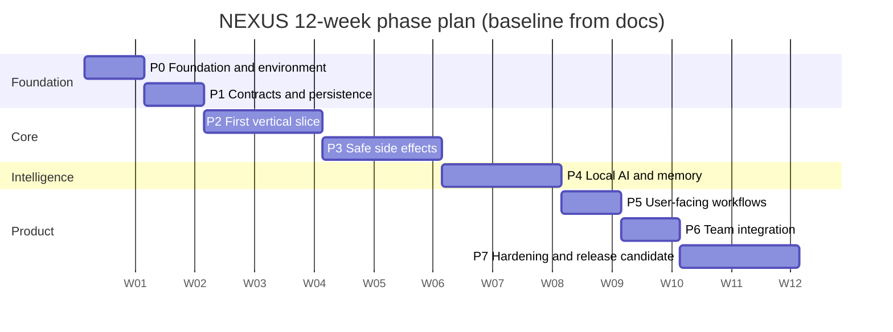

# NEXUS — Master Phase Plan

> Status: **DRAFT for team review.** This is the plan-of-plans. Detailed step-by-step roadmaps, trackers and
> diagrams are written **one phase at a time**, right before that phase is built.

## 1. Ground rules (confirmed with the project owner)

| Item | Decision |
|---|---|
| Starting point | Nothing built. Only the 66 files in `specification/word/` exist. |
| Scope | **Full documented MVP (all 15 items)** — see `Final Architecture Decision Closure and MVP Scope Freeze.docx`, section 04.27.06. |
| Timeline | **12 weeks** as written in the docs (`Consolidated 10–12 Week Implementation Plan and Project Sign-off.docx`, 04.28.03). 10 weeks is only an accelerated option if early gates pass. |
| Team skill level | All 3 developers are beginner/intermediate in Python → **every phase includes learning steps**. |
| Roles | **Rotating.** Every developer works in every area; each phase has one *primary owner* per work stream. |
| Deliverable format | Markdown in the repo (roadmap `.md`, tracker `.md` checklist, Mermaid diagrams). |

Developers are called **Dev A, Dev B, Dev C** until you give names.

### Work streams (from the docs' three ownership areas)

| Stream | Covers | Source |
|---|---|---|
| **BE** — Backend & execution | FastAPI, PostgreSQL, auth, task state machine, workers, policy, approvals, audit, backup | Doc 04.28.04 "Developer 1" |
| **WB** — Windows bridge & tools | Native bridge, enrollment, polling, path validation, file search/read/create, app launch | Doc 04.28.04 "Developer 2" |
| **AI** — AI, planning & memory | Local model runtime, adapter, structured planner, memory, retrieval, grounding | Doc 04.28.04 "Developer 3" |

## 2. Phase overview

The calendar dates above are **placeholders only** (used so the chart renders). Replace with the real start date.

| Phase | Weeks | Goal | Exit gate (from docs) |
|---|---|---|---|
| **P0** Foundation & environment | 1 | Everyone can run the project; hardware facts known | — (Week 1 checklist, 04.28.06) |
| **P1** Contracts & persistence | 2 | Shared contracts frozen; DB schema + auth skeleton | **Gate 1** — contracts agreed |
| **P2** First vertical slice | 3–4 | CLI → backend → bridge → scoped file search → result | **Gate 2** — first vertical slice works |
| **P3** Safe side effects | 5–6 | Policy, approvals, create-only file tool, idempotency, recovery | **Gate 3** — safe side effects |
| **P4** Local AI & memory | 7–8 | Validated local model, structured planner, memory, retrieval | **Gate 4** — AI and memory integrated |
| **P5** User-facing workflows | 9 | CLI history, results, approvals UX, diagnostics, document processing | (Week 9 deliverable) |
| **P6** Team integration | 10 | Three users/devices, isolation, concurrency, disconnect/restart | **Gate 5** — team integration |
| **P7** Hardening & release candidate | 11–12 | Backup restore, security regression, performance, clean install, sign-off | **Gate 6** — release candidate |

## 3. Rotation of primary owners

Each phase has three work streams; the primary owner rotates so everyone touches every area.

| Phase | BE | WB | AI |
|---|---|---|---|
| P0 | A | B | C |
| P1 | B | C | A |
| P2 | C | A | B |
| P3 | A | B | C |
| P4 | B | C | A |
| P5 | C | A | B |
| P6 | A | B | C |
| P7 | All three — release work is shared |

Rules for rotating safely (the docs assume specialists, so rotation needs guardrails):
- The **previous owner of a stream pairs with the new owner** for the first days of the phase.
- Shared contracts (task states, bridge protocol, tool schemas) still require review by all three
  (docs 04.28.04, "Ownership is not a silo").
- Security-sensitive changes are reviewed by someone who is **not** the author.

> **Trade-off to be aware of:** rotation spreads knowledge and removes a single-person bottleneck, but each
> hand-off costs ramp-up time inside a 12-week schedule. The pairing rule above is how the plan absorbs that cost.

## 4. Phase details (summary level)

### P0 — Foundation & environment (Week 1)
- **Do:** create the repo and layout, branching/PR rules, Python + WSL 2 + PostgreSQL setup, hardware inventory of the designated host, LAN connectivity test from another Windows PC, agree on task lifecycle/IDs/error format.
- **Source:** Week 1 checklist (04.28.06); `Hardware Inventory…`, `Development Environment Bootstrap…`, `Repository Structure, Branching Strategy…`.
- **Learning:** Git branching + pull requests; Python virtual environments and `pyproject.toml`; running PostgreSQL; reading a Windows hardware report.
- **Proposed change to the docs (needs your OK):** also run a **quick local-model smoke test** here instead of waiting for Week 7. The docs schedule runtime/model validation in Week 7 (04.28.03) — but GPU/runtime compatibility on this AMD machine is unverified and could change the product shape.

### P1 — Contracts & persistence (Week 2)
- **Do:** commit API + bridge contract definitions, task states, error catalogue; initial PostgreSQL schema + migrations; basic auth + ownership checks; bridge enrollment prototype; mock planner; contract tests.
- **Source:** Week 2 checklist (04.28.06); `API Contract Freeze…`, `Database Architecture…`, `Task State Machine…`.
- **Learning:** SQL basics and transactions; Pydantic models; what a contract test is; password-hashing concepts.
- **Candidates, not decisions** (per docs): Pydantic, SQLAlchemy, Alembic.

### P2 — First vertical slice (Weeks 3–4)
- **Do:** authenticated task submission, durable persistence, native Windows bridge, authenticated dispatch, scoped file search, result visible in CLI; duplicate-submission and unauthorized-device tests.
- **Source:** Gate 2 (04.28.05); `First Vertical Slice…` (both docs); `Device Registration Protocol, Bridge Polling…`.
- **Learning:** FastAPI routing + dependency injection; HTTP polling; Windows paths in Python; pytest fixtures.

### P3 — Safe side effects (Weeks 5–6)
- **Do:** tool registry, directory scopes, approval lifecycle, create-only file tool (no silent overwrite), operation IDs/deduplication, cancellation, lost-response/uncertain-outcome tests.
- **Source:** Gate 3; `Tool Execution Protocol…`, `File Access Security…`, `AI Safety, Tool Governance…`.
- **Learning:** idempotency; path canonicalization pitfalls (symlinks/junctions); database row locking and leases.

### P4 — Local AI & memory (Weeks 7–8)
- **Do:** runtime/model benchmark on the designated host, model adapter, structured plan validation, explicit memory CRUD, scoped retrieval, grounding, prompt-injection tests. If the model is not viable → a *documented blocker and tested fallback* (Gate 4 wording).
- **Source:** Gate 4; `Local AI Runtime and Model Selection Benchmark Plan`, `Planning Engine…`, memory documents.
- **Learning:** how LLM structured output fails; PostgreSQL full-text search; evaluation sets.
- **Note:** runtime (Ollama is only a *candidate*) and model are **not decided** in the docs.

### P5 — User-facing workflows (Week 9)
- **Do:** CLI history, results, approval prompts, diagnostics, supported document processing.
- **Source:** Week 9 row; `User Experience, Conversation Context…`, `Notifications, User Approval Experience…`, `Document Processing Pipeline…`.
- **Learning:** CLI design; structured logging.

### P6 — Team integration (Week 10)
- **Do:** three registered users/devices, cross-user/device isolation, concurrency, restart and disconnect scenarios, reproducible setup for every developer.
- **Source:** Gate 5; `Multi-User Isolation…`, `End-to-End Integration Architecture…`.

### P7 — Hardening & release candidate (Weeks 11–12)
- **Do:** backup restoration, security regression, performance testing, upgrade/recovery rehearsal, clean install, full acceptance suite, documentation, team sign-off.
- **Source:** Gate 6; `Testing Strategy and Quality Gates`, `Backup, Restore…`, `Operational Runbooks…`.

## 5. Open decisions to close (from the docs)

These are recorded as **open** in `Product Vision.docx` §1.7 and must not be treated as decided:

| ID | Question | Planned phase |
|---|---|---|
| PC-02 | Where do backend, PostgreSQL and model runtime run? | P0 |
| PC-09 | Real GPU / disk / RAM of the machines | P0 |
| PC-04 | How do users authenticate in the MVP? | P1 |
| PC-05 | Default permitted directories and applications | P1–P3 |
| PC-06 | What runs automatically vs. needs approval | P3 |
| PC-07 | Task behavior when target PC goes offline | P3 |
| PC-03 | Local model per PC vs. shared inference | P4 |
| PC-08 | What context is shared across devices | P4 |
| PC-10 | Which document formats the MVP supports | P5 |
| PC-01 | Must NEXUS work when disconnected from the backend? | P1 |

## 6. Honest risks to the plan

1. **Scope vs. skill:** full 15-item MVP in 12 weeks with beginner/intermediate Python is ambitious. The docs say essential safety work must not be cut; if a gate slips, the docs' rule is to *reduce non-essential scope or adjust the schedule*. We should decide the cut order **before** it is needed.
2. **AI feasibility** is unverified (16 GB RAM, AMD GPU, model unknown) — hence the P0 smoke test proposal.
3. **Single host** runs backend + PostgreSQL + model; it is a single point of failure (docs `Backup, Restore…`).
4. **Role rotation** adds ramp-up cost (see §3).

## 7. What happens next

For each phase, in order, we will produce:
1. `roadmap/phase-N-*.md` — numbered steps: *what to do*, *how to do it* (commands, files), *how to verify*, *learning links*.
2. A section in `roadmap/tracker.md` — checklist with owner, status, evidence link.
3. Updates to `roadmap/architecture.md` — Mermaid diagrams for the team.

Then we build the phase, check its gate, and move on.
