# NEXUS — Architecture Diagrams

> **Status:** DRAFT · **Scope:** what the specification documents *propose*, drawn for the team. Nothing here is built yet.
> Every diagram cites its source section. Items the documents mark as provisional or open are drawn as such.
> Update this file when a decision is recorded in `docs/decisions/`.
>
> Parent: [`00-phase-plan.md`](00-phase-plan.md) · Tracker: [`tracker.md`](tracker.md)

## How to view

Mermaid renders natively on GitHub, in VS Code (with a Mermaid preview extension) and in Bob chat.

---

## 1. Logical architecture

**Source:** NEXUS System Architecture 3.2 and Application Structure 3.8.1. Logical components only, not a finalized physical deployment.

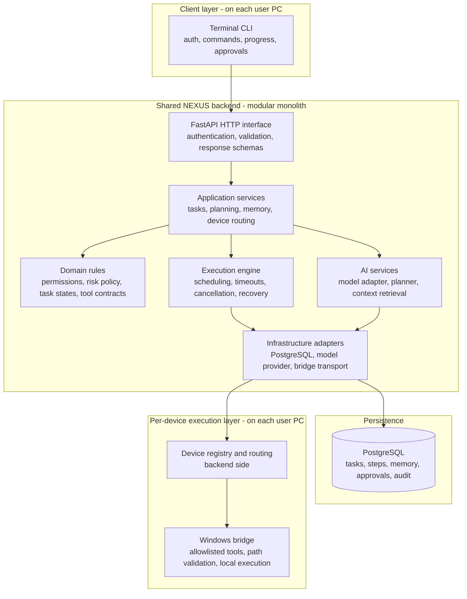

**Rules that the arrows do not show** (Application Structure 3.8.1, 04.04.06):
- The CLI never writes directly to PostgreSQL.
- The planner proposes; application code authorizes. The planner cannot call arbitrary Windows functions.
- API route handlers do not contain a second task state machine or authorization logic.
- The bridge executes only registered local tools after its own validation.

---

## 2. Proposed physical deployment — Option A

**Source:** Deployment Topology and Trust Boundaries 3.7.1–3.7.2. Option A is the **provisional** MVP default and is **not confirmed** until the host passes the checks in 3.7.6 (hardware, memory, LAN, availability, recovery).

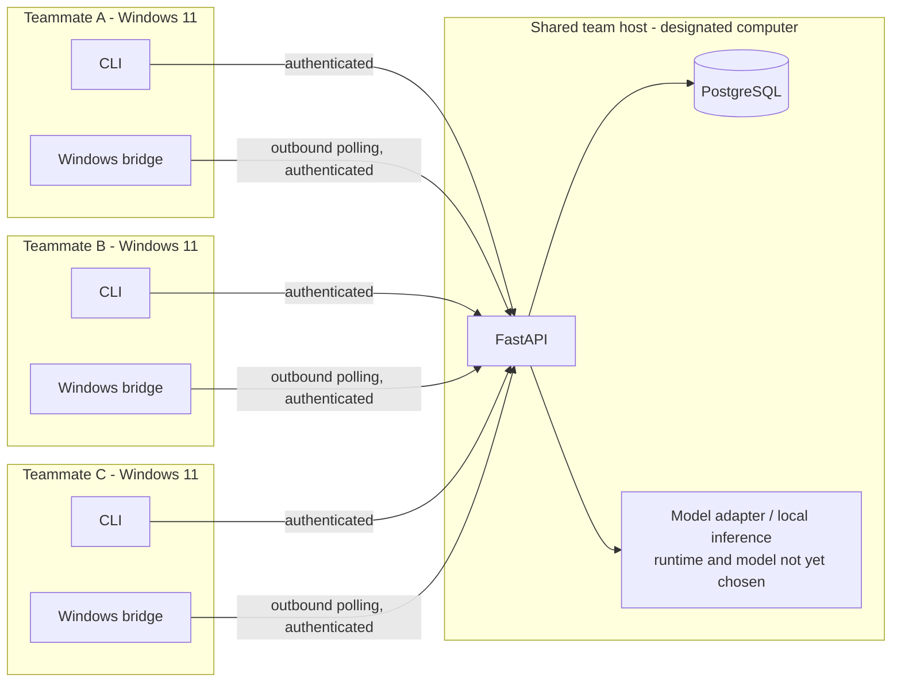

**Notes:**
- Bridges poll **outbound** to the backend (Final Architecture Decision Closure 04.27.04: "Authenticated outbound polling" — provisional).
- The model runtime may instead live on another machine (3.7.2); this is an option, not a decision.
- Option B (a separate always-on host) keeps the same bridge boundary and removes dependence on a developer's PC.
- **PostgreSQL and the model runtime must not be exposed to the LAN beyond what is needed** (3.7.7).
- **Single point of failure:** if the host is off or its disk fails, the shared backend, database and possibly the AI runtime stop (Backup, Restore and Data Lifecycle).

---

## 3. Trust boundaries

**Source:** Deployment Topology and Trust Boundaries 3.7.3 (Boundaries A–E).

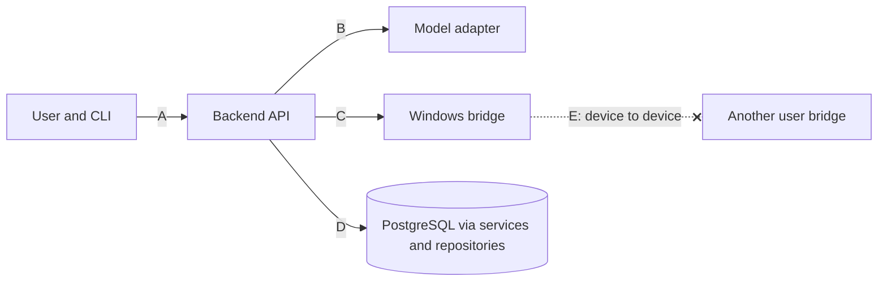

| Boundary | Meaning | Rule from the docs |
|---|---|---|
| **A** Client → backend | Every API request is authenticated | User identity comes from validated credentials, never from a user ID in the request body |
| **B** Backend → model | Model gets only the context it needs | Model output is **untrusted input**; it cannot authorize actions, touch the database or bypass policy |
| **C** Backend → bridge | Bridge authenticates and validates every operation | Bridge verifies the action is allowed on **that** device |
| **D** Application → database | Access via controlled services/repositories | Ownership checks on user-owned records; transactions keep task state consistent |
| **E** Device → device | One teammate's bridge is never a route to another's files | Registration, permissions and per-operation authorization checked independently |

Also from the docs: **do not assume "local network" means trusted** (3.7.4).

---

## 4. Code dependency direction

**Source:** Repository Structure 04.04.02 and 04.04.06.

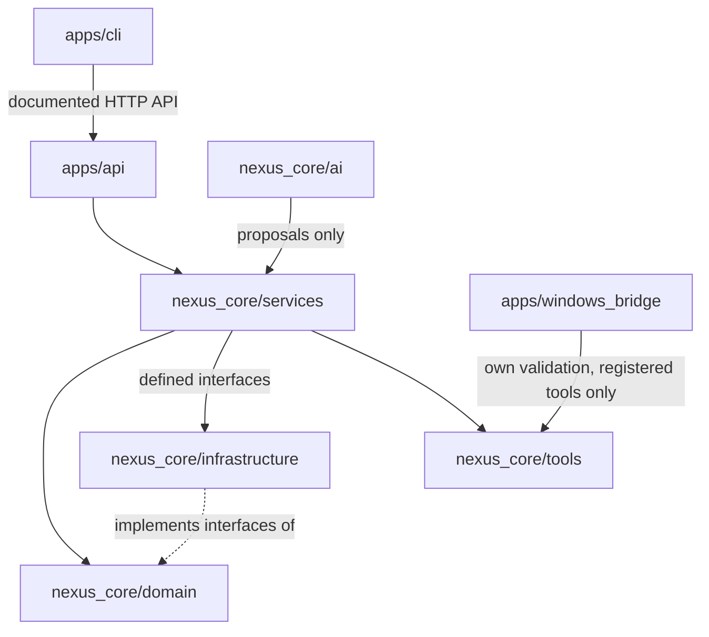

**The docs' dependency rules in words:**
- `domain` is independent of FastAPI, a model runtime and database session APIs.
- `services` use domain rules and defined interfaces.
- `infrastructure` implements the database, model and bridge interfaces.
- `api` and `cli` call application services / the documented API.
- `ai` produces proposals; services validate them.
- `windows_bridge` is a separate, native Windows process.

---

## 5. First vertical slice — request flow

**Source:** Repository Structure 04.04.10 (the 11-step milestone). This is the first integrated end-to-end behaviour (Gate 2, Week 4). It uses a **mock planner**; no live model is required.

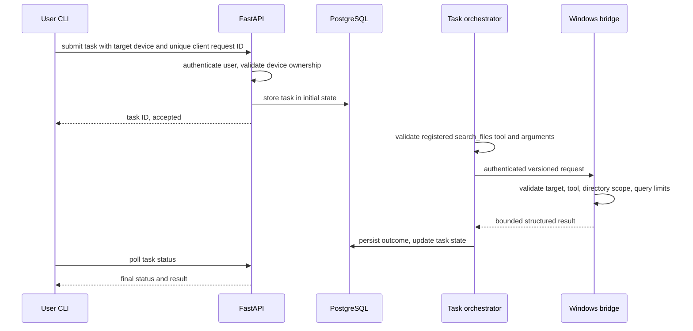

**Acceptance expectations from the docs:** duplicate submission, an unauthorized device and a disconnected bridge must not produce unsafe behaviour; task state stays correct after a backend restart; disconnection never yields a false success. How the bridge actually receives the request (outbound polling) is detailed in a later document (Device Registration Protocol), and will be drawn in P2.

---

## 6. Environments

**Source:** Repository Structure 04.04.08 and Development Environment Bootstrap 04.05.02.

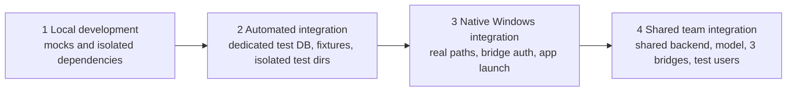

**Isolation rules (04.04.08):** automated tests never use the shared team database by default · filesystem tests use temporary directories · test credentials differ from real ones · model tests use fixed documented inputs · a failed test must not modify a real user's tasks or files · secrets never reach logs or test artifacts.

---

## 7. Delivery gates

**Source:** Consolidated 10–12 Week Plan 04.28.05.

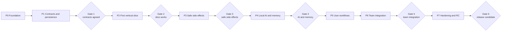

> The Gate 1–6 mapping to phases is from the plan (`00-phase-plan.md`). Gates require **repeatable tests**, not demonstrations (04.28.05).

---

## 8. Database entity-relationship diagram (P1, draft)

**Source:** Database Architecture and Data Model (03.10). The docs name the tables and the key constraints. **The relationships below are my reading of the column names** (`owner_user_id`, `target_device_id`, `task_id`, `task_step_id`), not a copy of an ER diagram from the docs, and the 10-row open-decisions table (03.10.11) was not extracted. Treat this as a draft until P1 Step 16 confirms it. `approvals` and `memories` are omitted because the P1 plan defers them (P3, P4).

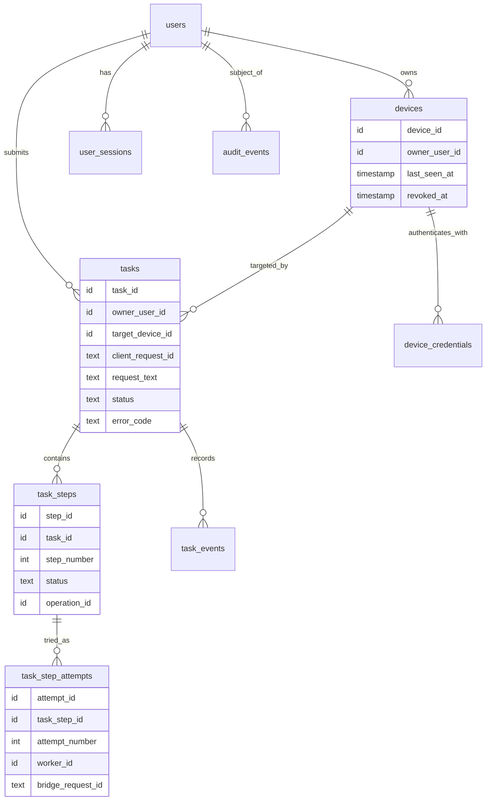

**Constraints from the docs (03.10):** `UNIQUE(owner_user_id, client_request_id)` · `UNIQUE(task_id, step_number)` · `UNIQUE(operation_id)` · `UNIQUE(task_step_id, attempt_number)`. Revoke or deactivate rather than cascade-delete. Database tests run on real PostgreSQL, not SQLite.

---

## 9. Task state machine (P1)

**Source:** Task State Machine (03.29). Only the transitions I confirmed from the document text are drawn; the document's full 17-row table was **not extracted**, so P1 Step 9 tells the team to copy it in and extend this diagram.

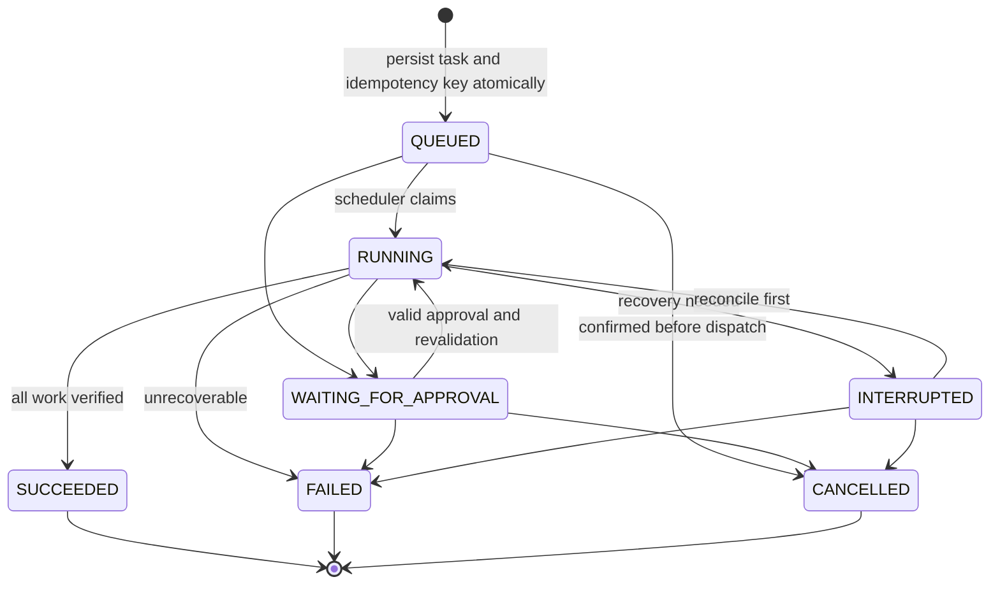

**Forbidden (docs):** `SUCCEEDED` or `FAILED` back to `RUNNING` · `CANCELLED` back to `QUEUED` · `WAITING_FOR_APPROVAL` to `SUCCEEDED` without execution · `INTERRUPTED` to `SUCCEEDED` without reconciliation · any state to `SUCCEEDED` on a model or bridge claim alone · any state to `CANCELLED` while an external effect is unresolved. `PARTIALLY_SUCCEEDED` must not be added.

---

## 10. Step states (P1)

**Source:** 03.29. The docs list the ten step states and two rules; the step transition table was **not extracted**, so no arrows are drawn here.

| Step state | Note |
|---|---|
| `PENDING`, `READY` | Not yet dispatched |
| `WAITING_FOR_APPROVAL` | Needs an approval before dispatch |
| `DISPATCHED` | Sent to the bridge. **Not** the same as `RUNNING` |
| `RUNNING` | Bridge reports it is executing |
| `SUCCEEDED`, `FAILED`, `REJECTED`, `CANCELLED` | Outcomes |
| `UNCERTAIN` | Outcome unknown. **Not** the same as `FAILED` |

---

## 11. Authentication and device registration (P1, draft)

**Source:** Authentication Implementation Design (04.09) and Device Registration Protocol (04.10.03). The sequence follows the docs' *proposed* registration steps. Credential format, token mechanism and the handshake are **open** (D-14, D-16), so no mechanism is named.

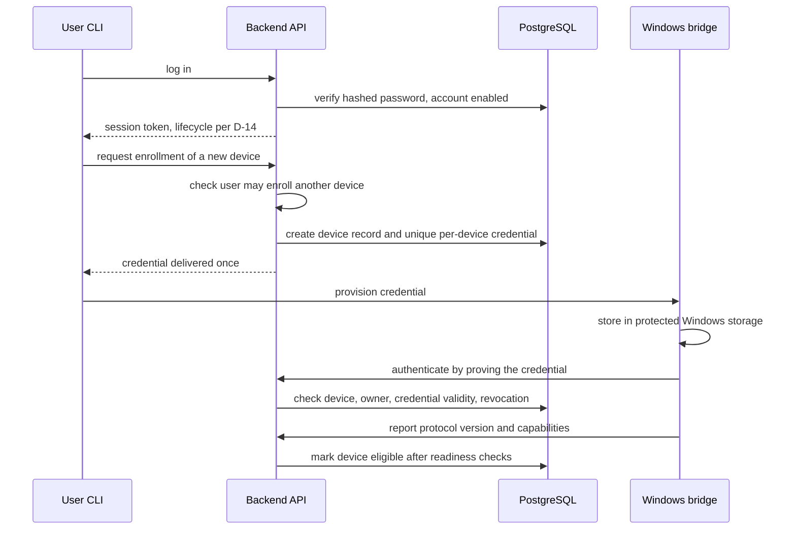

---

## 12. Bridge polling and command delivery (P1 draft, implemented in P2)

**Source:** 04.10.04 to 04.10.05. Polling is the docs' **Provisional** choice. The routes are the docs' *proposed* routes, not a frozen API. Only the P1 part (authenticate, heartbeat, capabilities, empty poll) is built in P1; delivery, ack and result belong to P2.

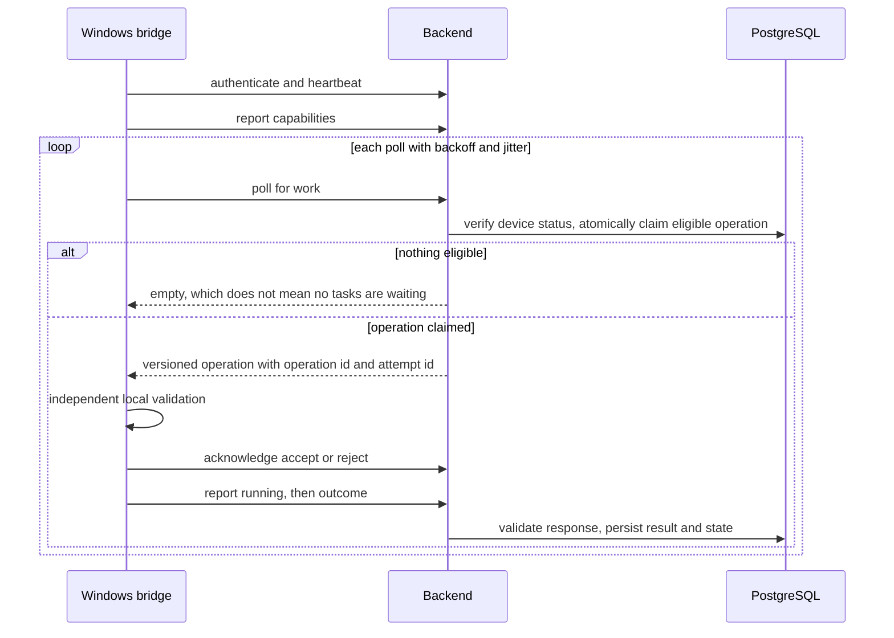

**Docs rules shown:** a device ID alone never earns an operation · the bridge validates independently · a bridge claim of success is validated by the backend · lost responses are reconciled through the operation lookup route, never blindly retried.

---

## 13. P2 vertical slice with persistence points

**Source:** 04.06 (9-step flow), 04.11.07 (worker sequence), 03.30.03 (execution protocol). This is the **target** sequence; the exact route names, claim fields and timings are still open decisions (D-27, D-28, D-32). The point of the diagram is *where state is committed*: intent is committed **before** dispatch, and no transaction is held open while waiting for the bridge.

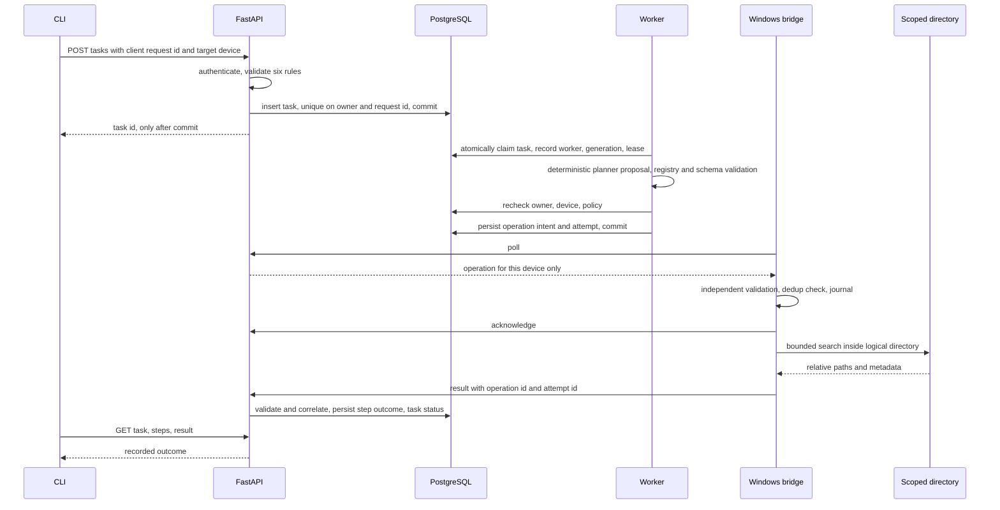

**Docs rules shown:** a task is acceptable only after commit · the planner proposes, the backend assigns IDs and validates · the worker never holds a transaction while waiting · SUCCEEDED only after a correlated result is persisted · results carry relative paths, never absolute ones.

---

## 14. Lost response after dispatch — what the backend may and may not do

**Source:** 03.30.01, 03.30.06, 03.30.10, 03.15.07, 04.11.05. The docs' crash-point table is the basis. The decision node "can the outcome be established" is the heart of recovery: **a timeout is not proof of failure**.

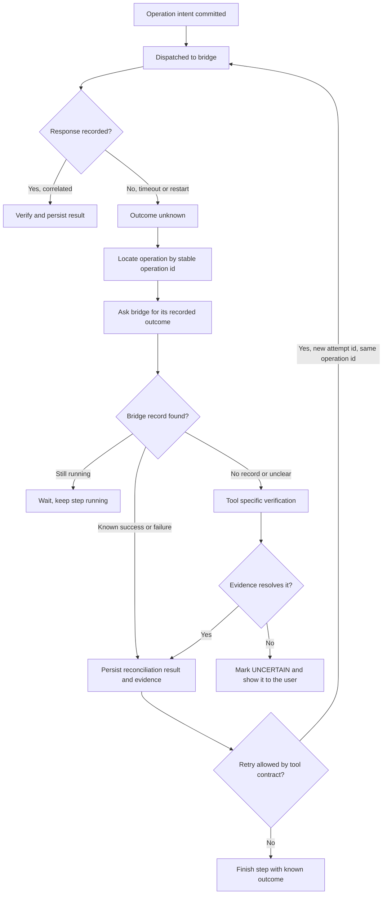

**Docs rules shown:** never retry blindly · a retry keeps the operation ID and gets a new attempt ID · recheck cancellation, device status and authorization before every retry · unresolved outcomes stay visible. For `search_files` a retry is generally safe, but it is still a new attempt.

---

## 15. Worker claim, lease and fencing

**Source:** 04.11.04 and 04.11.05, including the docs' generation 7 / 8 example. Claim columns, lease duration and the claim strategy are **open** (D-27, D-28).

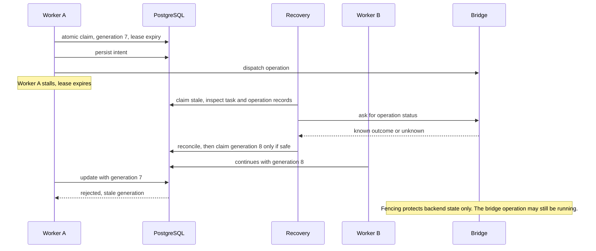

**Docs rules shown:** a lease is not proof that the worker or its external operation stopped · lease expiry triggers reconciliation, not replay · every state-changing path must check the generation · a transaction is never held while waiting for the bridge.

---

## 16. P3 — Authorization decision pipeline (8-layer policy engine)

**Source:** 03.23.3–03.23.4. The 8 layers run strictly in order; a DENY at any layer cannot be overridden by a later layer. The exact layer names and risk-tier enumeration values are open until Step 10 of P3. **Risk tiers are not permissions:** Tier 0 ALLOW still requires layers 1–5 to pass first.

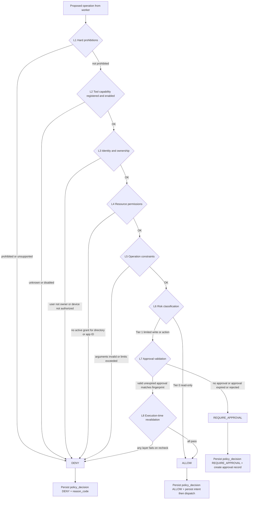

**Docs rules shown:** a model cannot lower a risk tier · a valid approval cannot make an unregistered tool executable · audit persistence fails → consequential action blocked · policy service unavailable → no dispatch.

---

## 17. P3 — Approval lifecycle state machine

**Source:** 04.18.06, 04.18.05. The expiry duration (D-40), state labels (D-42) and who can approve (D-41) are open until P3 Step 12. The transitions below use the docs' proposed five-state model.

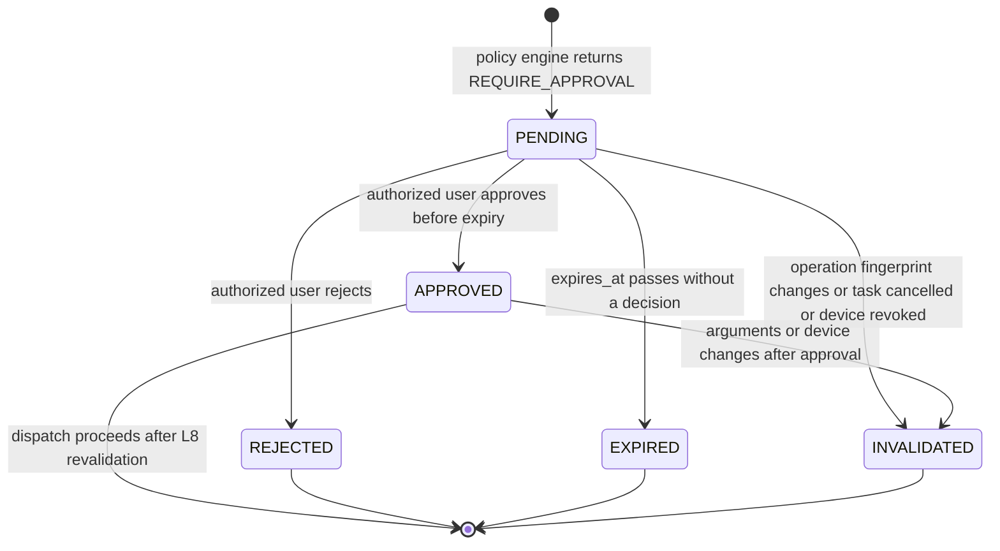

**Docs rules shown:** only a PENDING unexpired approval can receive a decision · two concurrent decisions are serialized atomically · a cancelled task invalidates all its PENDING approvals · a revoked user or device invalidates their approvals · an approved operation is still subject to L8 revalidation before dispatch.

---

## 18. P3 — `create_file` execution and reconciliation

**Source:** 03.30.03 (execution protocol), 03.30.06 (create_file uncertainty), 03.30.10 (verification). The creation strategy (D-43), content limit (D-44) and fingerprint algorithm (D-50) are open. This diagram shows the target behaviour; exact route names and bridge journal storage (D-47) are still open.

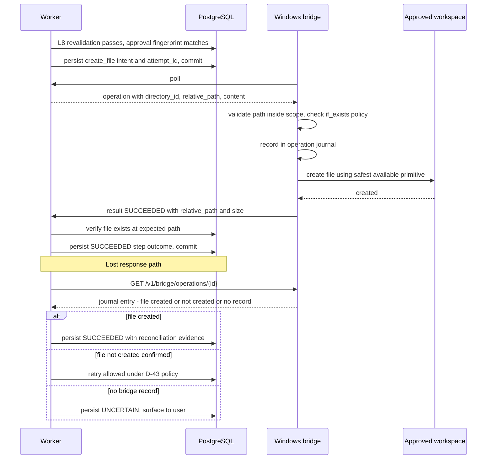

**Docs rules shown:** `if_exists=reject` returns `DESTINATION_ALREADY_EXISTS`, not UNCERTAIN · destination revalidated at execution time · no retry of uncertain create without reconciliation · no absolute paths returned to the backend.

---

## 19. P4 — Model adapter and inference lifecycle

**Source:** 04.13.04 (adapter contract), 04.13.06 (inference lifecycle), 04.13.07 (context budget), 04.13.08 (fallback). The `ModelProvider` interface isolates NEXUS from the runtime. Changing the model never requires touching the task state machine, policy engine or bridge. The runtime, model name, and execution mode are all **open** (D-56, D-57, D-58) until Step 6–8 of P4.

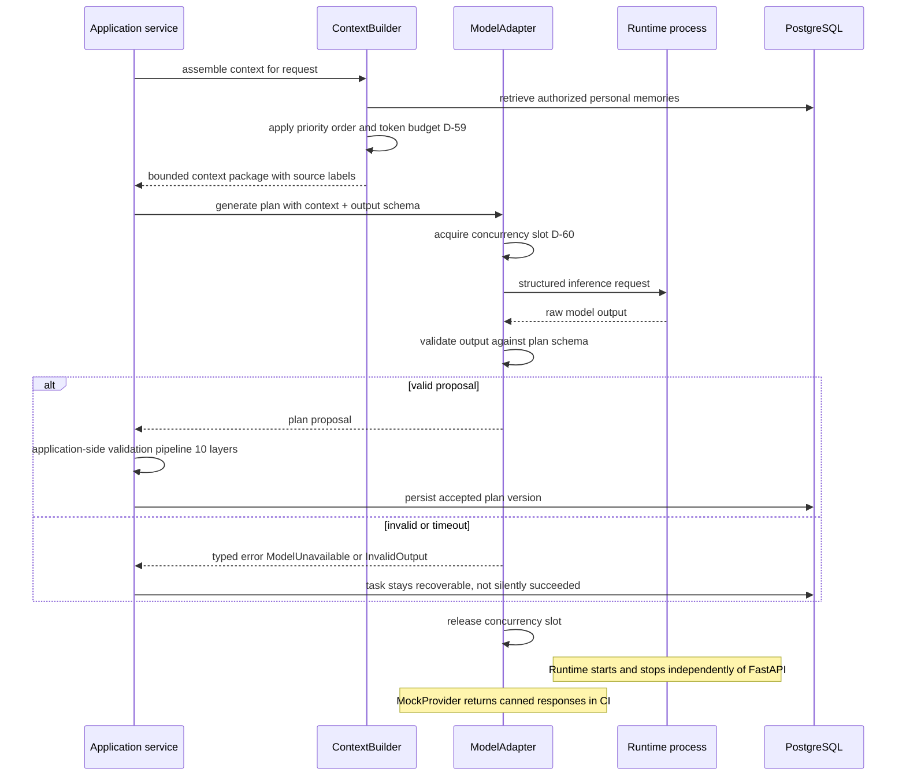

**Docs rules shown:** model output is untrusted input · a model-generated `approved`, `risk`, or `user_id` field cannot change policy outcomes · no DB transaction held during inference · context assembly runs authorization before the model sees any records · CPU fallback activates on GPU failure with stricter limits (D-68), logged, no silent scope change.

---

## 20. P4 — Multi-step plan DAG and execution orchestration

**Source:** 03.35.3–03.35.4 (plan structure and dependency rules), 03.35.5 (validation pipeline), 03.35.7–03.35.8 (execution phase and replanning). Step keys, dependency representation and replanning rules are **open** (D-61, D-62). The cycle detection and scope-expansion checks are mandatory, not optional layers.

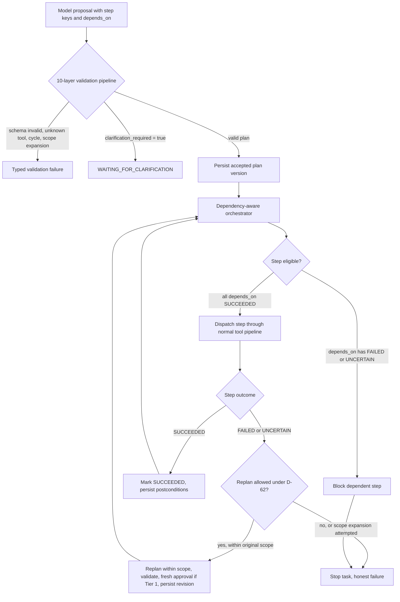

**Docs rules shown:** planning never modifies the user's computer · the backend assigns authoritative step IDs and operation IDs · a model-generated risk level or approved flag is stripped · replanning cannot expand scope, switch devices, bypass approval or revive a cancelled task · failed prerequisite blocks all dependent steps.

---

## 21. P4 — Memory retrieval and context assembly pipeline

**Source:** 04.15.03 (retrieval pipeline), 03.34.07 (assembly priority order), 04.15.06 (authorization before retrieval), 03.14.5 (lexical-first). Retrieval implementation (D-65), ranking signals (D-66) and token budget (D-59) are **open** until P4 Steps 8 and 16. The semantic/embedding path (dashed) is only built if lexical evaluation shows a meaningful gap.

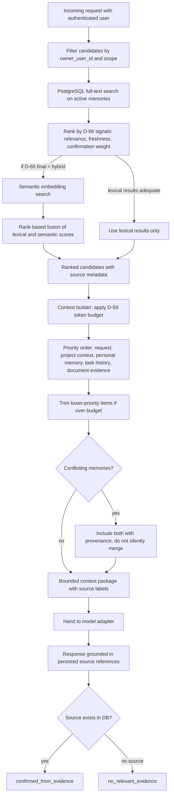

**Docs rules shown:** authorization filter runs before any content is exposed to the model · the model must not decide which users' records it is permitted to see · deleted memory is absent from retrieval · embeddings are not an authorization mechanism · a response citing a non-existent source fails the response validator.

---

## 22. P5 — Document processing pipeline: extraction, chunking and grounded response

**Source:** 03.33.03 (8-stage architecture), 03.33.06 (chunking), 03.33.07 (context budget), 03.33.09 (source attribution), 03.33.10 (prompt injection safeguards). Supported formats (D-71), extraction libraries (D-72) and chunking strategy (D-73) are **open** until P5 Step 12–14. The key invariant: extracted document text is untrusted data, never an instruction that can override NEXUS policy.

```mermaid
flowchart TD
    USER[User task: read document and summarize] --> BRIDGE[Windows bridge: authorize file access via directory_id + relative_path]
    BRIDGE --> CHECK{Format and resource checks}
    CHECK -->|unsupported format| ERR_FMT[DOCUMENT_UNSUPPORTED_FORMAT]
    CHECK -->|over size limit| ERR_SIZE[DOCUMENT_TOO_LARGE before reading]
    CHECK -->|eligible| EXTRACT[Text extraction using D-72 library]
    EXTRACT -->|extraction_status = failed| ERR_EXT[DOCUMENT_EXTRACTION_FAILED]
    EXTRACT -->|extraction_status = partial| WARN[Return segments with warnings - partial is not failure]
    EXTRACT -->|extraction_status = full| NORM[Normalization: line endings, encoding, preserve source locations]
    WARN --> NORM
    NORM --> CHUNK[Chunking: boundary-aware splits, sequence numbers, source_location per chunk]
    CHUNK --> LABEL[Label as untrusted document content - not instructions]
    LABEL --> RETRIEVAL[Lexical retrieval over chunks relevant to request]
    RETRIEVAL --> BUDGET[Context builder: apply D-59 and D-73 budget]
    BUDGET --> VALIDATE_SCOPE[Authorization check: user owns this document task]
    VALIDATE_SCOPE --> MODEL[Model receives: system instructions separate from document chunks]
    MODEL --> RESPONSE[Generated response with source references]
    RESPONSE --> VERIFY_CITATIONS{Source reference validated against supplied chunks?}
    VERIFY_CITATIONS -->|yes| GROUNDED[confirmed_from_evidence - safe to return]
    VERIFY_CITATIONS -->|invented page number or non-existent source| FAIL_CITE[Response validator rejects or marks no_relevant_evidence]
```

**Docs rules shown:** do not execute embedded macros or scripts · document text cannot modify permissions, device identity or the tool registry · every proposed operation is validated independently regardless of what a document requests · a citation must correspond to a chunk actually supplied to the model · private document paths must not leak through citations · partial extraction is reported honestly, never as full success.

---

## 23. P6 — Three-user LAN deployment and isolation topology

**Source:** Multi-User Isolation, Shared Resources, Team Collaboration and Personal Workspaces §03.37; Deployment Topology, Network Boundaries and Multi-Device Communication §03.22; Task Scheduling, Dependency Resolution and Resource-Aware Execution §03.28; Resource Governance, Fair Scheduling and Starvation Prevention §03.28.

```mermaid
flowchart TB
    subgraph LAN[LAN - single router, no internet route required]
        subgraph HOST[Designated host - designated PC]
            BACK[NEXUS Backend<br/>FastAPI + services + scheduler]
            PG2[(PostgreSQL<br/>per-user row ownership filters<br/>D-88: RLS optional defense-in-depth)]
            MODEL[Model runtime<br/>inference serialized - D-90]
            BACK --- PG2
            BACK --- MODEL
        end

        subgraph PCA[PC-A - User A]
            CLIA[CLI - User A]
            BRIDGEA[Windows bridge - Device A<br/>owner: User A - D-87]
        end

        subgraph PCB[PC-B - User B]
            CLIB[CLI - User B]
            BRIDGEB[Windows bridge - Device B<br/>owner: User B - D-87]
        end

        subgraph PCC[PC-C - User C]
            CLIC[CLI - User C]
            BRIDGEC[Windows bridge - Device C<br/>owner: User C - D-87]
        end

        CLIA -- "HTTPS to D-85 LAN address<br/>D-86 TLS decision" --> BACK
        CLIB -- "HTTPS to D-85 LAN address" --> BACK
        CLIC -- "HTTPS to D-85 LAN address" --> BACK
        BRIDGEA -- "outbound poll - D-32" --> BACK
        BRIDGEB -- "outbound poll" --> BACK
        BRIDGEC -- "outbound poll" --> BACK
    end

    note1["Device B cannot receive tasks from User A - D-87 owner-only<br/>Shared project memory deferred - D-91<br/>Per-user task limits confirmed in P6 - D-90<br/>Priority aging decided after starvation tests - D-92"]
```

---

## 24. P6 — Concurrent task lifecycle under three-user workload (isolation invariants)

**Source:** Multi-User Isolation §03.37.2–6; Resource Governance §03.28.05–09; Deployment Topology §03.22.06.

```mermaid
sequenceDiagram
    participant UA as User A CLI
    participant UB as User B CLI
    participant UC as User C CLI
    participant API as Backend API
    participant SCHED as Scheduler - PostgreSQL D-93
    participant INF as Model runtime - D-90
    participant DA as Device A bridge
    participant DB as Device B bridge

    UA->>API: POST /tasks - target Device A
    UB->>API: POST /tasks - target Device B
    UC->>API: POST /tasks - target Device A

    API->>SCHED: enqueue Task-A owner=UserA device=DevA
    API->>SCHED: enqueue Task-B owner=UserB device=DevB
    API->>SCHED: enqueue Task-C owner=UserC device=DevA

    note over SCHED: round-robin across users - D-92 aging if starvation seen

    SCHED->>INF: plan Task-A - serialized queue - D-90
    INF-->>SCHED: plan ready
    SCHED->>DA: dispatch step via bridge poll
    DA-->>SCHED: result - heartbeat lease D-28

    SCHED->>INF: plan Task-B - serialized
    INF-->>SCHED: plan ready
    SCHED->>DB: dispatch step
    DB-->>SCHED: result

    note over SCHED,DA: Task-C waits while Device A is busy - per-device limit D-90
    SCHED->>INF: plan Task-C
    INF-->>SCHED: plan ready
    SCHED->>DA: dispatch step - Task-C
    DA-->>SCHED: result

    note over API: UserA cannot see Task-B or Task-C rows - ownership filter D-88
```

---

## 25. P7 — Release candidate pipeline (five-gate CI/CD and controlled deployment)

**Source:** CI/CD Pipeline, Automated Quality Gates and Release Management §04.22.2–12; Application Packaging, Version Compatibility and Upgrade Strategy §04.23.6.

```mermaid
flowchart TD
    PR[Pull request opened<br/>code + tests + contracts + migrations]

    subgraph CI[CI checks - all required]
        GA[Gate A: Code quality<br/>format, lint, type-check, config validation]
        GB[Gate B: Unit tests<br/>state-transitions, authorization, idempotency, plan/tool validation]
        GC[Gate C: DB and contract tests<br/>PostgreSQL init, migrations, API/bridge/tool schemas, concurrent claims]
        GD[Gate D: Security regression<br/>cross-user denial, approval replay, path traversal, prompt-injection fixtures, secret leakage]
        GE[Gate E: Platform-specific<br/>Linux backend, native Windows bridge - D-96, package checks]
    end

    PR --> GA --> GB --> GC --> GD --> GE

    GE --> MERGE[Merge to main<br/>versioned artifact - D-100/D-101/D-102]
    MERGE --> RC[Release candidate<br/>integration + security + recovery + AI evaluation]

    subgraph DEPLOY[Controlled deployment - 04.23.6]
        D1[1 Prepare: versions, changes, dependencies, risks]
        D2[2 Validate: CI results and release-candidate checks]
        D3[3 Protect existing state: backup verified - D-97/D-98/D-99]
        D4[4 Deploy in controlled order]
        D5[5 Verify: health, auth, bridge capability, smoke tests]
        D6[6 Approve or recover]
    end

    RC --> D1 --> D2 --> D3 --> D4 --> D5 --> D6

    D6 --> SIGNOFF[Team sign-off - P7-21<br/>all three developers]
    D6 --> ROLLBACK[Rollback/forward-fix<br/>not automatic - external side effects are not reversed]

    note1["A failed Gate D blocks merging and requires a fix and regression test<br/>A mock planner passing does not prove the model is suitable for production<br/>Release blockers: 10 conditions that must be resolved - 03.40.11"]
```

---

## 26. P7 — Backup-and-restore reconciliation flow

**Source:** Backup, Restore and Data Lifecycle Management §03.21.5–7; Backup Automation, Disaster Recovery Objectives and Business Continuity §04.25.6–7.

```mermaid
flowchart TD
    FAIL[Host or database failure]
    FAIL --> DECLARE[Declare host unavailable<br/>stop dispatch assumptions<br/>identify last known healthy state]
    DECLARE --> SECURE[Secure the recovery environment<br/>select replacement host<br/>protect credentials and backup access]
    SECURE --> SELECTB[Select a verified backup<br/>identify timestamp and validation result]
    SELECTB --> RESTORE[Restore into an isolated database<br/>do NOT overwrite the only available backup or live DB]
    RESTORE --> VALIDATE[Validate restored state<br/>DB integrity, migrations, representative records, ownership boundaries]
    VALIDATE --> RECONFIGR[Restore configuration and dependencies<br/>auth keys, model connectivity, device registrations]

    RECONFIGR --> RECONCILE{Reconcile active tasks}

    subgraph RECON[Uncertain-operation reconciliation - 04.25.7]
        R1[Identify task + step + operation + target device]
        R2[Authenticate the correct bridge]
        R3[Query its operation journal if available]
        R4[Inspect external evidence within permitted resource scope]
        R5{Evidence sufficient?}
        R5 -- Yes --> R6[Record evidence and recovered outcome]
        R5 -- No --> R7[Preserve uncertainty<br/>tell the user outcome cannot be established]
        R6 --> R8{Retry safe?}
        R8 -- Yes, per recovery contract --> R9[Retry the operation]
        R8 -- No or unknown --> R7
    end

    RECONCILE --> R1

    R6 --> REVCHECK[Re-verify revocations and deletion records<br/>revoked device must remain revoked after restore<br/>deleted memory must not reappear - 04.25.8-9]
    R7 --> REVCHECK
    R9 --> REVCHECK

    REVCHECK --> SMOKE[Run smoke tests: login, task history,<br/>memory retrieval, device status, safe test operation]
    SMOKE --> RESUME[Resume service only after recovery owner authorizes<br/>Record: recovery point, data loss, unresolved operations]

    MUST_NOT["MUST NEVER: blindly replay all nonterminal tasks<br/>assume a file with the expected name was created by NEXUS<br/>treat a missing operation journal as proof nothing happened<br/>bypass current policy or revocation using an old backup"]
```

---

## 27. What is deliberately *not* drawn yet

These diagrams will be added in the phase that decides them, so we do not draw guesses:

| Diagram | Added in | Why not now |
|---|---|---|
| Step state transitions | P2 (after P2-09) | The step transition table was not extracted |
| Bridge-side operation journal states | P2 (after P2-17) or P3 (after P3-16) | Storage and retention (D-47) are open |
| Windows path validation flow | P2 (after P2-16) | D-30 (which APIs) is open; the 8-step sequence is in P2 Step 16 |
| `launch_application` session flow | P3 (after P3-19) | Session architecture (03.36.4) and D-46 are open |
| Tool registry capability resolver | P3 (after P3-11) | Capability state names (03.31.08) not yet finalized |

**Not verified:** I did not extract the 3.4 sequence diagram (it is image-based in the Word file) nor the 3.3 component-responsibility table; diagram 1 is built from 3.2 and 3.8.1 text instead.
