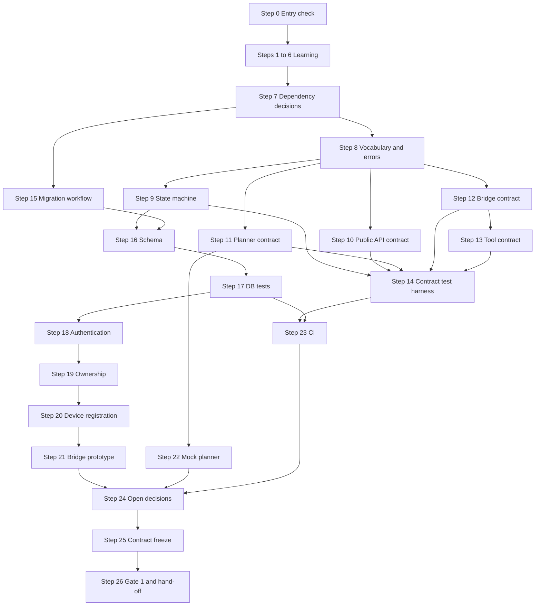

# Phase 1 — Contracts & Persistence

> **Status:** DRAFT for team review · **Weeks:** 2 · **Gate:** Gate 1 (contracts agreed)
> **Parent plan:** [`00-phase-plan.md`](00-phase-plan.md) · **Previous:** [`phase-0-foundation.md`](phase-0-foundation.md) · **Tracker:** [`tracker.md`](tracker.md) · **Diagrams:** [`architecture.md`](architecture.md)

## How to read this document

- Every step has: **Intent → Owner → Source → How (exact actions) → Verify → Evidence → Learning → Status**.
- **[Docs]** = stated in the documentation. **[Suggestion]** = my recommendation, *not* in the documents; the team accepts or changes it. **[Verify]** = general tooling knowledge I could not check against your machines or the current tool versions.
- **Owners:** you said you will divide the work yourselves, so every step says **"team assigns"**. The rotation table in `00-phase-plan.md` suggests BE = Dev B, WB = Dev C, AI = Dev A for P1; that is only a starting point. Where the docs name an owner per contract (04.08.02), it is quoted as a *reviewer rule*, because the docs assume specialists and you rotate.
- **No time estimates.** The schedule fixes this phase at Week 2; the exit criteria decide when it is done.
- **Candidates are not decisions.** The documents name Pydantic, SQLAlchemy and Alembic only as candidates (and FastAPI as the intended API framework in the architecture). Step 7 records each as a decision with evidence before anyone depends on it.
- Commands are examples. If the output differs from what is described, stop and ask; do not improvise around it.

---

## 1. Goal and scope

**Goal [Docs, 04.28.06 / 04.28.05 Gate 1]:** at the end of P1 the team has *one agreed vocabulary and one set of message shapes*, a database that can be created from scratch by a migration, a minimal authenticated API, a bridge that can enroll and stay connected, and a mock planner. Everything is covered by tests, so P2 can build the first vertical slice without arguing about shapes.

**P1 is not:** task submission end to end, a CLI, real file search, a real model, approvals, or file writing. Those are P2+.

### Week 2 checklist from the docs (04.28.06) and where each is covered

| # | Docs checklist item | Docs owner | Covered by |
|---|---|---|---|
| 1 | Commit initial API and bridge contract definitions | All | Steps 8–13, 25 |
| 2 | Create the initial PostgreSQL schema and migrations | Dev 1 (A) | Steps 15–17 |
| 3 | Basic authentication and ownership checks | Dev 1 (A) | Steps 18–19 |
| 4 | Bridge enrollment and authenticated connectivity prototype | Dev 2 (B) | Steps 20–21 |
| 5 | A mock planner returning a validated structured plan | Dev 3 (C) | Step 22 |
| 6 | Contract tests and a PostgreSQL integration-test environment | All | Steps 14, 17, 23 |
| 7 | Record the unresolved runtime, transport and security decisions | All | Step 24 |

### Gate 1 requirements from the docs (04.28.05)

| Gate 1 item | Covered by |
|---|---|
| Shared identifiers and task/step states | Steps 8, 9 |
| API and bridge message contracts | Steps 10–13, 25 |
| Initial tool schemas and an error catalogue | Steps 8, 13 |
| A DB migration workflow | Steps 15–16 |
| Hardware inventory started and an AI validation owner assigned | Carried from P0 Step 10; checked in Step 0 and Step 26 |

---

## 2. Decisions this phase must settle

Record each in `docs/decisions/` as an ADR (P0 Step 14 template). Statuses are the docs' five values: Confirmed · Provisional · Open · Blocked · Deferred. A decision stays **Provisional** until its evidence exists (04.27.04).

| ID | Decision | Docs position | Settled in step |
|---|---|---|---|
| D-09 | Identifier format for all ID types | Opaque, no embedded permissions; the exact format (UUID or another) is **open** (04.08.04 / 04.08.13) | 7, 8 |
| D-10 | Typed-validation approach (Pydantic as the candidate) and its strictness / unknown-field behaviour per boundary | Open (04.08.13) | 7, 10–13 |
| D-11 | Database access library and migration tool (SQLAlchemy and Alembic are *candidates*) | Candidates only | 7, 15 |
| D-12 | API framework (FastAPI) confirmation | Architecture assumes FastAPI; confirm with evidence | 7 |
| D-13 | User authentication method for the MVP (docs' provisional recommendation: **local NEXUS accounts**) — closes PC-04 | Provisional proposal, not confirmed (04.09) | 18 |
| D-14 | Token lifecycle for CLI sessions (one coherent lifecycle, defined revocation) | Open | 18 |
| D-15 | Password hashing library and parameters | Open (the docs require hashing, not a library) | 7, 18 |
| D-16 | Device credential mechanism and enrollment handshake | Open until transport and credential storage are chosen (04.10.03) | 20 |
| D-17 | Bridge transport: authenticated outbound polling | **Provisional** (04.10.13) | 12, 21 |
| D-18 | Interruption and approval-expiry semantics; how a cancel request is represented (separate field vs state) | Open (03.29 / 04.08.13) | 9 |
| D-19 | Error-catalogue structure and the tool-result / error payload schemas | Open (04.08.13) | 8, 13 |
| D-20 | API payload limits and pagination; older-schema support duration | Open (04.08.13) | 10, 12 |
| D-21 | CI platform and what runs where | CI table (04.04.05) not read; see Step 23 | 23 |
| D-22 | Disconnected-operation question (closes PC-01) | Open | 24 |

> **PC-04 and PC-01** from the tracker are closed (or explicitly deferred) by D-13 and D-22.

---

## 3. Steps

### Step 0 — Entry check: what P0 actually delivered

- **Intent:** P1 builds on P0 outputs. Find out *now* which are missing instead of discovering it mid-phase.
- **Owner:** team assigns (all three attend). **Source:** `phase-0-foundation.md` §5, Step 16.
- **How:**
  1. Open `tracker.md` section 2 and the P0 exit criteria. For each unchecked item, write it in the **Carried-over items** table with an owner.
  2. Confirm these exist and are merged: the three one-page drafts from P0 Step 13 (task lifecycle/ID/error draft, `search_files` contract draft, planner-interface and fixture-list draft), ADRs for D-01…D-08, `docs/setup.md`.
  3. Confirm each developer can: clone, create the venv, run the checks green, connect to **both** the dev and the test PostgreSQL database.
  4. **Blocking check:** if D-01 (Python version), D-02 (dependency manager) or D-03 (PostgreSQL mode) is still *Open*, settle it **first**. Steps 15+ depend on them.
  5. Confirm the P0 hand-off pairing happened (previous owner walked the new owner through their work).
  6. Gate 1 asks that the AI validation owner is *assigned*: write down who it is in `docs/roadmap/team.md`. [Docs, 04.28.05]
- **Verify:** a short list "inputs present / missing" in the tracker; every missing item has an owner.
- **Evidence:** tracker change in a merged PR.
- **Learning:** none.
- **Status:** `[ ] pending`

### Step 1 — Learning block 1: HTTP, REST, JSON and what a "contract" is

- **Intent:** the whole phase is about agreeing message shapes. Everyone needs the vocabulary first.
- **Owner:** all three, each explains to a teammate. **Source:** 04.08.01–03, 04.04.04.
- **How:** each developer can explain, in their own words:
  1. Request vs response; method (GET/POST/PUT); path; headers; status code; body.
  2. JSON types (string, number, boolean, null, array, object) and what a **required** vs **optional** field is.
  3. What a **contract** is: a written, versioned agreement on the shape of a message that a producer and a consumer both test against.
  4. The docs' **five contract layers** and why they are *not* one schema: Public API · Internal application · Planner · Bridge protocol · Tool contract. Two sentences from the docs to be able to quote: *a planner proposal is not a bridge command* and *a bridge response is not proof the task succeeded*.
  5. What "idempotent" means (same request sent twice has the same effect once). Preview for duplicate submission.
- **Practice (throwaway, not NEXUS):** use `curl` against any public test echo service [Verify availability] or a 10-line FastAPI file after Step 6 to send a POST with JSON and read the status code.
- **Verify:** each developer correctly sorts 10 sample messages (written by the team) into the five layers.
- **Evidence:** the sorted list, committed under `docs/learning/` or kept in the tracker notes.
- **Learning resources:** MDN "HTTP overview", json.org [Verify links before sharing].
- **Status:** `[ ] pending`

### Step 2 — Learning block 2: SQL, constraints and transactions in PostgreSQL

- **Intent:** the persistence rules in the docs (unique constraints decide duplicates, atomic claims, short transactions) are only understandable if you have seen them in plain SQL.
- **Owner:** all three. **Source:** 03.10 (Database Architecture).
- **How:** in `psql` against the **dev** database, in a scratch schema (not the real tables), practise:
  1. `CREATE TABLE`, `INSERT`, `SELECT ... WHERE`, `UPDATE`, `DELETE`.
  2. `PRIMARY KEY`, `NOT NULL`, `UNIQUE` (including a **composite** unique constraint), `FOREIGN KEY`, `CHECK`.
  3. Trigger a unique violation on purpose and read the error. This is exactly how NEXUS arbitrates duplicate task submission: UNIQUE(`owner_user_id`, `client_request_id`).
  4. `BEGIN; ... COMMIT;` and `ROLLBACK;` — prove nothing is saved until commit.
  5. Two `psql` sessions: session 1 `BEGIN; SELECT ... FOR UPDATE;` on a row; session 2 tries to update the same row and waits. This is the "row lock" idea behind a worker claim (03.10: the claim must be atomic; use a row lock or a conditional update and check the affected-row count).
  6. A conditional update: `UPDATE t SET status='RUNNING' WHERE id=1 AND status='QUEUED';` and read how many rows changed. Zero means somebody else got it.
- **Verify:** each developer can show a duplicate rejected by a constraint and a lost race detected by the affected-row count.
- **Evidence:** a saved `.sql` practice file per developer (kept out of the main schema).
- **Learning resources:** the PostgreSQL official tutorial [Verify link].
- **Status:** `[ ] pending`

### Step 3 — Learning block 3: typed data validation (concepts first, library second)

- **Intent:** most of P1 is "reject bad input in a predictable way". Learn the idea before the tool, because the tool is only a candidate.
- **Owner:** all three. **Source:** 04.08.03, 04.08.13.
- **How:**
  1. Python type hints: `str`, `int`, `list[str]`, `dict[str, int]`, `Optional`/`X | None`, `Literal`, `Enum`.
  2. "Parse, don't trust": data arriving from the network is *untrusted* until validated; the docs' rule is never trust a client-supplied `user_id`, `device_id`, `risk_tier` or `approved` flag (04.09).
  3. Strict vs lenient: what happens to an unknown extra field and to a number sent as a string. The docs list **unknown-field behaviour per boundary** as an open decision (04.08.13). Be able to name one argument for rejecting and one for ignoring unknown fields.
  4. After D-10 is recorded (Step 7), do the library tutorial: define a model, validate good and bad dictionaries, read the validation error.
- **Verify:** each developer writes a tiny model (an object with `step_id`, `tool_name`, `arguments`) and shows one valid input, two invalid inputs, and the error text.
- **Evidence:** practice file in `docs/learning/` or the team scratch repo.
- **Status:** `[ ] pending`

### Step 4 — Learning block 4: pytest fixtures, parametrization and "contract tests"

- **Intent:** Gate 1 is passed by *repeatable tests*, not demonstrations (04.28.05).
- **Owner:** all three. **Source:** 04.08.12, 04.05.08.
- **How:**
  1. pytest basics already learned in P0 Step 7; now add: `fixture`, `parametrize`, `tmp_path`, `pytest.raises`, markers (e.g. `integration`).
  2. Fixture that creates a clean database state per test (practice with SQLite-free approach: use the PostgreSQL **test** database from P0; the docs say database tests must run on real PostgreSQL, not SQLite).
  3. Contract test idea: the same JSON example files are used by (a) the written documentation and (b) the tests, so docs and code cannot drift. [Docs, 04.08.12: valid and invalid example payloads]
  4. Difference between **deterministic contract tests** and **real-model evaluation**; never report one as the other (04.05.08).
- **Verify:** each developer writes a parametrized test that loads example files from a directory and asserts valid ones pass and invalid ones fail.
- **Evidence:** merged practice test in `tests/contract/` (or discarded after review).
- **Status:** `[ ] pending`

### Step 5 — Learning block 5: passwords, hashing, tokens, and credential storage concepts

- **Intent:** authentication is easy to get subtly wrong. Learn the concepts before choosing mechanisms in Steps 18 and 20.
- **Owner:** all three. **Source:** 04.09, 04.10.03.
- **How:** each developer can explain:
  1. Why passwords are **hashed**, not encrypted; what a **salt** is; why a general-purpose fast hash is the wrong tool for passwords. The docs only say "hashed passwords" and name no algorithm.
  2. The docs' requirements: generic login failure message (do not reveal whether the username exists); rate limiting; an account-disable mechanism; controlled initial account creation; **no shared default password**; no plaintext passwords in config or logs.
  3. What a session token is; what "revocation" means; the difference between a token that is **stored and looked up on the server** (easy to revoke) and one that is **self-contained and signed** (revocation needs extra work). This is a trade-off for D-14, not a decision. [Suggestion: treat this trade-off as the main input]
  4. Why a **device ID is not a secret** (04.09) and why each device gets its own independently revocable credential (04.09/04.10).
  5. Why a raw credential must not be stored in device metadata or logs; what "store only a hash of it" gives you.
- **Verify:** each developer answers 6 written questions drawn from the list above; the team compares answers.
- **Evidence:** answers in `docs/learning/`.
- **Status:** `[ ] pending`

### Step 6 — Learning block 6: FastAPI essentials (just enough for P1)

- **Intent:** P1 needs a small authenticated API and a bridge session endpoint. FastAPI is the architecture's API framework; the deeper routing and dependency-injection learning is in P2.
- **Owner:** all three. **Source:** NEXUS System Architecture, Application Structure 3.8.
- **How:**
  1. Install FastAPI and an ASGI server in a **scratch** virtual environment (not the project environment) **[Verify package names and current install instructions in the official docs]**.
  2. Write `hello.py` with a `GET /health` route; run it; call it with `curl`.
  3. Add a `POST` route that takes a validated JSON body; send a valid and an invalid body and compare status codes.
  4. Learn the idea of a **dependency** (a function the framework calls before your route, e.g. "who is the current user?") — you will use it for authentication.
  5. Learn how to test a route without starting a server (the framework's test client) **[Verify the name and dependency in current docs]**.
- **Verify:** each developer runs the scratch app and its test.
- **Evidence:** scratch code reviewed by a teammate; not merged into `nexus/`.
- **Status:** `[ ] pending`

### Step 7 — Dependency and format decisions (D-09, D-10, D-11, D-12, D-15)

- **Intent:** the docs list candidates but make no decisions. Turn each into a recorded decision *with evidence*, or reject it.
- **Owner:** team assigns one person per decision; **another person reviews** each. **Source:** 04.08.13, 03.10, 04.04.06, 04.27.04.
- **How (repeat per decision):**
  1. Write an ADR in `docs/decisions/` with Status **Provisional**, the options considered, and what evidence will turn it Confirmed.
  2. **Evidence to gather** (small spike on a scratch branch, discard after):
     - **D-09 ID format:** generate 5 IDs of each candidate format; check they are opaque, URL-safe, safe in logs, and can be created in the app *and* by PostgreSQL. [Suggestion: UUIDs are the docs' own parenthetical example; random UUIDs (version 4) are the simplest — **[Verify]** the PostgreSQL function name for the version you run.] Also settle timestamps: UTC, ISO 8601 [Docs, 04.08.04].
     - **D-10 validation:** validate the Step 10–13 example payloads with the candidate; decide strictness (reject unknown fields at the public API and bridge boundaries? [Suggestion: reject at the security-relevant boundaries — API in, bridge in/out, planner out — so typos fail loudly]).
     - **D-11 DB access and migrations:** create two tables with a foreign key and a composite unique constraint through the candidate migration tool; run **up** on an empty DB; show the revision history; show how a failed migration behaves **[Verify]**. Check that you can express the conditional update from Step 2 and read the affected-row count.
     - **D-12 FastAPI:** confirm it runs under the D-01 Python version and the D-02 dependency manager.
     - **D-15 password hashing:** pick a maintained library intended for password hashing; **[Verify]** current maintenance status and recommended parameters in its own documentation. Do not hand-roll hashing.
  3. Add the chosen libraries to `pyproject.toml` **with a lock** (per D-02) in one PR; all three developers re-sync their environments (P0 Step 7).
  4. Update the **version matrix** started in P0 with the exact versions.
- **Verify:** each ADR has an explicit statement of what was tried and the result; the PR that adds dependencies passes the P0 checks on all three PCs.
- **Evidence:** merged ADRs; dependency PR.
- **Learning:** why teams record "options considered".
- **Status:** `[ ] pending`

### Step 8 — Canonical vocabulary: identifiers, timestamps, enums and the error catalogue

- **Intent:** one place defines the words every layer uses. [Docs 04.08.04, 04.08.09]
- **Owner:** team assigns a coordinator; **all three review** (docs: "Error catalogue and identifiers — Dev 1 coordinates, all three review").
- **Source:** 04.08.04, 04.08.09, 04.08.06.
- **How:**
  1. Create the shared vocabulary document `contracts/README.md` (or `docs/architecture/vocabulary.md` — put it where D-07 placed the specs).
  2. **Identifiers** [Docs]: `user_id`, `device_id`, `task_id`, `step_id`, `operation_id`, `attempt_id`, `request_id`, `client_request_id`, `approval_id`, `policy_version`. For each, record: who creates it, where it is stored, and which layers may see it. Rules: opaque; do not encode permissions; never use an ID as proof of authority.
  3. **Timestamps:** UTC, ISO 8601 [Docs].
  4. **Planner outcomes** [Docs]: `PROPOSED`, `CLARIFICATION_REQUIRED`, `UNSUPPORTED`.
  5. **Bridge response statuses** [Docs]: `SUCCEEDED`, `FAILED`, `REJECTED`, `RUNNING`, `UNCERTAIN`.
  6. **Error catalogue** [Docs codes]: `INVALID_ARGUMENT`, `AUTHENTICATION_REQUIRED`, `ACCESS_DENIED`, `POLICY_DENIED`, `APPROVAL_REQUIRED`, `APPROVAL_EXPIRED`, `DEVICE_UNAVAILABLE`, `DEPENDENCY_UNAVAILABLE`, `CONTRACT_VERSION_UNSUPPORTED`, `OPERATION_TIMEOUT`, `OPERATION_OUTCOME_UNCERTAIN`, `FILE_NOT_FOUND`, `FILE_ALREADY_EXISTS`, `FILESYSTEM_SCOPE_DENIED`, `INTERNAL_ERROR`. For **each code** write a row with: **who emits it** · **terminal for the task or step?** · **is retry meaningful?** · **recovery procedure** · **user-facing message that reveals nothing sensitive**. [Docs require these four columns; the docs' own cell values for them were *not* extracted by me — see §8. Fill them from 04.08.09 table when drafting, do not invent.]
  7. Rule [Docs]: errors are **typed, stable codes**, not exception text. The code, not the message, is the contract. Add a rule: new codes are added through the change process in Step 25.
  8. Keep a separate list of **internal-only** details (stack traces, SQL text) that must never reach the client.
- **Verify:** every error code has all columns filled or is explicitly marked "to decide, owner X"; a reviewer from a different stream has approved.
- **Evidence:** merged vocabulary + catalogue document.
- **Learning:** why stable error codes matter for clients and tests.
- **Status:** `[ ] pending`

### Step 9 — Task and step state machine contract (D-18)

- **Intent:** fix legal states and transitions in one pure piece of logic that both the database layer and the API use. [Docs 03.29]
- **Owner:** team assigns; all three review. **Source:** 03.29 (Task State Machine), 04.08.06.
- **How:**
  1. **Task states** [Docs]. Active: `QUEUED`, `RUNNING`, `WAITING_FOR_APPROVAL`, `INTERRUPTED`. Terminal: `SUCCEEDED`, `FAILED`, `CANCELLED`. The docs say **do not add `PARTIALLY_SUCCEEDED`**.
  2. **Step states** [Docs]: `PENDING`, `READY`, `WAITING_FOR_APPROVAL`, `DISPATCHED`, `RUNNING`, `SUCCEEDED`, `FAILED`, `REJECTED`, `UNCERTAIN`, `CANCELLED`. Rules: `DISPATCHED` is **not** `RUNNING`; `UNCERTAIN` is **not** `FAILED`.
  3. **Transition table.** Open `03.29.04` (the 17-row table) and copy it verbatim into `contracts/…/task-transitions.md`. Transitions I confirmed from the docs: None → `QUEUED` (task and idempotency key persisted atomically); `QUEUED` → `RUNNING` (scheduler claims); `QUEUED` → `CANCELLED` (confirmed before dispatch); `QUEUED`/`RUNNING` → `WAITING_FOR_APPROVAL`; `RUNNING` → `INTERRUPTED` / `SUCCEEDED` (all work verified) / `FAILED` (unrecoverable); `WAITING_FOR_APPROVAL` → `RUNNING` (valid approval + revalidation) / `FAILED` / `CANCELLED`; `INTERRUPTED` → `RUNNING` (recovery conditions met, **reconcile first**) / `FAILED` / `CANCELLED`. **I did not extract the full 17-row table or the step-level table** — the team copies those from the document; do not rely on this list as complete.
  4. **Forbidden transitions** [Docs]: `SUCCEEDED`/`FAILED` → `RUNNING`; `CANCELLED` → `QUEUED`; `WAITING_FOR_APPROVAL` → `SUCCEEDED` without execution; `INTERRUPTED` → `SUCCEEDED` without reconciliation; any state → `SUCCEEDED` on a model or bridge claim alone; any state → `CANCELLED` while an external effect is unresolved.
  5. **Principles** [Docs]: persist before dispatch · unknown is a valid outcome · transitions are centralized · a transition and its event commit in one transaction.
  6. **Decide D-18** (record as ADR, status Provisional until tests exist): what *interrupted* means precisely, what happens when an approval expires, and whether "cancel requested" is its own field or a state (the docs list this as open). [Suggestion: a separate "cancel requested" field keeps the state list exactly as the docs state it — but the team decides.]
  7. Implement `nexus_core/domain/state_machine.py` as **pure Python with no database, no HTTP, no framework imports** (enforced by the P0 dependency-direction rules). It exposes one function such as `can_transition(from_state, to_state) -> bool` plus a function that returns the reason when forbidden. [Suggestion on the function shape.]
  8. Unit tests: every allowed transition passes; every forbidden transition fails; **every pair not in the table fails** (generate the full matrix with parametrize so a new state cannot slip in untested).
- **Verify:** the test matrix covers 100% of state pairs; the docs' 6 forbidden rules each have a named test.
- **Evidence:** merged state-machine module, tests, ADR for D-18.
- **Learning:** what a state machine is; why "centralize transitions" removes a whole class of bugs.
- **Status:** `[ ] pending`

### Step 10 — Public API contract: task submission and acceptance (D-20)

- **Intent:** the first externally visible contract (CLI ⇄ API). [Docs 04.08.05]
- **Owner:** team assigns; **reviewers are the other two** (docs: public API and task lifecycle are owned by one developer and reviewed by the other two).
- **Source:** 04.08.03, 04.08.05, 04.08.12.
- **How:**
  1. Create `contracts/api/` with one file per message (name the files after the message, e.g. `task-submission.request.valid-01.json`). Use the **same folder** for the examples that the tests load (Step 14).
  2. **Task submission request** [Docs example fields]: `client_request_id`, `target_device_id`, `request`. Write each field's type, required/optional, length limit, and an example.
  3. **Task acceptance response** [Docs example fields]: `task_id`, `status` (value `QUEUED`), `request_id`, `created_at`.
  4. **Error response**: always the typed code from Step 8 plus `request_id`; never exception text. The exact error-payload schema is an **open decision** (04.08.13, D-19) — draft it here as **Provisional**.
  5. **Rules to write down explicitly** [Docs]:
     - The `user_id` is derived from the authenticated session, **never** from the body. A submitted `user_id`, `risk_tier` or `approved` field is either ignored or rejected (decide and record it: D-10 strictness).
     - Duplicate submission: same `client_request_id` for the same user with the **same payload** returns the existing task; with a **different payload** returns a conflict. The unique constraint in the database decides, not an application-side "check then insert" (03.10).
     - Unauthorized or non-owned `target_device_id` → a stable error, without revealing whether the device exists for someone else. [Suggestion on the "do not reveal" wording; the docs require owner-only targeting.]
  6. Decide **D-20** (payload size limits, pagination for list endpoints, how long an older schema version is supported). If undecided, record "Open — revisit at Gate 2" rather than guessing numbers. The docs give no values.
  7. List the minimum endpoints P1 needs: login, a protected "who am I" / health route to prove authentication, and the device registration route (Step 20). **Task submission is specified here but implemented in P2.** [Suggestion on endpoint names; none are frozen in the docs.]
- **Verify:** every message has ≥ 1 valid and ≥ 2 invalid examples (missing required field, wrong type, forged `user_id`); the written text and the example files agree.
- **Evidence:** merged `contracts/api/` files + a reviewer sign-off line in the file header.
- **Learning:** Step 1 vocabulary applied.
- **Status:** `[ ] pending`

### Step 11 — Planner contract (proposal, clarification, unsupported)

- **Intent:** define what any planner (mock now, local model in P4) may return, so the rest of the system never depends on a particular model. [Docs 04.08.08]
- **Owner:** team assigns; other two review. **Source:** 04.08.03, 04.08.08, 04.05.08, Application Structure 3.8.3.
- **How:**
  1. Create `contracts/tools/planner-proposal.*` (or `contracts/api/` per your layout decision in P0 D-07 — keep all five layers visibly separate).
  2. **Planner input**: the user request plus *permitted* context only (from the P0 interface draft).
  3. **Planner proposal** [Docs example fields]: `proposal_version`, `outcome`, `objective`, `target_device_id`, `steps[]`; each step has `step_id`, `tool_name`, `tool_schema_version`, `arguments`, `depends_on`.
  4. **Outcomes** [Docs]: `PROPOSED`, `CLARIFICATION_REQUIRED`, `UNSUPPORTED`. For the last two, decide which fields are required (e.g. the clarification question) and which must be absent.
  5. **Core rule [Docs]:** a proposal is *advice*. The application must validate it (tool exists, arguments match the tool schema, device is owned, policy allows) before anything becomes a step. A proposal is **never** a bridge command.
  6. List the invalid-proposal cases as examples: unknown tool · malformed arguments · missing arguments · step depends on a nonexistent step · target device not owned by the user · plan containing text that tries to give the system new instructions (the docs' "malicious or irrelevant document instructions" fixture).
  7. Decide the dependency rule: is `depends_on` allowed to form a cycle? Write "must be a DAG" only if the team agrees; the docs' sample shows the field but I did not find a stated cycle rule. [Suggestion: reject cycles.]
- **Verify:** valid proposal examples for each outcome; invalid examples for each case in item 6.
- **Evidence:** merged files + review.
- **Status:** `[ ] pending`

### Step 12 — Bridge protocol contract (D-17, D-20)

- **Intent:** the contract between backend and Windows bridge: envelope, statuses, routes, and delivery semantics. [Docs 04.08.07, 04.10]
- **Owner:** team assigns; other two review. **Source:** 04.08.07, 04.10.02–10.
- **How:**
  1. **Transport decision D-17:** the docs' *proposed initial choice* is **authenticated outbound polling** from each bridge to the backend (04.10.01 and 04.10.13: "Provisional"). Record the ADR as **Provisional** and state the reasoning from the docs: the backend does not initiate inbound connections to developers' PCs. Polling first; a persistent connection only if a measured need justifies it (04.10.13).
  2. **Operation envelope** [Docs example fields]: `protocol_version`, `operation_id`, `attempt_id`, `task_id`, `step_id`, `target_device_id`, `tool_name`, `tool_schema_version`, `arguments`, `deadline`.
  3. **Bridge response statuses** [Docs]: `SUCCEEDED`, `FAILED`, `REJECTED`, `RUNNING`, `UNCERTAIN`. A `SUCCEEDED` from the bridge is a *claim*; the backend validates it before changing task state.
  4. **Proposed routes** [Docs, explicitly "not a frozen API"]: `POST /v1/bridge/session`, `POST /v1/bridge/heartbeat`, `PUT /v1/bridge/capabilities`, `POST /v1/bridge/poll`, `POST /v1/bridge/operations/{operation_id}/ack`, `POST /v1/bridge/operations/{operation_id}/result`, `GET /v1/bridge/operations/{operation_id}`. The docs add that a separate session endpoint may be unnecessary if every request is authenticated directly. Decide this and write down the result.
  5. **Semantics to write down** [Docs 04.10.04–05, 04.10.13]:
     - A device ID alone never earns an operation. The backend authenticates, checks device status and eligibility, then **atomically claims** an operation.
     - An empty poll means "nothing eligible now" — it does **not** mean the device has no waiting tasks.
     - The bridge validates each operation **independently** before execution (unknown tool, unsupported protocol version, invalid/revoked credential, wrong target device, unconfigured directory ID, path escaping scope, over limits — the P0 draft list).
     - Operation identity is a **stable `operation_id` plus a per-attempt `attempt_id`**. Duplicate delivery is handled by deduplication plus reconciliation. Retry is tool-specific; **never blindly retry an uncertain side effect**.
     - The backend enforces the real dispatch deadline regardless of poll frequency.
     - Heartbeat does not prove tools work; a revoked state takes precedence over a heartbeat. Capability reports are advisory and revalidated at dispatch.
  6. **Polling behaviour:** the interval is configurable and must be measured, not guessed (04.10.04). Write "backoff with jitter when the backend is unavailable" as a requirement; leave the numeric default as **Open** and have a P2 task to measure.
  7. **Unknown fields:** decide per direction (backend→bridge, bridge→backend) whether unknown fields are rejected. Record in D-10.
  8. Add **version rules**: what the bridge does with an unsupported `protocol_version` → `CONTRACT_VERSION_UNSUPPORTED`.
- **Verify:** example files for envelope, ack, result in each status, plus an invalid example for each rejection reason above.
- **Evidence:** merged `contracts/bridge/` + ADR for D-17.
- **Status:** `[ ] pending`

### Step 13 — Tool contract: `search_files` and the generic tool schema (D-19)

- **Intent:** the first tool contract, and the pattern every later tool follows. [Docs 04.04.04, 04.04.10, 04.05.05, 04.05.07]
- **Owner:** team assigns; other two review. **Source:** P0 Step 13b draft, 04.08.03.
- **How:**
  1. Promote the P0 one-page `search_files` draft into `contracts/tools/search_files.*` with: request fields, response fields, **bounded** results (the bridge returns a bounded structured result), rejection cases.
  2. **Logical directory ID rule** [Docs 04.05.05]: the backend refers to a configured directory by ID; the bridge maps the ID to a local path. The backend never sends raw paths in the first slice.
  3. **Generic tool schema header:** `tool_name`, `tool_schema_version`, argument schema, result schema, error codes the tool can emit (subset of Step 8), whether it has side effects. `search_files` is read-only.
  4. **Tool-result and error payload schemas** — open in the docs (D-19). Draft: success result object, failure object with a typed code from the catalogue, `UNCERTAIN` object. Mark Provisional.
  5. Carry over the P0 bridge rejection list into the tool's invalid examples.
  6. Confirm with the team: no other tool is specified in P1. Later tools (`create_file`, application launching) are P3.
- **Verify:** valid + invalid examples; every error code the tool can emit exists in the Step 8 catalogue.
- **Evidence:** merged files + review.
- **Learning:** why results are bounded; why raw paths are not sent.
- **Status:** `[ ] pending`

### Step 14 — Contract-test harness and shared example fixtures

- **Intent:** the contract tests that turn documents into enforcement. [Docs 04.08.12]
- **Owner:** team assigns. **Source:** 04.08.12, 04.05.08.
- **How:**
  1. Build one loader that discovers example files under `contracts/**/` using the file-name convention from Step 10 (`*.valid-*.json` / `*.invalid-*.json`). Parametrize tests over them.
  2. Write the tests the docs require:
     - **Public API:** valid and invalid requests · duplicate and payload-conflict behaviour · auth and ownership · stable error structure.
     - **Lifecycle:** valid, invalid and terminal transitions (Step 9) · persisted state after restart (Step 17).
     - **Planner:** valid proposal · unknown tool · malformed arguments · clarification · unsupported.
     - **Bridge:** schema validation · operation and attempt correlation · unknown protocol and tool rejection · timeout and uncertain outcome.
     - **Cross-component fixtures:** happy path · authorization denial · disconnected device · lost response and reconciliation. (In P1 these exist as **fixtures and skipped/xfail tests marked with the phase that will implement them**, not as fake passes.)
  3. Mark tests with pytest markers: `contract`, `integration`, `unit`.
  4. Add a test that fails if a contract file exists without any example, and if an example file is not referenced by any test case.
  5. Report **honestly** [Docs]: green deterministic contract tests ≠ real-model evaluation.
- **Verify:** `pytest -m contract` is green on all three PCs; a deliberately broken example turns it red.
- **Evidence:** merged harness + CI log (Step 23).
- **Status:** `[ ] pending`

### Step 15 — Migration workflow and database-environment rules (D-11)

- **Intent:** the DB must be creatable from nothing and upgradeable by the same, reviewed path. [Docs Gate 1 "DB migration workflow", 03.10]
- **Owner:** team assigns. **Source:** 03.10, 04.05.06, 04.04.
- **How:**
  1. Use the D-11 decision from Step 7. Create `migrations/` with the tool's initial setup. Keep the connection string in configuration (P0 Step 9), never in the migration files.
  2. Write `docs/operations/database.md` with the rules:
     - **Dev DB** and **test DB** are separate databases with different credentials (P0).
     - Automated tests **never** touch the shared team database by default (04.04.08).
     - Each schema change is a **new migration file** reviewed in a PR; never edit a migration that has been merged. [Suggestion: standard practice; the docs ask for a "migration workflow" without specifying this.]
     - How to: create a migration, apply it, see the current revision, roll back **in dev only**.
  3. **Startup safety checks** (04.05.06): read that section of the Development Environment Bootstrap document and list the checks in the file. I did not extract the exact list; do not guess it.
  4. Test the workflow: (a) migrate an **empty** database to head; (b) migrate a DB at the previous revision to head; (c) confirm the result has the expected tables and constraints by querying the catalog (Step 17).
- **Verify:** (a) and (b) both succeed on all three PCs from a clean DB.
- **Evidence:** merged `migrations/` + `docs/operations/database.md`.
- **Learning:** what a migration is; why you never edit history.
- **Status:** `[ ] pending`

### Step 16 — Initial PostgreSQL schema (core tables)

- **Intent:** persist what Gate 2 needs, no more. [Docs 03.10]
- **Owner:** team assigns; two reviewers (one must not be the author). **Source:** 03.10.
- **How:**
  1. **Core tables from the docs:** `users`, `devices`, `tasks`, `task_steps`, `task_step_attempts`, `approvals`, `memories`, `audit_events`. **Supporting tables to consider** (docs): `device_credentials`, `device_permissions`, `worker_claims`, `task_events`, `user_sessions`.
  2. **Scope for P1 [Suggestion]:** create only what P1–P2 uses: `users`, `user_sessions` (if D-14 stores sessions), `devices`, `device_credentials`, `tasks`, `task_steps`, `task_step_attempts`, `task_events`, `audit_events`. Leave `approvals` and `memories` for P3 and P4 so unused tables are not frozen too early. Record this as a decision.
  3. **Column names the docs use** (reuse them; do not rename without a reason): `owner_user_id`, `target_device_id`, `client_request_id`, `request_text`, `error_code`, `operation_id`, `attempt_count`, `result_summary`, `step_number`, `attempt_number`, `worker_id`, `bridge_request_id`, `operation_fingerprint`, `expires_at`, `decided_at`, `revoked_at`, `last_seen_at`, `deleted_at`.
  4. **Constraints the docs call out:** UNIQUE(`owner_user_id`, `client_request_id`) · UNIQUE(`task_id`, `step_number`) · UNIQUE(`operation_id`) · UNIQUE(`task_step_id`, `attempt_number`).
  5. **Rules [Docs]:**
     - Revoke or deactivate; **do not cascade-delete** records that carry audit meaning.
     - Do **not** store full documents, prompts or secrets in task or audit records.
     - Store only a hash/verifier of device credentials, never the raw credential in `devices`.
     - Every table that belongs to a user carries the owner so ownership checks are a simple filter (Step 19).
     - State columns accept only the states from Step 9; enforce with a database CHECK **in addition to** the Python state machine. [Suggestion]
     - Transactions are short and never wait on the bridge.
  6. **Open schema decisions:** the docs have a 10-row open-decisions table at 03.10.11 which I did not extract; read it and copy every row into the decision register.
  7. Write the migration(s). Add a short comment on every table explaining its purpose, in the migration.
- **Verify:** migrating an empty database produces the tables; Step 17 tests prove each constraint.
- **Evidence:** merged migration + `docs/architecture/data-model.md` summarizing columns and constraints.
- **Learning:** foreign keys; what a constraint prevents.
- **Status:** `[ ] pending`

### Step 17 — PostgreSQL integration-test environment and schema tests

- **Intent:** database behaviour is tested on **real PostgreSQL**, never SQLite. [Docs 03.10]
- **Owner:** team assigns. **Source:** 03.10, 04.05.08, 04.04.08.
- **How:**
  1. A pytest fixture that connects to the **test** database, applies migrations to head, and gives each test a clean state (transaction rollback, truncate, or a fresh schema — choose one and document the choice). [Suggestion]
  2. Tests that prove, one per constraint: duplicate (`owner_user_id`, `client_request_id`) is rejected · duplicate (`task_id`, `step_number`) rejected · duplicate `operation_id` rejected · duplicate (`task_step_id`, `attempt_number`) rejected · a row cannot hold an invalid state · deleting a user does not silently delete their audit trail.
  3. **Atomic claim test:** two concurrent attempts to claim the same queued task — exactly one wins, the other sees zero affected rows. This is the Step 2 learning applied.
  4. **Duplicate-submission arbitration test** at the database layer: second insert with same key, same payload → existing task returned; different payload → conflict signalled. (The API layer is P2; P1 tests the repository function.)
  5. **Restart test:** commit a task, close the connection, open a new one, read the state back.
  6. Tests must never use or modify the dev or shared database.
- **Verify:** `pytest -m integration` green on all three PCs, from an empty test database.
- **Evidence:** merged tests + CI log.
- **Status:** `[ ] pending`

### Step 18 — Authentication: users, passwords and CLI session tokens (D-13, D-14, D-15)

- **Intent:** only authenticated users reach protected routes. [Docs 04.09]
- **Owner:** team assigns; **security-sensitive: reviewed by someone who is not the author** (phase plan rule). **Source:** 04.09.
- **How:**
  1. **Decide D-13.** The docs' provisional recommendation is **local NEXUS accounts**. Ask the team whether they accept it (this also closes PC-04). Record the ADR as Provisional. If rejected, stop and ask before continuing — the rest of this step assumes local accounts.
  2. **Decide D-14.** Pick *one* coherent token lifecycle and write it down: how a token is issued at `nexus login`, how long it lives, what revokes it, what happens on logout. The docs only say "short-lived access token stored in an approved local credential store" with Windows Credential Manager as a *candidate*, and require one coherent lifecycle with defined revocation. Use the Step 5 trade-off (server-stored vs self-contained). The **CLI side storage** is implemented in P2; P1 delivers the server side.
  3. **User creation:** a controlled initial-account path (a command run by an administrator on the host, not an open registration endpoint) — [Docs: "controlled initial account creation"; **no shared default password**; no plaintext password in config or logs].
  4. **Login:** hash comparison using the D-15 library; **generic failure** message for both an unknown user and a wrong password; **rate limiting** on failures; **account-disable** flag respected on every request.
  5. **Protected-route dependency:** one function resolves a token to the current user (or fails with `AUTHENTICATION_REQUIRED`) and is the **only** way a route learns who the user is.
  6. **Never trust a client-supplied** `user_id`, `device_id`, `risk_tier` or `approved` flag.
  7. **Logging rule:** no passwords, tokens or raw device credentials in any log line or error message. Add a test that logs a login attempt and asserts the secret string is absent.
  8. Tests: correct login · wrong password · unknown user (same message) · disabled account · expired token · revoked token · rate limit trips · token for user A cannot read user B (Step 19).
  9. Open decisions from the auth document's 10-row table (04.09.11) — I did not extract it; read it and copy every row to the decision register.
- **Verify:** all tests pass; a reviewer tries to log in with a bad password 20 times and sees the limiter engage.
- **Evidence:** merged code + tests + ADRs D-13…D-15.
- **Learning:** Step 5 concepts applied.
- **Status:** `[ ] pending`

### Step 19 — Ownership and authorization checks

- **Intent:** a user can only see and act on their own data and devices. [Docs 04.09]
- **Owner:** team assigns; reviewed by a non-author. **Source:** 04.09.
- **How:**
  1. Implement the docs' **10-step authorization sequence** from 04.09 as a single function in `nexus_core/security/` — open the document section and copy the sequence in as the function's documentation. I did not extract the ten steps here; do not guess.
  2. All repository functions that read user data take the **authenticated user ID as a required argument** (not an optional filter), so forgetting it is a type error. [Suggestion]
  3. **Owner-only device targeting:** a task can only target a device whose `owner_user_id` equals the caller. Refusals use `ACCESS_DENIED` or the agreed code, with no information leak about other users' devices.
  4. **Multi-user test** (docs implementation order ends with it): create users A and B and a device each; assert A cannot list, read, target, revoke or enroll against B's device and cannot read B's tasks.
  5. **Revocation test:** a revoked device or disabled user is rejected on the next request, not at some later cache expiry.
- **Verify:** the multi-user test suite is green; mutation check — temporarily remove the owner filter in one function and confirm a test fails.
- **Evidence:** merged tests + review notes.
- **Status:** `[ ] pending`

### Step 20 — Device registration and per-device credential (D-16)

- **Intent:** a Windows bridge can be enrolled under one user and later prove who it is. [Docs 04.09, 04.10.03]
- **Owner:** team assigns; reviewed by a non-author. **Source:** 04.09, 04.10.03.
- **How:**
  1. **Separate** *registration* (creates an identity) from *authentication* (proves possession of the credential each time). [Docs]
  2. Registration sequence [Docs, proposed]: authenticated user requests enrollment → backend checks the user may enroll another device → backend creates the device record and a **unique per-device credential** → the bridge stores the credential in protected Windows storage → the bridge authenticates → backend validates device status, ownership, credential validity and revocation → bridge reports protocol version, supported tools and local configuration status → the device becomes eligible for dispatch only after authentication and readiness checks.
  3. **Rules [Docs]:** the bridge cannot choose its own owner or privilege level · credentials are unique per device and independently revocable · a revoked device does not become trusted by reconnecting · re-registration after credential loss follows a controlled authorization process · registration does not grant access to another user's tasks or files · the credential is never in ordinary logs or command history.
  4. **Decide D-16** (credential format, enrollment handshake, how the secret is delivered to the bridge once and only once). The docs say these remain open until transport and credential storage are chosen; record the choice as Provisional with the reasoning and a Revisit condition. Do not invent a mechanism beyond what you can test.
  5. **Windows credential storage on the bridge** is a candidate (Windows Credential Manager) — **[Verify]** how to use it from Python on Windows 11 before committing; that part runs on Windows, not WSL.
  6. Backend side: endpoints to register a device, list the caller's devices, and revoke one. Revocation sets `revoked_at` and invalidates the credential; it does not delete rows.
  7. Tests: enroll succeeds for owner · second user cannot enroll against first user's account · credential works once registered · revoked credential fails immediately · forged device ID without credential fails · raw credential is not present in any database column or log.
- **Verify:** tests green; manual exercise: enroll, revoke, try to reconnect.
- **Evidence:** merged code, tests, ADR D-16.
- **Learning:** why a device ID is not a secret.
- **Status:** `[ ] pending`

### Step 21 — Bridge enrollment and authenticated connectivity prototype

- **Intent:** a minimal Windows-side process that enrolls, authenticates, sends heartbeats, and reports capabilities — nothing else. [Docs 04.28.06 item 4, 04.10.04]
- **Owner:** team assigns (this runs on **native Windows**, not WSL). **Source:** 04.10.04, 04.10.12.
- **How:**
  1. Create `apps/windows_bridge/` as a plain Python program with a clearly separated `transport` module and a `main` loop. The bridge imports **contract types only**, not backend internals (P0 dependency rules).
  2. The loop: load credential → authenticate → send a heartbeat → publish capabilities (protocol version + an empty or stub tool list) → **poll** → on empty poll sleep with **backoff and jitter** → repeat. Interval is configuration. Handle backend-unavailable without crashing.
  3. Backend side: implement the session/heartbeat/capability/poll routes at the **prototype** level: they authenticate, update `last_seen_at`, store the capability report, and return "no work".
  4. Honour the docs' semantics: heartbeat proves liveness only; revoked status takes precedence over a heartbeat; capability report is advisory.
  5. **Network:** the bridge on a second Windows PC reaches the backend using the topology and networking mode recorded in P0 (D-05, D-06). If P0 findings say it cannot, stop and raise it — do not "fix" it with open firewall rules.
  6. **Integration scenarios** from 04.10.12 (15 listed there): I did not extract the list in this plan. Open the document, copy the 15 into `tests/integration/bridge_scenarios.md`, and mark which are exercisable in P1 (registration, authentication, heartbeat, capabilities, revoked-device behaviour, backend unavailable) and which belong to P2 (delivery, ack, result, lost response).
  7. Tests: success path · wrong credential · revoked device · backend unavailable (bridge survives) · duplicate heartbeat is harmless.
- **Verify:** from a Windows PC, a bridge enrolls and appears as "online" in the database with a recent `last_seen_at`; revoking it makes the next authentication fail.
- **Evidence:** screenshot or log (with secrets removed), merged code, tests.
- **Learning:** polling vs push; backoff and jitter; running Python on Windows.
- **Status:** `[ ] pending`

### Step 22 — Mock planner returning a validated plan

- **Intent:** exercise the planner contract with no AI. [Docs 04.28.06 item 5, 04.04.10]
- **Owner:** team assigns. **Source:** 04.08.08, 04.05.08.
- **How:**
  1. Define the planner **interface** (a small abstract type) in `nexus_core/ai/` that takes the request and permitted context and returns a proposal object of the Step 11 type.
  2. Implement `MockPlanner`: deterministic, lookup-table style. Given a known request string it returns a fixed, valid `search_files` proposal; given an ambiguous request it returns `CLARIFICATION_REQUIRED`; given an unsupported request it returns `UNSUPPORTED`. [Suggestion: keep it a simple table of fixtures, no logic.]
  3. A separate **plan validator** (application side) that takes any proposal and checks: schema valid · tool registered · arguments valid for that tool's schema · step dependencies reference existing steps · target device owned by the user. It returns either a validated plan or typed errors.
  4. **Fixtures required by the docs (04.05.08):** valid plans · malformed model output · unknown tools · missing/invalid arguments · clarification requests · unauthorized device targets · approval-required operations · model timeouts/unavailability · plans containing malicious or irrelevant document instructions. Build the first six now; leave approval-required, timeout and injection fixtures as listed, with a note of the phase that implements them (P3 and P4).
  5. Never claim real-model quality from these tests.
- **Verify:** every fixture is fed through the validator and produces the expected result; a hand-made invalid proposal is rejected with the right code.
- **Evidence:** merged planner interface, mock, validator, fixtures, tests.
- **Learning:** what an interface is; why validation is separate from generation.
- **Status:** `[ ] pending`

### Step 23 — Continuous integration (D-21)

- **Intent:** the contract and integration tests run automatically on every PR. [Docs 04.04.05, 04.28.06 item 6]
- **Owner:** team assigns. **Source:** 04.04.05 (CI table — **not read**), 04.04.08.
- **How:**
  1. **Read 04.04.05 first** (the CI table) and copy its stages into the ADR. I did not read it.
  2. Ask the team whether to use **GitHub Actions** (the repository host is GitHub). Pricing/minute limits for private repositories on the free plan are **[Verify]** on GitHub's current pricing page before committing to a design.
  3. Minimum pipeline for P1: install from the lock file → format/lint/type checks (P0 D-04) → unit tests → contract tests → integration tests with a **PostgreSQL service** started inside the job → fail on any warning the team has agreed to treat as an error.
  4. The docs also describe Windows-specific bridge checks on a Windows runner; the bridge here is a prototype, so add only a smoke import/test job for `apps/windows_bridge/` on a Windows runner **[Verify availability and minutes on the free plan]**.
  5. CI uses **throwaway test credentials** stored as repository secrets or defaults that never match a real user; nothing live. Check that logs never print secrets.
  6. Make the check required for merging if the plan supports branch protection (P0 Step 2 result); otherwise it is a team rule to wait for green.
- **Verify:** a PR with a failing test cannot be merged by team rule; a clean PR is green on all jobs.
- **Evidence:** workflow file, one green and one red run, ADR for D-21.
- **Learning:** what CI is; reading a failing log.
- **Status:** `[ ] pending`

### Step 24 — Record unresolved runtime, transport and security decisions (D-22)

- **Intent:** Week-2 item 7. Decisions that cannot be settled now must be *written down as open*, with an owner and a revisit condition, not left in people's heads. [Docs 04.28.06, 04.27.04]
- **Owner:** team assigns; all sign off. **Source:** 04.27.02 (status values), 04.27.04 (closure rules), 04.08.13.
- **How:**
  1. Add to the decision register every item that is still not Confirmed after Steps 7–23. For each: status (Confirmed · Provisional · Open · Blocked · Deferred), owner, evidence needed, and **revisit condition**.
  2. Copy in the open-decision tables I did not extract: 03.10.11 (database, 10 rows), 03.29.16 (state machine), 04.09.11 (auth, 10 rows), and the "Recommended initial decisions" table of 04.10.13. The 04.10.13 rows I did read are listed below so you can check them against the document:

     | Decision | Docs recommendation | Docs status |
     |---|---|---|
     | Bridge communication | Authenticated outbound polling | Provisional |
     | Operation authority | Backend task and policy state | Required architectural invariant |
     | Local execution validation | Independent Windows bridge checks | Required architectural invariant |
     | Device credentials | Unique, independently revocable credentials | Required architectural invariant |
     | Operation identity | Stable operation ID plus per-attempt ID | Required architectural invariant |
     | Duplicate delivery | Deduplication plus reconciliation | Required architectural invariant |
     | Retry behavior | Tool-specific; never blindly retry uncertain side effects | Required architectural invariant |
     | Capability discovery | Versioned capability report with dispatch-time revalidation | Proposed implementation |
     | Real-time updates | Polling first; persistent connection only if measured need justifies it | Provisional |

     (The docs table has 10 rows including the header row, so these are all nine decision rows.)
  3. **Ask the team the two product questions that P1 touches and write the answers down:**
     - **PC-01** Must NEXUS work when disconnected from the shared backend? (D-22) The docs list it as open; if "yes", the CLI needs local state and the architecture changes, so it must not be left silent.
     - **PC-05** Default permitted directories and applications (spans P1–P3). P1 only needs the *logical directory ID* concept; the actual defaults are decided before P2's file search runs.
  4. Update the tracker's PC-01 and PC-04 rows with the answer or "deferred to <phase>".
- **Verify:** no decision that appears in `contracts/` or a migration is missing from the register; no decision is marked Confirmed without linked evidence.
- **Evidence:** merged decision register + ADRs.
- **Status:** `[ ] pending`

### Step 25 — Contract freeze procedure (Gate 1 baseline)

- **Intent:** turn the drafts of Steps 8–13 into an approved baseline and put a change process around it. [Docs 04.08 freeze procedure; 04.04.04 approval checklist]
- **Owner:** all three. **Source:** 04.08 (six-step freeze), 04.04.04.
- **How:** run the docs' six steps, in order, and write the outcome of each into `contracts/CHANGELOG.md`:
  1. **Draft** — Steps 8–13 are the drafts.
  2. **Consumer review** — each consumer reads the contract it uses: CLI side reads the public API; bridge side reads bridge and tool contracts; planner side reads the planner contract.
  3. **Test fixtures** — Step 14 passes.
  4. **Security review** — someone who is not an author reads every contract against the security rules: no client-supplied authority fields, no raw paths from the backend, no secrets in payloads, no information leak across users.
  5. **Baseline approval** — all three approve; tag the commit (for example `contracts-v0.1`) [Suggestion on the name].
  6. **Controlled changes** — from now on, a contract change requires: a PR touching `contracts/`, updated examples, updated tests, approval from the producer and each consumer, and a CHANGELOG entry. Add a CODEOWNERS-style rule or a PR checklist item if branch protection is not available.
  Also run the docs' approval checklist (04.04.04) on each contract: schemas · required/optional fields · validation and failure behaviour · version-compatibility rules · valid/invalid examples · contract tests · producer/consumer review · freeze.
- **Verify:** `contracts-v0.1` (or your name) exists; all three approvals are recorded; a test fails if someone edits a contract file without changing the version/CHANGELOG. [Suggestion for the last check; it is optional.]
- **Evidence:** tag, CHANGELOG, PR approvals.
- **Learning:** what it means to freeze an interface, and when thawing it is acceptable.
- **Status:** `[ ] pending`

### Step 26 — Gate 1 review and hand-off to P2

- **Intent:** pass Gate 1 honestly and prepare P2. [Docs 04.28.05]
- **Owner:** all three.
- **How:**
  1. Run the **Gate 1 checklist** (§5). A gate is passed only with *repeatable tests* — a demo does not count.
  2. Update the tracker: P1 rows, decisions D-09…D-22, risks, carried-over items.
  3. **Hand-off pairing (rotation):** each stream's P1 owner walks the next owner through what they built, before P2 starts (suggested rotation P1 → P2: BE = Dev C, WB = Dev A, AI = Dev B — your call).
  4. Write the P2 entry list: everything P1 deliberately left for P2 (task submission endpoint, CLI, bridge delivery/ack/result, real `search_files`, polling interval measurement, CLI token storage, full Baseline 2 from P0).
  5. Hold a short retrospective.
  6. **Ask me to detail P2.** I will first read the First Vertical Slice documents (04.06 and 04.07), Windows Bridge Architecture and Tool Contracts, File Access Security, Tool Registry, API Communication and Task Execution Model, and API Contract and CLI User Experience.
- **Status:** `[ ] pending`

---

## 4. Suggested step order and dependencies

This is a dependency picture so you can divide the work yourselves. It is not a time plan.

Three work streams can run in parallel after Step 8 (public API/state machine/database/auth; bridge/tool/enrollment; planner/validator/fixtures), which fits the three-developer layout. Steps 14, 23, 24 and 25 need everyone.

---

## 5. Gate 1 checklist (P1 exit criteria)

Derived from 04.28.05 (Gate 1) and the Week-2 checklist (04.28.06). Tick only with evidence.

- [ ] Shared identifiers, timestamps, task states and step states are documented and enforced by a tested pure state-machine module. (Steps 8, 9)
- [ ] The error catalogue exists with emitter / terminal / retry / recovery for every code. (Step 8)
- [ ] The public API, planner, bridge and tool contracts are committed as five separate layers, each with valid and invalid example payloads used by tests. (Steps 10–13, 14)
- [ ] The contract baseline is approved by all three developers and a security reviewer; the change process exists. (Step 25)
- [ ] A migration workflow creates the schema from an empty database and upgrades the previous revision; run on all three PCs. (Steps 15–16)
- [ ] Database tests run on real PostgreSQL and prove each documented constraint, atomic claim, duplicate arbitration and restart persistence. (Step 17)
- [ ] Users can authenticate; ownership checks are tested with two users; revocation takes effect immediately. (Steps 18–19)
- [ ] A device can be enrolled, authenticate, heartbeat, report capabilities and be revoked. (Steps 20–21)
- [ ] A mock planner returns a plan that passes the application-side validator; invalid fixtures are rejected. (Step 22)
- [ ] CI runs unit, contract and PostgreSQL integration tests on every PR. (Step 23)
- [ ] Dependencies and every open decision (D-09…D-22) are recorded with an honest status. (Steps 7, 24)
- [ ] Hardware inventory exists (P0) and an AI-validation owner is named. (Step 0)
- [ ] Carried-over items from P0 and the P2 entry list are in the tracker with owners. (Steps 0, 26)

> **Not part of P1** (docs list them later): task submission end to end, the CLI, delivery of real operations to the bridge, real file search, approvals, model validation.

---

## 6. Risks specific to P1

| Risk | Why it matters | Mitigation in this phase |
|---|---|---|
| Contracts drift between docs, code and tests | Gate 1 is a contract gate | One example folder used by both docs and tests; Step 14 check that fails on unreferenced examples |
| P0 left D-01…D-03 open | Blocks Steps 7 and 15 | Step 0 blocking check |
| Candidate libraries do not fit (migration tool, validation library) | Rework after others depend on them | Step 7 spike and ADR before use |
| Authentication done subtly wrong | Security defect in the base of everything | Learning block 5, non-author review, logging-secret test, multi-user tests |
| Bridge cannot reach the backend over the LAN | Blocks Step 21 | P0 Step 11 result; stop and raise rather than opening ports |
| Windows-only behaviour (credential storage) untested | Surprises in P2 | Step 20 [Verify]; develop that part on native Windows |
| Rotation means the person building a contract did not write the P0 draft | Misread intent | Step 0 pairing and the one-page drafts |
| Too many contracts for a single week | Phase overruns | Contract scope kept to what Gate 2 needs; unused tables and tools deferred; gate demands evidence, not completeness |
| Unread docs tables hide requirements | Wrong contracts | Steps 8, 9, 16, 18, 19, 21, 23 name the specific tables to read; flagged in §8 |

---

## 7. Learning plan summary

| Topic | Step | Needed because |
|---|---|---|
| HTTP, REST, JSON, contracts, the five layers | 1 | All contract steps |
| SQL, constraints, transactions, row locks | 2 | Schema and claims |
| Typed validation, "parse, don't trust" | 3 | Every boundary |
| pytest fixtures, parametrize, contract tests | 4 | Gate 1 is test-evidenced |
| Password hashing, tokens, revocation, credentials | 5 | Authentication, device registration |
| FastAPI basics, dependencies, test client | 6 | Protected routes, bridge routes |
| Architecture decision records with evidence | 7, 24 | Governance (04.27) |
| State machines | 9 | Task lifecycle |
| Migrations | 15 | Schema workflow |
| Polling, backoff, jitter | 21 | Bridge loop |
| Interfaces and test doubles | 22 | Mock planner |
| CI basics | 23 | Automatic checks |
| Freezing interfaces | 25 | Gate 1 |

---

## 8. What I could not verify (so you know)

- **Tables I did not extract** from the documents: the full 17-row task-transition table and the step-state table (03.29); the open-decisions tables 03.29.16, 03.10.11 and 04.09.11; the emitter / terminal / retry / recovery cells of the error catalogue (04.08.09); the delivery-stage, device-status, timeout, security-failure and work-package tables in 04.10; the 15 integration scenarios (04.10.12); the 10-step authorization sequence (04.09); the startup safety checks (04.05.06); and the CI table (04.04.05). The steps above tell the team to read each of these at the point of use. I did not guess their contents.
- **Values the documents leave unspecified, so I have not supplied them:** Python and library versions, ID format, token mechanism and lifetime, device credential format, polling interval, timeout values, approval-expiry default, payload limits.
- **Candidates versus decisions:** Pydantic, SQLAlchemy, Alembic, Docker Compose, Ollama are candidates only. FastAPI is the architecture's stated API framework but still gets an ADR.
- **My suggestions** (marked [Suggestion]): the P1 table scope, database CHECK constraints on states, required owner argument in repository functions, rejecting unknown fields at security boundaries, the cycle rule for `depends_on`, the test-isolation method, the tag name.
- **Tools and platforms:** I did not run any command. GitHub Actions free-plan limits for private repositories, Windows runner availability, the FastAPI test client name, the Windows credential-store library and all learning-resource links are **[Verify]**.
- **Mapping to owners:** the docs' Dev 1/2/3 task split (04.28.06) is used as a hint only; you said you will divide the work yourselves.
