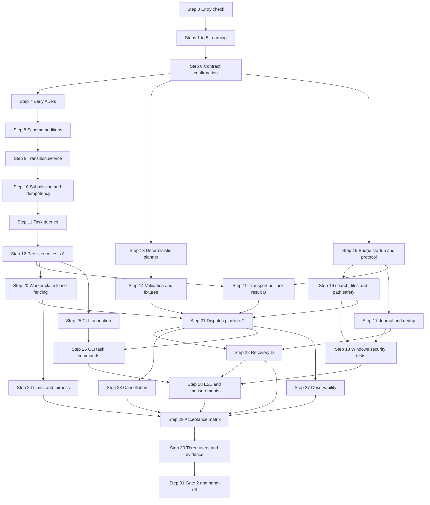

# Phase 2 — First Vertical Slice

> **Status:** DRAFT for team review · **Weeks:** 3–4 · **Gate:** Gate 2 (first vertical slice)
> **Parent plan:** [`00-phase-plan.md`](00-phase-plan.md) · **Previous:** [`phase-1-contracts-persistence.md`](phase-1-contracts-persistence.md) · **Tracker:** [`tracker.md`](tracker.md) · **Diagrams:** [`architecture.md`](architecture.md)

## How to read this document

- Every step has: **Intent → Owner → Source → How (exact actions) → Verify → Evidence → Learning → Status**, the same as P0 and P1.
- **[Docs]** = stated in the documentation. **[Suggestion]** = my recommendation, *not* in the documents; the team accepts or changes it. **[Verify]** = general tooling or platform knowledge I could not check against your machines or the current tool versions.
- **Owners:** you said you will divide the work yourselves, so every step says **"team assigns"**. The rotation table in `00-phase-plan.md` suggests BE = Dev C · WB = Dev A · AI = Dev B for P2. That is only a starting point. The docs (04.06, 04.07) name "Dev 1 / Dev 2 / Dev 3" per work package; this roadmap quotes those as a *hint about which skill is needed*, not as an assignment.
- **No time estimates from me.** The schedule fixes this phase at Weeks 3–4; the exit criteria decide when it is done. The docs (04.07.11) contain their own 12-day milestone schedule, quoted in §1 as **the docs' estimate, not a commitment**. The docs also say: if bridge transport, device authentication or recovery design is unresolved, **extend the milestone rather than bypass those boundaries**. This roadmap follows that rule.
- **Candidates are not decisions.** SQLAlchemy, Alembic, Pydantic, Docker Compose, Ollama and a local SQLite database for bridge deduplication are *candidates* in the documents. P2 only uses what P1 recorded as a decision; anything still Open gets an ADR before anyone depends on it.
- **Test evidence only.** The docs state that a happy-path demo alone does not satisfy the milestone (04.06). A step is `[x]` only when the evidence listed in it exists.
- Commands are examples. If the output differs from what is described, stop and ask; do not improvise around it.

---

## 1. Goal and scope

**Goal [Docs, 04.06]:** a user submits a file-search request in the terminal. NEXUS persists a task, routes it to the **explicitly selected** Windows device, searches **only an approved directory**, records the result and shows it. The plan is **deterministic; there is no live AI**.

### Success criteria [Docs, 04.06]

- A durable task ID and persisted status exist.
- The authenticated user owns the task.
- The device is authenticated and authorized.
- Backend and bridge validate **independently**.
- File access stays in a configured scope.
- Duplicate submissions do not create duplicate tasks.
- Failures and disconnections are shown honestly.
- The CLI shows the recorded outcome.

### Included / excluded [Docs, 04.06]

| Included in P2 | Excluded from P2 |
|---|---|
| Authentication, device selection, task creation | Live AI |
| PostgreSQL persistence | Semantic memory |
| Deterministic planning | Document summarization |
| Policy validation | File creation (P3) |
| Bridge communication | Application launching (P3) |
| Scoped file search | GUI automation |
| Task history | Broad multi-step plans |
| Basic recovery tests | Unrestricted commands |

> Approval flow, `create_file`, `launch_application` and `read_document` are **not** P2 even though some of their routes and contracts exist in the docs. The docs' MVP tool list puts `search_files` and `read_document` at Tier 0 and `create_file` and `launch_application` at Tier 1 (03.12). In the tracker's mapping `read_document` is P5.

### The 9-step flow [Docs, 04.06]

1. The CLI submits the request, target device and client request ID.
2. FastAPI authenticates and validates.
3. PostgreSQL persists the task and enforces idempotency.
4. The orchestrator claims the task and prepares a registered search operation.
5. The policy engine validates ownership, device, tool and directory scope.
6. The Windows bridge authenticates the request and validates local restrictions.
7. The filesystem tool searches only the configured test directory.
8. PostgreSQL persists the step outcome and final task status.
9. The CLI shows the task ID, result summary and any error.

### Gate 2 requirements from the docs (tracker §5, from 04.28.05)

| Gate 2 item | Covered by |
|---|---|
| Authenticated task submission, persisted, task ID returned | Steps 8–12 |
| Bridge receives an authenticated operation | Steps 15, 19 |
| Scoped file search returns a structured result | Steps 16–18 |
| Result and state persisted and visible in the CLI | Steps 21, 25, 26 |
| Duplicate-submission and unauthorized-device tests pass | Steps 10, 12, 29 |

### The docs' own schedule for this milestone (04.07.11) — **docs estimate, not a commitment**

Days 1–2 agree contracts and repo conventions · Days 3–5 task API, persistence, bridge skeleton and planner fixtures · Days 6–8 scoped file search and orchestration integration · Days 9–10 CLI integration, failure tests and first complete demo · Days 11–12 multi-user validation, fixes and reproducibility review.
The docs assume specialist developers and no learning time. Your team rotates roles and is beginner/intermediate in Python, so treat this as a *shape*, not a target. See risk P2-R1.

### How the docs' work packages map to the steps

| Docs WP (04.07) | Name | Docs owner | Steps in this roadmap |
|---|---|---|---|
| WP-01 | Shared contracts and repo foundation | All (coordinator Dev 1) | 6, 7 |
| WP-02 | Task API and PostgreSQL persistence | Dev 1 | 8–12 |
| WP-04 | Deterministic planner and tool proposals | Dev 3 | 13, 14 |
| WP-03 | Windows bridge and scoped search | Dev 2 | 15–18 |
| WP-05 | Orchestration, integration, recovery | Dev 1 (all review) | 19–24 |
| WP-06 | CLI, multi-user validation, release evidence | Shared (Dev 1 coordinates) | 25–30 |

The docs' merge order (04.07) is: **1** contracts, conventions and fixtures → **2** DB models and task API → **3** bridge protocol and scoped search → **4** planner interface → **5** orchestrator integration → **6** CLI integration → **7** end-to-end milestone. The step order below follows it.

---

## 2. Decisions this phase must settle

Record each in `docs/decisions/` as an ADR (P0 Step 14 template). Statuses are the docs' five values: Confirmed · Provisional · Open · Blocked · Deferred. A decision stays **Provisional** until its evidence exists (04.27.04). D-23 onward continue the tracker's numbering.

| ID | Decision | Docs position | Settled in step |
|---|---|---|---|
| D-23 | Task status casing on the wire (`queued` vs `QUEUED`) | **Inconsistent:** 03.16 and 03.9 show lower-case, 04.08 upper-case | 6 |
| D-24 | Bridge envelope field names (`schema_version` in 03.12 vs `tool_schema_version` + `attempt_id` in 04.08 and 03.30) | **Inconsistent** across documents; "illustrative" in all | 6 |
| D-25 | Error-code reconciliation: 03.32 adds filesystem codes (e.g. `DIRECTORY_NOT_CONFIGURED`, `UNSUPPORTED_PATH_TYPE`, `LINK_TARGET_NOT_ALLOWED`, `FILE_TOO_LARGE`, `FILESYSTEM_ACCESS_DENIED`, `FILESYSTEM_OPERATION_TIMEOUT`, `DOCUMENT_FORMAT_UNSUPPORTED`) that are not in the 04.08 catalogue; 03.9 shows `DEVICE_OPERATION_FAILED`, in neither | Proposed in 03.32; "must be aligned with the shared error contract (03.24)" | 6 |
| D-26 | Logical directory IDs for tests and PC-05 (default permitted directories). 04.06 uses `nexus_test_documents`; 03.12 and 03.32 use other illustrative IDs | All labelled illustrative | 6, 15 |
| D-27 | Where claim fields live (on the task row or a separate claim table) and the claim strategy (row lock vs conditional update) | Open; "required behavior, exact implementation to validate" (04.11.13) | 20 |
| D-28 | Lease duration, heartbeat interval, renewal policy | Open; to be selected from measured durations (04.11.05) | 20 |
| D-29 | Bridge-side operation journal storage and retention | Open; a small local database is a candidate only (03.30.11, 03.12) | 17 |
| D-30 | Windows APIs and libraries for safe path resolution | Open (03.32.15 #6) | 16 |
| D-31 | `search_files` limits: max depth, max results, max duration, hidden/system files, file types, exclusions | Open; "set by performance testing on your hardware" (03.32) | 16 |
| D-32 | Transport timings: poll interval, request timeout, heartbeat interval, deadline representation; credential auth mechanism | Open; polling is **Provisional** (03.12, 04.10.13) | 19 |
| D-33 | `search_files` timeout and retry policy (dispatch timeout, result-wait timeout, max attempts, backoff) | Open; per-tool (03.30.08) | 21 |
| D-34 | CLI framework and HTTP client library | Open: "pick a Python CLI library" (03.16.15 #6) | 7 |
| D-35 | CLI token storage, exit codes, watch interval, human vs JSON output conventions | Open; numeric exit codes open, but must distinguish success, accepted-but-running, failed (03.16) | 25, 26 |
| D-36 | Device selection: explicit ID every time vs a displayed, overridable default | Open (03.16.15 #2); explicit targeting is required either way | 26 |
| D-37 | Pagination style for task lists (cursor vs offset) | Open (03.16.15 #5) | 11 |
| D-38 | Concurrency and queue limits (max active claims, per-user, per-device, queue capacity) and the fairness approach | Numbers open; round-robin is a "proposed baseline" (04.11.13) | 24 |
| D-39 | Bridge distribution and startup on Windows (Python source vs packaged executable) and credential location | Open (04.21.18); ties to D-16 | 15 |

Carried over from P1 and still relevant: **D-01** Python version · **D-18** how cancellation is represented · **D-19** error payload shape · **D-20** payload limits.

> **PC-05** (default permitted directories and applications) must be answered for the P2 test directory by Step 6. **PC-07** (behaviour if the target PC goes offline) is planned for P3 in the tracker, but P2 already needs a *safe* behaviour: no rerouting, no false success, task stays recoverable (04.06 acceptance matrix).

---

## 3. Steps

### Step 0 — Entry check: what P1 actually delivered

- **Intent:** P2 builds on P1. Find out *now* which pieces are missing or only half-done.
- **Owner:** team assigns (all three attend). **Source:** `phase-1-contracts-persistence.md` §5 and Step 26, `tracker.md` §2b and §8.
- **How:**
  1. Open the P1 Gate 1 checklist. For each unchecked item, copy it to the tracker's **Carried-over items** with an owner. A P2 step that depends on it is blocked until it is done.
  2. Confirm these exist and are merged: the contract baseline tag from P1 Step 25 (suggested name `contracts-v0.1`), the error catalogue, the pure state-machine module, the initial schema migration, PostgreSQL integration-test environment, authentication, device registration, the bridge prototype (heartbeat, capability report, poll loop), `MockPlanner` plus the plan validator, CI.
  3. Confirm each developer can clone, build the environment, run all checks green, and reach the dev **and** the test PostgreSQL database. At least **two developers must also have a native Windows environment that runs the bridge prototype** (P1 Step 21), because P2 tests run on Windows.
  4. **Blocking check:** D-01 (Python version), D-02 (dependency manager), D-03 (PostgreSQL mode), D-09 (ID format), D-10 (validation approach), D-11 (DB library and migration tool), D-16 (device credential) and D-17 (transport) must be settled at least as Provisional. If not, settle them first.
  5. Read the **P1 "P2 entry list"** (P1 Step 26). Expected items: task-submission endpoint, CLI, bridge delivery/ack/result, real `search_files`, polling-interval measurement, CLI token storage, full Baseline 2 from P0 (backend + PostgreSQL + small workload).
  6. Read the P1 integration-scenario file for the bridge (`tests/integration/bridge_scenarios.md`): the scenarios marked "P2" become part of Step 19.
  7. Confirm the hand-off pairing happened: each P1 stream owner walks the next owner through their work before P2 starts.
- **Verify:** an "inputs present / missing" list in the tracker; every missing item has an owner.
- **Evidence:** tracker change in a merged PR.
- **Learning:** none.
- **Status:** `[ ] pending`

### Step 1 — Learning block 1: service layering in FastAPI (thin routes, application services, dependencies)

- **Intent:** the docs require that "the API layer calls application services, not DB records directly" (04.07 WP-02). Everyone needs the same mental picture before writing the task API.
- **Owner:** all three. **Source:** 04.07 WP-02, Application Structure and Component Interfaces (read in P1).
- **How:** each developer builds a throwaway FastAPI app (not in the NEXUS repo) with:
  1. A route that does nothing except parse the request, call a function in a separate `services` module and map the result or exception to a status code.
  2. A `Depends(...)` dependency that provides a fake "current user" (to rehearse the protected-route pattern from P1).
  3. A service function that raises a typed exception on a conflict; the route turns it into a stable error body. Be able to explain why the *service* must not import FastAPI.
  4. A test using the test client from P1 Step 6 that checks status code **and** body.
- **Verify:** each developer explains where validation, authorization, persistence and response mapping live in their toy app.
- **Evidence:** the practice file kept under `docs/learning/` or the team scratch repo.
- **Learning resources:** FastAPI official tutorial on dependencies and error handling [Verify link].
- **Status:** `[ ] pending`

### Step 2 — Learning block 2: PostgreSQL concurrency for idempotency, claims and fencing

- **Intent:** the hardest bugs in P2 are races. P1 Step 2 introduced row locks and conditional updates; now apply them to the exact patterns the docs require.
- **Owner:** all three. **Source:** 03.15.04, 03.15.05, 04.11.04, 04.11.05.
- **How:** in `psql` against a **scratch schema** of the dev database, with two sessions open:
  1. **Duplicate submission:** a table with `UNIQUE(owner_user_id, client_request_id)`. Insert from session 1 (uncommitted), then from session 2: observe that session 2 waits and then fails or succeeds depending on session 1's commit/rollback. The docs: "the database enforces uniqueness; an application-level check-then-insert is not sufficient under concurrent requests" (03.15.04).
  2. **After a violation:** load the existing row and compare the stored normalized request to the new one. Same → return it; different → conflict (04.06).
  3. **Atomic claim by conditional update:** `UPDATE ... SET status='RUNNING', claim_generation=claim_generation+1 WHERE id=? AND status='QUEUED'` and read the affected-row count. 0 = lost the race.
  4. **Row locking:** `SELECT ... FOR UPDATE` in session 1; session 2 waits. Also look up what `SKIP LOCKED` does **[Verify against the PostgreSQL documentation for the version in D-03]**. Do not adopt it without an ADR (D-27).
  5. **Fencing:** simulate the docs' example (04.11.05): worker A claims generation 7, its lease "expires", recovery assigns generation 8, worker A resumes with 7 and its update `WHERE id=? AND claim_generation=7` affects 0 rows.
  6. **Short transactions:** state in your own words why no transaction may stay open while waiting for a bridge, a model, a file operation or a human (04.11.04).
- **Verify:** each developer shows (a) a rejected duplicate, (b) a lost claim race detected by row count, (c) a stale update rejected by generation.
- **Evidence:** a saved `.sql` practice file per developer, kept out of the main schema.
- **Status:** `[ ] pending`

### Step 3 — Learning block 3: Python on native Windows, Windows paths and links

- **Intent:** Windows file-path security is the highest-risk part of P2 and behaves differently from Linux. The docs insist: "a WSL2 process is not equivalent to a Windows user-session process" (03.12) and "a Python package that works in Ubuntu must not be assumed to work identically in native Windows" (04.21.03).
- **Owner:** all three; at least the two developers who run the bridge do the Windows parts for real. **Source:** 03.32, 03.12, 04.21.03.
- **How:**
  1. Windows paths: drive letters, backslashes, case-insensitive comparison, reserved device names, UNC paths (`\\server\share`), the long-path prefix and device namespace forms (`\\?\`, `\\.\`), and alternate data stream syntax (`file.txt:stream`). Read the 9-row path-type table of 03.32 (see Step 16).
  2. In Python on **native Windows** (not WSL), try `pathlib.PureWindowsPath`, `pathlib.Path.resolve()`, `os.scandir`, `os.path.realpath`. Observe what each does with `..`, with a symlink, and with a directory junction. **[Verify]** the behaviours on the Windows version and Python version you pinned (D-01); I have not run any of this.
  3. Create, in a scratch folder on Windows: a normal folder, a **junction** (`mklink /J`) and a **symbolic link** (`mklink /D`; may need developer mode or elevation **[Verify]**), plus a sibling folder whose name *starts with* the allowed folder's name (the docs' prefix-check example: `C:\NexusWorkspace-Private` vs `C:\NexusWorkspace`, 03.32).
  4. Show with a three-line script why `str(path).startswith(allowed)` is **wrong** (the docs: "a string-prefix check is not sufficient").
  5. Concept only: TOCTOU (time-of-check/time-of-use): a path that is safe when checked can be swapped before it is used. No portable helper is a complete defense (03.32).
  6. Why a WSL virtual environment, Linux executable or Linux path cannot be used by the Windows bridge (04.21.05).
- **Verify:** each developer explains, with their scratch folder, why the prefix check fails and what a reparse point is.
- **Evidence:** a short note per developer in `docs/learning/windows-paths.md` [Suggestion on the file name].
- **Status:** `[ ] pending`

### Step 4 — Learning block 4: failure thinking — timeouts, lost responses, reconciliation, fault injection

- **Intent:** P2's value is that failure is handled honestly. The docs' central warning: "A PostgreSQL commit cannot roll back a file that Windows has already created" (03.30.06).
- **Owner:** all three. **Source:** 03.30.01–03.30.10, 03.15.01, 03.15.07, 03.9.
- **How:**
  1. Walk through the docs' file-creation story (03.30.01) on paper: backend sends → bridge acts → success response lost → backend times out. State what the backend **knows** and **does not know**.
  2. Learn the docs' four distinct outcomes: succeeded, failed, rejected, uncertain, and the extra running status. A transport timeout ≠ tool failure (03.12).
  3. Learn the three timeout kinds (03.30.08): dispatch timeout (request may or may not have reached the bridge), execution timeout (may still be running or finished), result-recording timeout (side effect may have happened even if not recorded).
  4. Learn the **crash-point table** (03.15.07): before task commit · after commit, before execution · after intent stored, before dispatch · after dispatch, before bridge response · after bridge execution, before result persistence · after result persistence, before the client sees it · while awaiting approval.
  5. Learn the difference between *at-least-once delivery*, *deduplication* and *exactly-once*; the docs say NEXUS does **not** promise exactly-once for arbitrary Windows operations (03.30.06). For `search_files`, retry is "generally safe" (03.30.05), but retries still need authorization and resource limits.
  6. Fault injection: write a tiny fake transport (a Python class with a method that can be told to "drop the response", "raise a timeout", "deliver twice") in your scratch repo and exercise a toy retry loop against it.
- **Verify:** each developer can say, for each of the 7 crash points, what the system must do next and what it must not do (never blindly replay an uncertain operation).
- **Evidence:** one page per developer or a team table committed to `docs/learning/failure-thinking.md` [Suggestion on the name].
- **Status:** `[ ] pending`

### Step 5 — Learning block 5: building a CLI — arguments, HTTP client, exit codes, stdout vs stderr

- **Intent:** WP-06 needs a CLI that is scriptable and honest. The CLI framework is not chosen yet (D-34).
- **Owner:** all three. **Source:** 03.16 (CLI commands, output modes, error situations).
- **How:**
  1. Concepts: command, subcommand, option/flag, positional argument; exit code 0 vs non-zero; **stdout for results, stderr for diagnostics** (the docs' machine mode: stable JSON on stdout with no decoration).
  2. Two or three CLI libraries exist for Python. Spend a short session with each on a toy `hello --name X` command. Do **not** pick one yet: the choice is made in Step 7 with a recorded reason.
  3. An HTTP client library: send a request with a timeout, handle a connection error, read a JSON body, read the status code. Why *every* request needs an explicit timeout.
  4. Why the CLI is **untrusted** (03.16): the server must never trust anything it sends, such as a user ID.
  5. Why stopping a "watch" loop must not cancel a task (03.16): the loop is a client-side polling display, not the task.
- **Verify:** each developer's toy CLI prints JSON on stdout, an error on stderr and returns a non-zero code on failure.
- **Evidence:** practice files under `docs/learning/` or the scratch repo.
- **Status:** `[ ] pending`

### Step 6 — Contract confirmation and gap fixes (docs WP-01)

- **Intent:** the docs' first rule is "freeze contracts first" and the first merge is contracts, conventions and fixtures (04.07). The documents contain several inconsistencies; fix them now in the contracts, before code depends on them.
- **Owner:** all three (the docs name Dev 1 as coordinator). **Source:** 04.07 WP-01, 04.06 (implementation order, gate 1), 03.12, 03.16, 03.9, 03.30, 03.32, 04.08.
- **How:**
  1. **Reconcile the cross-document inconsistencies** and record each as an ADR with the contract change:
     - D-23 status casing (`queued` vs `QUEUED`). Pick one wire form; map once at the API boundary.
     - D-24 envelope field names. The two documents' examples are: 03.12 `protocol_version, operation_id, task_id, target_device_id, tool_name, schema_version, arguments{directory_id, query, max_results}, deadline`; 03.30/04.08 add `attempt_id` and `step_id` and use `tool_schema_version`. The docs require a stable `operation_id` and a **new `attempt_id` per attempt** (03.30.04, 04.10.13), so the final envelope must carry both. Check what your P1 bridge contract already has and amend it with a CHANGELOG entry.
     - D-25 error codes. Take the P1 catalogue (15 codes), the 03.32 filesystem codes (11 rows) and the 03.9 error categories (validation, authentication, authorization, conflict, device unavailable, tool failure, uncertain outcome, internal failure). For each code you will really emit in P2 add emitter / terminal / retry / recovery. A code that nothing in P2 emits is deferred. 03.32 says its codes are "proposed" and "must be aligned with the shared error contract".
  2. **Name the directory IDs (D-26).** 04.06 uses `nexus_test_documents` as its example and says "each developer configures their own local path". Choose the ID(s) for tests; the ID is the same on every PC, the path differs. Answer **PC-05** for P2: *which one test directory per PC, read-only search only*.
  3. **Confirm the task-submission contract** against 04.06's six validation rules: `client_request_id` present and in the agreed format · `target_device_id` refers to a device the user may target · `request` non-empty and within a length limit · request maps to a supported capability · request cannot override security policy through natural language · the user identity comes from the auth context, **never a client-supplied `user_id`**. Make sure each rule has a valid and an invalid example payload.
  4. **Confirm the duplicate-submission contract** [Docs, 04.06]: same ID and same normalized request → return the existing task · same ID and a different request or device → stable conflict error · concurrent duplicates → arbitrated by a DB constraint and transaction · an API timeout does not prove rejection (the client may retry with the same ID or fetch the task). Define what "normalized request" means (case, whitespace) and write it in the contract. **[Suggestion]** store a hash of the normalized request next to `client_request_id` so the comparison is one value.
  5. **Confirm the lifecycle contract** (task: QUEUED, RUNNING, WAITING_FOR_APPROVAL, INTERRUPTED; terminal SUCCEEDED, FAILED, CANCELLED; step: PENDING, READY, WAITING_FOR_APPROVAL, DISPATCHED, RUNNING, SUCCEEDED, FAILED, REJECTED, UNCERTAIN, CANCELLED). Check which transitions the P2 slice needs and that the P1 state machine allows exactly those. The docs: SUCCEEDED only after a valid, correlated result and a successful persist; partial success is probably a **result classification**, not a state (03.9, 03.15).
  6. **Confirm the `search_files` tool contract** (03.12 input: `directory_id` string referencing an approved local scope; `query` bounded-length search term, never executable code; `max_results` integer bounded by a server-defined maximum; output: matching entries, bounded metadata, `truncated` flag). Add the 03.32 result fields: stable result ID per operation, display name, **path relative to the logical directory**, metadata (size, mtime), status for inaccessible/skipped/unsupported entries. **No absolute paths** to the backend or AI.
  7. **Shared fixtures (the docs' WP01-05):** valid requests · invalid arguments · authorization failures · failure scenarios. Cover at minimum the 04.06 acceptance matrix (Step 29) and the nine negative tests (Step 18).
  8. **Configuration names and test isolation (WP01-06):** list every setting P2 adds (backend URL, bridge poll interval, directory mapping file, limits, lease duration, concurrency limits). Names only; defaults come from measurement. Test databases and Windows test directories are isolated from real user data (04.21.06, 03.32).
  9. **Do not freeze** bridge transport details, dependency versions or DB field types that are still Open (04.07 WP-01).
  10. Follow the P1 contract change process: PR touching `contracts/`, updated examples and tests, producer and consumer approvals, CHANGELOG entry. Tag a new baseline when finished (suggested `contracts-v0.2`) [Suggestion].
- **Verify:** all three developers approve the same contract examples and tests (the 04.06 gate for this stage); contract tests green; the inconsistency table in §8 shows each item as "resolved in ADR D-xx".
- **Evidence:** merged contract changes, ADRs D-23, D-24, D-25, D-26, new fixtures, tag.
- **Learning:** why a contract disagreement found now costs less than one found at integration.
- **Status:** `[ ] pending`

### Step 7 — Remaining early ADRs (D-34 now; others recorded when evidence exists)

- **Intent:** open decisions become Provisional ADRs with a revisit condition, instead of being decided by whoever types first.
- **Owner:** team assigns. **Source:** 04.27.04, 03.16.15.
- **How:**
  1. **D-34 CLI framework and HTTP client library.** Use the Step 5 toy results. Criteria [Suggestion]: easy for beginner/intermediate Python, supports subcommands, easy testing, no hidden global state. Record the decision and the revisit condition. Pin the dependency through the P1 dependency process.
  2. Create ADR stubs with status **Open** for D-27 to D-33 and D-35 to D-39, each with: the question, the docs' position, evidence needed, owner, the step that settles it. Do not pre-fill answers.
  3. Update the tracker decision register.
- **Verify:** every decision in §2 exists as a file or tracker row with an honest status.
- **Evidence:** ADRs, tracker.
- **Status:** `[ ] pending`

---

### Step 8 — Persistence: schema additions and models (docs WP02-01, WP02-02)

- **Intent:** task, step, attempt and audit records exist, with ownership and ID constraints, created from a migration on a clean database. [Docs WP-02; 04.06 table]
- **Owner:** team assigns. **Source:** 04.06 persistence table, 03.10 (read in P1), 04.11.04 (claim record), 03.30.02 (identifiers).
- **How:**
  1. Open the P1 initial schema (P1 Step 16). The 04.06 **minimum records** are: `tasks` (owner, target device, request ID, status, timestamps) · `task_steps` (search operation, status, operation ID, outcome) · `task_step_attempts` (dispatch attempts and outcomes) · `audit_events` (security-relevant events and decisions). List which already exist and which fields are missing.
  2. Add what is missing via a **new migration** (never edit the P1 migration). Use P1's migration workflow and safety checks.
  3. Required constraints [Docs]: every task has an owner and an explicit target device; a task has a durable initial state; **UNIQUE(`owner_user_id`, `client_request_id`)** (03.15.04 "same user and equivalent request"); IDs are opaque (D-09); each attempt belongs to an operation and each operation to a step. Identity separation: `task_id`, `step_id`, `operation_id` (stable across retries), `attempt_id` (new per attempt), `device_id`, `worker_id` (03.30.02).
  4. **Claim fields** (D-27 is settled in Step 20, but the table must exist before then): the docs' illustrative claim record is `task_id, worker_id, claim_generation, claimed_at, lease_expires_at, last_heartbeat_at, claim_status (active, expired or released)`. "The team must decide whether these fields belong in the task table or a separate claim table. Avoid duplicating authoritative state across both" (04.11.04). **Leave claim columns out of this migration** and add them in Step 20 once D-27 is decided.
  5. Persist enough on the step to reconstruct intent: tool name and schema version, target device, directory ID, query, limits, expected result structure (04.06), the operation ID, and a reference to the validated arguments. **[Suggestion]** store arguments as a JSON column plus the request fingerprint (03.30.07: tool name and schema version, canonicalized arguments, target device, resource scope, relevant execution options).
  6. Keep the audit table append-only in application code. Decide what is an "audit-worthy" event now: authentication outcomes, authorization denials, device targeting decisions, policy decisions, recovery decisions (04.06 observability).
  7. Write the SQLAlchemy-style or equivalent models **only if** D-11 settled on that; otherwise use what D-11 chose. Do not leak persistence models into the API layer.
  8. Update the data-model document from P1 and the ER diagram in [`architecture.md`](architecture.md) §8.
- **Verify:** a fresh database migrates to head; the previous revision upgrades; constraint tests in Step 12 can fail by removing a constraint (mutation check).
- **Evidence:** migration, model code, updated data-model doc.
- **Learning:** why the schema carries constraints and not just application checks.
- **Status:** `[ ] pending`

### Step 9 — State-transition service (docs WP02-06)

- **Intent:** invalid transitions are rejected centrally; every accepted transition is persisted. [Docs 03.9 invariants, 03.15.2]
- **Owner:** team assigns. **Source:** 03.9 (six invariants), 03.15.02, P1 Step 9.
- **How:**
  1. Wrap the P1 pure `state_machine.py` in a **service** that: loads the task and step in a short transaction, asks the pure module whether the transition is legal, writes the new state and an audit/event row, commits.
  2. Invariants to enforce [Docs]: application code validates every transition · every accepted transition is persisted **before it is reported as durable progress** · a claimed task cannot be run by another worker without valid ownership · SUCCEEDED requires finished operations and verification · terminal states are not casually reopened · after a backend restart recovery starts from persisted state.
  3. A transition from a stale worker must fail (the generation check is added in Step 20; leave a clearly marked parameter now).
  4. Progress is **derived** from persisted step state, never from text or memory (03.9, 03.16).
  5. Return typed errors (illegal transition, not found, access denied) that the route layer maps to the agreed error codes.
- **Verify:** unit tests for the full transition matrix (reuse P1's) and a PostgreSQL test for "illegal transition rejected and nothing persisted".
- **Evidence:** merged service plus tests.
- **Status:** `[ ] pending`

### Step 10 — Task submission endpoint and idempotency (docs WP02-03, WP02-04)

- **Intent:** `POST /v1/tasks` validates, persists in one short transaction, and only then returns acceptance. [Docs 04.06 steps 2–3; 03.9]
- **Owner:** team assigns. **Source:** 04.06, 03.16, 03.9, 03.15.04.
- **How:**
  1. Route (proposed in the docs): `POST /v1/tasks`. The route parses the body, gets the user from the **auth context**, calls the application service and maps the result. It never takes `user_id` from the body.
  2. The service does, in order: validate the six rules (Step 6.3) · check the user may target the device (owner-only targeting from P1 Step 19; refusals do not reveal other users' devices) · verify the request maps to a supported capability (a lookup, since the deterministic planner runs later; see Step 13) **without** contacting the bridge · normalize and fingerprint the request · insert the task row (initial state QUEUED) · commit.
  3. **Acceptance means durably accepted**, not valid, approved or completed (03.16). Return the task ID, status, `created_at` and a status URL only **after the commit succeeds**. If the database is unavailable or the commit fails, return a stable error and **do not** claim acceptance. Test it.
  4. Duplicate handling per Step 6.4, using the unique constraint as arbiter: on violation, reload and compare. Return the existing task (same request) or a stable conflict error (different request or device). Concurrent duplicates: exactly one row.
  5. Capacity: if queue capacity is reached return a stable capacity error rather than an in-memory-only task (04.11.06, 04.11.09). The numeric limit comes from Step 24; until then implement the error path with a configurable limit.
  6. Audit rows: submission accepted, rejected for authorization, conflict.
  7. Do not run any work in the request. The worker (Step 20+) picks the task up later: "a background task tied to an HTTP request lifetime is not durable" (03.9).
- **Verify:** tests: valid submission · same ID and payload returns the existing task with no second row · same ID, different payload/device → conflict, still one row · two concurrent submissions with the same ID (PostgreSQL) → one row · unauthenticated → rejected, no row · unauthorized device → denied before any dispatch · PostgreSQL unavailable → no false acceptance · oversized or empty request → rejected.
- **Evidence:** merged route, service, tests.
- **Learning:** acceptance vs completion.
- **Status:** `[ ] pending`

### Step 11 — Task queries (docs WP02-05)

- **Intent:** users inspect their own tasks, steps and results; nobody can read another user's. [Docs 03.16, 04.07 WP02-05]
- **Owner:** team assigns. **Source:** 03.16, 03.9.
- **How:**
  1. Routes proposed in the docs: `GET /v1/tasks/{task_id}`, `GET /v1/tasks/{task_id}/steps`, `GET /v1/tasks/{task_id}/result`, `GET /v1/tasks` (list). `GET /v1/devices` and `GET /v1/me` exist from P1.
  2. Task status body [Docs 03.16]: task ID, state, target device ID, timestamps, progress (`completed_steps`, `total_steps`), `action_required`, error classification, outcome summary. Counters reflect persisted steps.
  3. Step body [Docs]: step ID and sequence, tool name, state, attempt count, times, safe result summary or structured error, whether approval or recovery is required. **Filter** arguments and outputs (they may be sensitive).
  4. Result body: grounded in recorded operation results, not an AI summary. It must distinguish verified success · partial success · definite failure · cancellation with preserved completed actions · **unresolved or uncertain** (03.16).
  5. List: bounded and paginated (D-37: cursor vs offset, record the ADR). Apply the page-size limit.
  6. **Authorization per resource:** a task of another user returns the same "not found"-style response as a non-existent one ("don't leak the existence of other users' resources", 03.16).
  7. Lists and detail use the authenticated user ID as a required argument (P1 Step 19 rule).
- **Verify:** tests: owner reads own task/steps/result · other user gets the agreed denial · unknown ID same response · pagination bounds · uncertain step renders as uncertain · no secrets in bodies.
- **Evidence:** merged routes + tests.
- **Status:** `[ ] pending`

### Step 12 — Persistence integration tests and failure tests (docs WP02-07) — **checkpoint A**

- **Intent:** prove on **real PostgreSQL** that persistence guarantees hold. Mocked databases cannot prove locking, uniqueness or transaction behaviour (03.15.13).
- **Owner:** team assigns. **Source:** 04.07 WP-02, 03.15.13, 04.06 gate 2.
- **How:** write and run the docs' required failure tests for WP-02:
  1. PostgreSQL unavailable during submission.
  2. Two concurrent requests with the same key.
  3. Same key with a different device.
  4. A user reading another user's task.
  5. A stale worker updating after losing its claim (the claim mechanism arrives in Step 20; write the test now as `xfail` with a reason and un-mark it there). [Suggestion]
  6. An illegal transition.
  7. Also: backend restart with a queued task persisted (restart the app object, reload from DB).
  8. Checkpoint A (docs, WP-05): **submit and retrieve without Windows and without the AI runtime** (the WP-02 exit gate: "works independently of the bridge and AI runtime").
- **Verify:** all green in CI with a PostgreSQL service; mutation checks: drop the unique constraint and see test 2 fail; remove the owner filter and see test 4 fail.
- **Evidence:** CI run, merged tests.
- **Status:** `[ ] pending`

---

### Step 13 — Deterministic planner interface and `search_files` handler (docs WP04-01, WP04-02)

- **Intent:** a simple handler maps an explicitly supported search request to `search_files`. It "must not pretend to understand arbitrary natural language" (04.06). [Docs WP-04]
- **Owner:** team assigns. **Source:** 04.06 planner section, 04.07 WP-04, P1 Steps 11 and 22.
- **How:**
  1. Reuse the P1 planner interface and proposal types. Add a `DeterministicSearchPlanner` next to `MockPlanner`; do not remove the mock.
  2. Define the **explicit supported request forms** (docs: "use explicit supported request forms or a small deterministic parser. Do not call text matching natural-language understanding"). [Suggestion] start with exactly one form, e.g. `search <term> in <directory_id>`; the team writes the exact grammar in the contract and tests it. Anything else returns `UNSUPPORTED` or `CLARIFICATION_REQUIRED` from the P1 planner contract.
  3. The proposal contains [Docs 04.06]: tool name and schema version · target device ID · logical directory ID · search query · result and execution limits · expected result structure.
  4. **The backend assigns the task, step and operation IDs and the required permissions, not the planner** (04.06). The planner cannot set `risk_tier`, `approved`, `user_id`, device ownership or permissions.
  5. Natural-language attempts to override policy ("ignore the directory limit", "search C:\\") either map to an unsupported result or are rejected by validation in Step 14; never "interpreted".
  6. Dev 3's docs ownership: "does not own authorization or task state. The planner proposes and the backend independently validates" (04.07).
- **Verify:** unit tests: supported form → valid proposal; unsupported/ambiguous → typed result; injection-style text → no scope expansion.
- **Evidence:** merged planner + tests + fixtures.
- **Learning:** why a planner is a *proposer*, not an authority.
- **Status:** `[ ] pending`

### Step 14 — Proposal validation, capability descriptions, invalid-plan fixtures (docs WP04-03..06)

- **Intent:** unsupported or invalid operations are rejected **without contacting the bridge** (the 04.06 gate for this stage).
- **Owner:** team assigns. **Source:** 04.07 WP-04, 04.06, 03.12 (registry), 04.08.
- **How:**
  1. Extend the P1 plan validator: schema valid · tool registered **and enabled** · schema version supported · arguments valid for that tool's schema (bounded query length, `max_results` ≤ the server-defined max) · directory ID known and authorized · target device owned by the user and eligible · limits within server maxima. Unknown fields at security boundaries are rejected.
  2. **Tool registry (backend side):** the registry is maintained by the application; "a model cannot register tools or change risk tiers" (03.12). Registry fields from the docs: `tool_name, schema_version, description, input_schema, output_schema, risk_tier, required_permissions, timeout_policy, retry_policy, enabled`. In P2 only `search_files` is registered and `enabled`. `risk_tier` Tier 0, `retry_policy` "generally safe" (03.12, 03.30.05); the exact values are in the contract.
  3. **Capability descriptions (WP04-04):** the planner receives only the relevant registered capabilities. Check them at dispatch time against the bridge's last capability report (docs: versioned report with dispatch-time revalidation; "proposed").
  4. **Context fixture interface (WP04-05):** tests supply controlled context without a live model.
  5. **Invalid-plan fixtures (WP04-06):** unknown tool · invalid arguments · scope-expansion attempt · missing arguments · unauthorized device target · excessive `max_results` · malformed proposal. Each has an expected typed error.
  6. Exit gate (docs): the backend receives a valid structured search proposal or a clear unsupported/clarification result and **never trusts the planner as authority**.
- **Verify:** every fixture passes through the validator with the expected result; a mock bridge is wired with a "call counter" and the test asserts it was **never called** for invalid proposals.
- **Evidence:** merged validator, registry, fixtures, tests.
- **Status:** `[ ] pending`

---

### Step 15 — Windows bridge: configuration, startup, device authentication, protocol handling, tool registry (docs WP03-01..04)

- **Intent:** the native Windows bridge starts under the intended user, authenticates, validates every incoming operation against the shared contract and only runs registered, enabled tools. [Docs WP-03]
- **Owner:** team assigns (runs on **native Windows**). **Source:** 04.07 WP-03, 03.12 (lifecycle), 04.21.09 (installation and startup), 04.10.
- **How:**
  1. **Configuration (WP03-01):** load validated local settings: backend endpoint (not hard-coded), poll interval, directory mapping, logging. Non-secret settings come from a config file; the device credential comes from the protected location chosen in P1 (D-16) — do not put it in the config file. Settings are validated at startup with an actionable error for each failure.
  2. **Directory mapping (03.32):** each entry has `directory_id`, `configured_path`, `allowed_operations`, `enabled`, `limits`, `configuration_version`. The mapping lives **on the bridge**; the backend may know only the ID and its authorized uses. Create the test directory mapping for the ID chosen in D-26; every developer points it at their own folder with a few harmless files.
  3. **Distribution (D-39):** Python source in a native Windows environment is the lowest-effort option and avoids new tooling; a packaged executable is the other option named by 04.21.09. Record the choice as Provisional. P2 does not need an installer (the docs put a packaged installer in "P2 Future improvements" of 04.21.17, a different numbering from this roadmap).
  4. **Startup sequence (04.21.09):** load and validate config → load the protected credential → authenticate to the backend → confirm registered device identity and status → report supported protocol and tool capabilities → validate local directory mappings → begin the approved polling workflow → report readiness only for capabilities that passed validation. **If authentication fails the bridge must not accept operations as if it were trusted.** Do not run as administrator.
  5. **Device authentication (WP03-02):** invalid or revoked credentials are rejected (reuse P1 Step 20–21 mechanism).
  6. **Protocol handling (WP03-03):** every operation is validated against the shared contract: protocol version, `tool_name`, schema version, target device equals this device, required and unexpected arguments, types and lengths, deadline. Unknown fields: rejected or per the versioning policy; **security-sensitive unknown fields fail closed** (03.30.04).
  7. **Tool registry (WP03-04):** only registered **and locally enabled** tools run. The bridge exposes **no generic command endpoint** and "must not expose one to compensate for a missing tool" (03.30.12).
  8. **Bridge states** (proposed labels, not final): starting, connected, disconnected, degraded, stopping. On disconnect it stops accepting work that needs backend authorization; on shutdown it stops dispatching and reports in-flight state (03.12).
- **Verify:** tests on Windows: starts from a clean environment · config errors produce actionable messages · wrong or revoked credential → refuses to serve · unknown tool rejected · unsupported protocol version rejected · target-device mismatch rejected · credential never appears in logs.
- **Evidence:** merged code, tests, a log excerpt with secrets removed.
- **Learning:** running a Python program as a Windows user process; reading bridge logs.
- **Status:** `[ ] pending`

### Step 16 — `search_files` implementation and Windows path safety (docs WP03-05, WP03-06)

- **Intent:** the search stays inside a configured logical directory and is bounded. This is the highest-risk step of P2. [Docs 03.32, 04.06]
- **Owner:** team assigns; **a non-author must review**. **Source:** 03.32 (whole document), 03.12, 04.06.
- **How:**
  1. **First settle D-30:** which Windows/Python facilities will resolve and inspect paths (an approach built on `os.scandir`/`pathlib`, a lower-level Windows API call, or a library). The docs list this as open (03.32.15 #6) and say "the precise implementation must be selected and tested on the real Windows environment". Spike on the Windows PCs, write an ADR with results, and mark it Provisional.
  2. **Apply the docs' 8-step validation sequence (03.32):** validate arguments and the directory ID → resolve the ID via trusted local config → reject disallowed path forms and namespaces → normalize and resolve any relative path with Windows-aware APIs → confirm the target stays inside the scope → inspect attributes and link behaviour → perform the operation with the safest primitive → verify the result and record it. **Never authorize on a string prefix.**
  3. **Path-type behaviour for MVP (03.32 table):** ordinary local drive paths only via configured IDs · relative paths only against a trusted configured root · **UNC denied by default** · Windows device namespaces rejected · environment-variable expressions are not expanded · traversal components resolved safely, rejected if scope cannot be proven · alternate data stream syntax rejected · reparse points and links not followed by default · network-mounted and removable drives unsupported by default.
  4. **Link policy (03.32):** do not follow directory links or junctions in recursive search; inspect attributes before traversing; skip or reject entries whose target cannot be validated; unsupported reparse-point types are unsafe; prefer handle-based checks where practical.
  5. **Limits (D-31):** max depth, max results, max duration, explicit hidden/system file rules, bounded query length, cancellation checks (04.06: "supports cancellation where practical"). The docs give **no numbers**; measure on your hardware (Step 28) and record. Until measured, start conservative and make every limit configuration with a server-defined maximum the request cannot exceed. A model or user asking for more must still be bounded (03.32 acceptance).
  6. **Result (03.32, 04.06):** bounded metadata (relative path, display name, size, mtime), a `truncated` flag, per-entry status for inaccessible/skipped/unsupported, **no file contents**, no absolute paths, stable error codes (D-25). Results are not permanent permissions.
  7. **Errors:** use the reconciled codes. Examples from the docs: unknown/unavailable ID → `DIRECTORY_NOT_CONFIGURED` · outside scope → `FILESYSTEM_SCOPE_DENIED` · unsupported namespace/form → `UNSUPPORTED_PATH_TYPE` · prohibited link → `LINK_TARGET_NOT_ALLOWED` · OS permission → `FILESYSTEM_ACCESS_DENIED` · over duration → `FILESYSTEM_OPERATION_TIMEOUT`. Names are proposals until D-25 is closed.
  8. **TOCTOU (03.32):** keep resolution and access tightly coupled; re-validate attributes at access; reject or report uncertain if scope cannot be established. State plainly in the code comments what is *not* defended.
  9. **No logging of private paths or contents** (03.32, 04.06). Return paths relative to the logical directory.
- **Verify:** Step 18 test group passes **on Windows**; limits tests: more matches than max → truncated; slow directory → duration limit; deep tree → depth limit.
- **Evidence:** merged tool, ADR D-30 and D-31 (Provisional), test results from the Windows PCs.
- **Learning:** Windows path canonicalization; fail closed.
- **Status:** `[ ] pending`

### Step 17 — Operation journal and deduplication on the bridge (docs WP03-07)

- **Intent:** a repeated delivery of the same operation must not run twice, and the bridge must be able to report what it knows after a restart. [Docs 03.30.05, 03.30.11]
- **Owner:** team assigns. **Source:** 03.30.05, 03.30.11, 03.12, 04.07 WP03-07.
- **How:**
  1. **D-29:** choose how the bridge stores its operation record. The docs: a small local database is one candidate; "the team must validate durability, locking, permissions, cleanup and recovery behavior before choosing it"; in-memory alone is insufficient. Spike, record an ADR (Provisional).
  2. Record per operation: operation ID and request fingerprint · task and step correlation IDs · tool and schema version · status (the docs distinguish: never received, accepted not started, executing, known result, uncertain) · attempt metadata · known result or bounded result reference · timestamps and reconciliation state (03.30.11). Do not retain complete private content.
  3. **Repeated operation ID, five cases (03.30.05):** verify it matches the original · completed → return the recorded outcome, do not re-execute · in progress → report status · previous attempt uncertain → start reconciliation where supported · same ID with different parameters or target → **reject**.
  4. **Bridge restart (03.30.11):** load config → re-authenticate → report capabilities and protocol → load unresolved local records → report known, running or uncertain operations → reconcile with the backend before accepting duplicate or conflicting work → accept new operations only when readiness checks pass. Local records are **not authorization** to run new work.
  5. **Retention (D-29):** records cannot be discarded while a task or retry may refer to them; minimal tombstones may stay longer; periods are Open until task lifetime and retry limits are final. Write what you chose for P2 and the revisit condition.
  6. Remember the docs' limit: deduplication prevents known duplicate executions but "does not by itself solve the crash window between performing a side effect and durably recording its result". For `search_files` that is acceptable because search is generally safe to retry, but the reconciliation code path still must exist and be tested (Step 22).
- **Verify:** tests: duplicate delivery returns the recorded outcome · same ID/different arguments rejected · restart with an unrecorded outcome reports uncertain · old duplicate after completion is not re-executed.
- **Evidence:** merged journal + tests + ADR D-29.
- **Status:** `[ ] pending`

### Step 18 — Windows security tests (docs WP03-08)

- **Intent:** the 04.06 "required negative tests" and WP-03 failure tests exist and run on Windows.
- **Owner:** team assigns; at least two PCs run them. **Source:** 04.06, 04.07 WP-03, 03.32 testing section, 04.21.09.
- **How:**
  1. **04.06 negative tests (9):** unregistered directory ID · traversal · link or junction escape · target another device · unknown tool · malformed or excessive arguments · revoke the bridge credential and retry · disconnect while pending · lose the response after dispatch (no fabricated success). The last three need the transport and are completed in Steps 19–22; write them now as pending tests.
  2. **WP-03 failure tests (7):** unknown directory ID · relative path escape · link or junction outside scope · unsupported protocol version · request after device revocation · duplicate operation after a successful search · bridge restart with an unrecorded outcome.
  3. **03.32 groups:** path authorization (traversal, **sibling-prefix confusion**, case, relative, alternate forms, unknown IDs, unauthorized roots) · links and redirection · search and extraction · recovery and concurrency. Also: diagnostics must not leak paths, contents or credentials.
  4. Use isolated temporary directories and dedicated fixtures. **Never touch real documents** (03.32, 04.21.13). Create links in the test setup; skip with a clear message (not silently) if the OS refuses and record that as untested.
  5. Mark these tests with a `windows` marker [Suggestion] so CI on Linux skips them knowingly and the Windows runs are visible in the evidence report (Step 30). CI Windows availability is **[Verify]** (P1 Step 23).
- **Verify:** all tests pass on two developers' Windows PCs; the sibling-prefix and junction tests fail if the corresponding check is deliberately broken.
- **Evidence:** test output from two PCs (with secrets/paths removed), merged tests.
- **Status:** `[ ] pending`

---

### Step 19 — Bridge transport integration: poll, ack, result (checkpoint B)

- **Intent:** replace the P1 prototype's "no work" poll with real delivery, acknowledgement and result submission, with correlation. [Docs 04.10, 03.12, 04.07 checkpoint B]
- **Owner:** team assigns. **Source:** 04.10 (read in P1), 03.12, 03.30.
- **How:**
  1. Routes proposed in the docs (not frozen): `POST /v1/bridge/session`, `POST /v1/bridge/heartbeat`, `POST /v1/bridge/poll`, `PUT /v1/bridge/capabilities`, `POST /v1/bridge/operations/{id}/ack`, `POST /v1/bridge/operations/{id}/result`, `GET /v1/bridge/operations/{id}`. The last supports reconciliation queries. The device-facing contract is separate from user routes; "user endpoints must not become an execution channel" (03.16).
  2. Poll returns **only operations for the authenticated device** with state "dispatch intent persisted". A device never sees another device's operations.
  3. Ack records that the bridge accepted (validated) the operation; result carries `operation_id`, `attempt_id`, `device_id`, `protocol_version`, `status` (SUCCEEDED, FAILED, REJECTED, RUNNING, UNCERTAIN), `error_code`, a bounded `result_summary`, `evidence`, `started_at/finished_at` (03.30.09 proposed fields).
  4. **Response validation on the backend:** authenticate the device, confirm the `operation_id`/`attempt_id` belong to that device and a dispatched operation, and reject mismatches **and record the discrepancy** (03.30.13: "Bridge returns a mismatched operation ID → response rejected and discrepancy recorded").
  5. **D-32:** measure and choose poll interval, request timeout, heartbeat interval and deadline representation. P1 left "polling interval measurement" for P2. Method: run the bridge from a second PC over the LAN topology from P0, record round-trip and idle load; choose conservative defaults and the evidence. Polling is **Provisional**; keep it unless a measured need appears (04.10.13).
  6. **Bridge delivery-stage semantics:** a transport timeout is not a tool failure; "dispatch timeout, execution timeout and result-recording timeout" map to different recovery paths (03.30.08).
  7. Bring in the P1 bridge integration scenarios marked "P2" and run them (delivery, ack, result, lost response, revoked device, duplicate delivery).
  8. Checkpoint B (docs): the bridge contract works, an operation reaches the **correct** bridge and an unauthorized target is rejected.
- **Verify:** tests with a fake bridge and with the real one on Windows: delivery to the right device only · wrong device cannot fetch or post a result for someone else's operation · revoked credential rejected on the next call · duplicate result post is idempotent · mismatched IDs rejected and audited.
- **Evidence:** merged routes + tests, ADR D-32 with measurements.
- **Learning:** what correlation IDs are for.
- **Status:** `[ ] pending`

### Step 20 — Orchestrator part 1: worker, atomic claim, lease, fencing (docs WP-05 deliverables 2 and part of 7)

- **Intent:** exactly one worker can progress a task, a stale worker cannot overwrite newer state, and no transaction stays open during external waits. [Docs 04.11]
- **Owner:** team assigns. **Source:** 04.11 (whole document), 03.15.05, 03.9.
- **How:**
  1. **Worker shape (04.11.02):** run initially inside the backend process, but keep its logic **separate from HTTP handlers** so it can move out later. A worker "is not a security authority": it loads authoritative task and device data and applies checks before dispatch.
  2. **D-27 decision:** claim fields on the task row vs a separate claim table. Docs fields: `task_id, worker_id, claim_generation, claimed_at, lease_expires_at, last_heartbeat_at, claim_status`. Avoid duplicating authoritative state. Spike both against the Step 2 SQL; choose one; ADR; add the migration.
  3. **Claim behaviour (04.11.04):** find an eligible task → atomically claim (row lock or conditional update; verify the affected-row count) → record worker identity, claim generation and lease expiry → confirm the claim → only then start work → verify ownership before every later authoritative state change. A worker that loses the claim **stops** changing authoritative state.
  4. **Eligibility vs capacity (04.11.03):** eligibility = eligible state, dependencies complete, device registered/authorized, valid approvals (none in P2), tool/protocol supported, not cancelled. Capacity = worker slot, device can accept work, DB capacity, within limits. "Queue position alone must never imply permission to execute."
  5. **Fencing (04.11.05):** each new claim increments the generation; every state-changing path checks it; the fencing token protects backend state only and does **not** stop a bridge operation already running.
  6. **Lease (D-28):** choose duration, heartbeat interval, renewal rule from measured durations (Step 28 provides measurements; start with a conservative configured value and mark it Provisional). Renewal is bounded.
  7. **Lease expiry (04.11.05):** mark the claim stale/eligible for recovery → inspect task and operation records → determine whether a bridge operation was dispatched → reconcile any operation that might have executed → revalidate authorization, device status → reclaim only when safe. **Never treat lease expiry as proof that no side effect occurred.**
  8. **Un-mark the Step 12 test 5** (stale worker update) and make it pass.
  9. Worker events (04.11.10): task/step/operation IDs, `worker_id`, claim generation, device ID, state, claim and expiry timestamps, dispatch/ack/result timestamps, retry and recovery classification, stable error code, duration. No task/user IDs or paths as unrestricted metric labels.
- **Verify:** PostgreSQL tests (04.11.11 rows): two workers claim the same task concurrently → only one holds the active claim · worker loses its lease → stale update rejected · old worker resumes after a newer claim → fencing rejects it.
- **Evidence:** merged worker + migration + ADRs D-27, D-28 + tests.
- **Learning:** leases and fencing; why a lease is not proof.
- **Status:** `[ ] pending`

### Step 21 — Orchestrator part 2: the dispatch pipeline (docs WP-05, checkpoint C)

- **Intent:** the complete happy path with every persistence point, using the docs' 12-step worker sequence and 7-step execution protocol. [Docs 04.11.07, 03.30.03]
- **Owner:** team assigns. **Source:** 04.11.07, 03.30.03, 03.15.03, 04.07 WP-05.
- **How:** implement the worker's unit of work in this order, committing between stages and never holding a transaction while waiting:
  1. Claim (Step 20).
  2. Load authoritative owner, target device and current state.
  3. Obtain the proposal from the deterministic planner (Step 13).
  4. Validate against the registry and schema (Step 14).
  5. **Recheck authorization and policy** (user owns task; device registered, active, authorized; tool registered and enabled; arguments satisfy schema; task state allows dispatch; cancellation has not intervened) — the backend checks list of 03.30.12.
  6. **Persist operation intent** in a short transaction: operation ID, attempt ID, step state, dispatch intent. **Commit.** The docs: "the intent must be durably committed before dispatch; otherwise the bridge could perform a side effect the backend has no record of requesting."
  7. Dispatch = the operation becomes available to the poll route for that device (Step 19). Step state → DISPATCHED when the bridge acknowledges.
  8. Record ack and result; validate identity and correlate with the operation; apply the tool's verification contract (for `search_files`: validate the result structure and confirm results remain within the authorized scope, 03.30.10).
  9. Persist the result through **legal transitions**; task becomes SUCCEEDED **only** after a valid, correlated result and a successful persist (04.06). Verification failure → do not auto-succeed; keep the step unresolved or UNCERTAIN per the tool contract (03.30.09).
  10. Release the claim or move on.
  11. **D-33:** set the `search_files` timeout/retry policy: dispatch timeout, result-wait timeout, maximum attempts and backoff (03.30.08 list). Retry is allowed only if the contract permits; retrying keeps the same `operation_id` and gets a new `attempt_id`; recheck cancellation, device status and authorization before each retry (03.30.08 retry rules). Values are configuration.
  12. **No generic exception handler that marks every error FAILED** (04.11.07). Use the worker error classification: invalid request or plan → reject, do not dispatch · permission denied → stop and record · device unavailable before dispatch → preserve a recoverable state · timeout after possible dispatch → reconcile or UNCERTAIN · DB failure before durable acceptance → do not claim acceptance · DB failure after external execution → recover from persisted intent and bridge evidence · stale claim → reject updates · model unavailable → not applicable in P2.
  13. **Device offline:** the task waits or becomes recoverable according to policy; it must **not** be rerouted to another device or run on the inference host, and it must not hold a worker slot while waiting (04.11.06, 03.15.08).
  14. Append audit events at: policy decision, dispatch, result recorded, rejection.
- **Verify:** checkpoint C: a complete search from a script or test client: submit → worker → bridge → result → persisted SUCCEEDED, then `GET` shows results. Tests for invalid proposals prove the mock bridge is never called. Assert persisted state after every stage with a "crash here" hook (used in Step 22).
- **Evidence:** merged pipeline + tests + D-33.
- **Status:** `[ ] pending`

### Step 22 — Orchestrator part 3: recovery and reconciliation (docs WP-05, checkpoint D)

- **Intent:** interrupted operations are not blindly replayed and uncertain outcomes stay visible. [Docs 04.06 gate 5, 03.15.07–08, 03.30.10]
- **Owner:** team assigns; all review. **Source:** 03.15.07, 03.15.08, 03.30.06, 03.30.10, 04.11.05, 04.11.11.
- **How:**
  1. **Backend-restart recovery (03.15.07, 7 steps):** load non-terminal tasks · find expired or orphaned claims · inspect dispatched/running steps whose outcome was not durably recorded · query the target bridge for known operation status (`GET /v1/bridge/operations/{id}`) · reconcile before deciding to retry · revalidate authorization · mark unrecoverable ambiguity as INTERRUPTED/UNCERTAIN and say so.
  2. **Crash-point matrix [Docs 03.15.07]** — implement and test a recovery action for each:

     | Crash point | Required recovery (docs) |
     |---|---|
     | Before the task is committed | Task not durably accepted; the client can repeat the request with the same ID |
     | After commit, before execution | Resume from persisted state after validating eligibility |
     | After intent stored, before dispatch | Determine whether dispatch occurred before retrying |
     | After dispatch, before bridge response | Query or reconcile; do not assume it failed |
     | After bridge execution, before result persistence | Retrieve the bridge's recorded outcome if available; otherwise assess external state |
     | After result persistence, before the client receives it | Return the persisted result on later queries |
     | While awaiting approval | Restore pending approval state (P3; not exercised in P2) |

  3. **Reconciliation protocol (03.30.10, 7 steps):** locate the operation by stable identity → check the bridge's durable record → check whether the bridge reports it running → apply tool-specific verification where supported → classify as confirmed success, confirmed failure, still running or unresolved → **persist the reconciliation result and evidence** → retry only if evidence and the retry contract make it safe. If nothing resolves it, preserve UNCERTAIN and surface it. For `search_files` a retry is generally safe within scope and limits, but it is still a new *attempt* of the same operation.
  4. **Device disconnect (03.15.08):** stop dispatching to that device · keep recorded step outcomes · detect an in-flight operation · distinguish a known failure from a lost response · resume only when the device reconnects and the operation is safe · revalidate registration and authorization. A heartbeat is not proof that every tool is available.
  5. **Lease-expiry reconciliation** from Step 20 gets wired to this procedure.
  6. **Fault-injection suite (04.11.12: all three developers):** build a fault-injecting fake transport (Step 4) that can drop a response, delay a response, deliver twice, and fail a DB write. Run the docs' lists:
     - From **04.11.11** (14 scenarios): two workers claim the same task · worker loses its lease · old worker resumes · lease expires after dispatch · three users submit concurrently · one user bursts · model capacity exhausted (not applicable in P2) · target device offline · database becomes unavailable · backend restarts with queued tasks · backend restarts with an uncertain operation · cancellation races with dispatch · approval expires before dispatch (P3) · queue reaches capacity.
     - From **03.30.13** (14 scenarios): duplicate operation delivery · same ID with different arguments · backend crashes before dispatch · backend crashes after dispatch · bridge executes a write but loses its response · bridge crashes after the side effect but before recording it · bridge receives an expired request · approval expires before retry (P3) · device credential revoked · old duplicate message after completion · result persistence fails · bridge returns a mismatched operation ID · local file already exists (P3 create) · backend restores an older DB backup (P7).
     - Items marked P3/P7/N/A are listed in the tracker as "not applicable in P2" **with the phase that covers them**, not silently skipped.
  7. The docs: tests must verify the actual side effect/state, not only an HTTP status. For `search_files` the "side effect" is the persisted state and the correlated result.
- **Verify:** each applicable scenario has a passing automated test on PostgreSQL (and, for bridge-involving ones, with the real Windows bridge in the E2E step); a task never ends SUCCEEDED without a correlated, persisted result.
- **Evidence:** merged tests and a scenario table in `docs/testing/p2-failure-matrix.md` [Suggestion on the path] with each row pass/fail/not-applicable.
- **Learning:** reconciliation and honesty about uncertainty.
- **Status:** `[ ] pending`

### Step 23 — Cancellation requests (minimal; docs WP-05 required test "cancellation racing dispatch")

- **Intent:** a user can request cancellation; the system prevents new dispatch and never claims a cancel that did not happen. The full cancellation semantics for in-flight operations and approvals belong to Gate 3 / P3; P2 needs only the minimum the docs list for this slice. [Docs 04.07 WP-05, 03.15.06, 04.11.08]
- **Owner:** team assigns. **Source:** 03.15.06, 04.11.08, 03.16.
- **How:**
  1. **Settle or reuse D-18** (how a cancel request is represented: separate persisted field vs state). The docs leave it open (04.11.08).
  2. Route proposed by the docs: `POST /v1/tasks/{id}/cancel`. Response is "cancellation requested" and is **not** a durable state in itself (03.16).
  3. Behaviour table [Docs 03.15.06]: queued task → prevent dispatch · running before dispatch → stop future dispatches once the request is recorded and observed · operation in progress → request cancellation only if the tool/bridge support it · uncertain outcome → reconcile first · already completed operation → keep the result, never imply it was undone. The task becomes CANCELLED **only** after the system establishes that execution has stopped or will not proceed.
  4. Persist the cancel request, then ensure the worker checks it **before** every dispatch (Step 21 stage 5). Race test: cancellation vs dispatch → no new dispatch after cancellation is observed; in-flight work is reconciled (04.11.11).
  5. In P2 `search_files` may not support mid-run cancellation; say so in the tool contract and report the task as cancellation-pending/recovery until the outcome is known. Whether this needs an explicit state is D-18.
- **Verify:** tests: cancel a queued task · cancel racing with dispatch · cancel after completion keeps results · another user's cancel denied.
- **Evidence:** merged route, worker check, tests.
- **Status:** `[ ] pending`

### Step 24 — Admission control, concurrency limits and fairness (D-38)

- **Intent:** protect the shared backend and each bridge, and answer "queue full" honestly. [Docs 04.11.06, 04.11.09]
- **Owner:** team assigns. **Source:** 04.11.06, 04.11.09, 04.11.12, 03.15.05.
- **How:**
  1. Implement the **limits as configuration** with validation and observability (docs completion condition for the concurrency-configuration work item): maximum active claims · per-user active tasks · per-device active operations · bounded DB connection pool · maximum queue size. The docs say numbers are open and must come from host measurements.
  2. **Admission control** (decides whether a new task can be durably accepted) is separate from **execution scheduling** (when an accepted task may run). Queue full → stable capacity error; never an in-memory-only task; PostgreSQL unavailable → no durable-acceptance claim.
  3. **Fairness (docs "proposed baseline"):** exclude blocked, cancelled, unauthorized tasks → group eligible work by user → pick users round-robin → apply per-user and per-device limits → pick a task → revalidate eligibility before dispatch. **[Suggestion]** implement the simplest correct version and extend only if the Step 29 multi-user test shows starvation: "the exact fairness policy should be kept simple until the team has measured real contention".
  4. A task waiting for an offline device must not use a worker slot (04.11.06).
  5. Document how the limits were chosen and what was measured (Step 28).
- **Verify:** tests: queue at capacity → capacity error · one user's burst does not starve a second user (PostgreSQL) · per-device limit respected · limits validated at startup.
- **Evidence:** merged configuration + tests + ADR D-38.
- **Status:** `[ ] pending`

---

### Step 25 — CLI foundation: login, session storage, devices, status (docs WP-06, part 1)

- **Intent:** a CLI that authenticates and shows what the backend knows, treating itself as untrusted. [Docs 03.16, 04.07 WP-06]
- **Owner:** team assigns. **Source:** 03.16, 04.07 WP-06, 04.21.
- **How:**
  1. Create the CLI package (`apps/cli/` per the P0 repository layout) using the D-34 library. It imports contract types only; no backend internals.
  2. Commands from the docs (names are proposals, not final): `nexus login`, `nexus logout`, `nexus devices`, `nexus status`. API: `POST /v1/auth/login`, `POST /v1/auth/logout`, `GET /v1/me`, `GET /v1/devices` (from P1).
  3. **Token storage (D-35):** P1 left "CLI token storage" for P2. Options are open. Requirements from the docs: credentials never in URLs, logs or terminal output; logout invalidates the session server-side. Choose, record the ADR and test that the token is never printed.
  4. Backend URL comes from configuration (not hard-coded). Every HTTP call has an explicit timeout.
  5. **Two output modes (03.16):** human-readable by default; machine mode with stable JSON, **no decoration on stdout, diagnostics on stderr**.
  6. Error situations from the docs: not authenticated · invalid request · target device offline · task still running · approval required · cancellation pending · uncertain operation · permission denied · backend unavailable. Define the message and a stable non-zero exit code per situation (D-35). The docs require that exit codes at least distinguish a successful task, an accepted-but-still-running task and a failed command.
  7. `nexus devices` lists only the caller's devices with online/offline from `last_seen_at`, device ID and status; no credentials.
- **Verify:** tests with the test client / a fake backend: login failure message · logout invalidates the token · backend unavailable → clear message, no stack trace · JSON mode has valid JSON only on stdout.
- **Evidence:** merged CLI + tests + D-35 ADR (partial).
- **Status:** `[ ] pending`

### Step 26 — CLI task commands (docs WP-06, part 2)

- **Intent:** submit, inspect and cancel with explicit device targeting and honest status. [Docs 03.16, 04.07 WP-06]
- **Owner:** team assigns. **Source:** 03.16, 04.07.
- **How:**
  1. **Explicit device target (D-36):** the docs require the target to be explicit; a configured default is allowed **only if it is displayed and can be overridden**. If the device is offline, report it and do not reroute. [Suggestion] require `--device` in P2 and revisit defaults later.
  2. `nexus run "<request>" --device <id>`: generate a `client_request_id` on the client and print the task ID **only after** the backend confirms durable acceptance; if the request times out, the CLI can fetch or retry with the same ID (04.06) — implement this retry path and test it with a fake slow backend.
  3. `nexus task <id>` shows status; `--steps`, `--result` show steps and the result; `--watch` polls at a configurable interval, shows changes and stops on a terminal state or when the user interrupts. **Interrupting `--watch` must not cancel the task** (03.16, 04.07). State this in the output on interrupt.
  4. `nexus cancel <id>` is a separate command from stopping the watch, with different wording.
  5. Must distinguish and display: accepted, running, waiting for device, succeeded, failed, uncertain (04.07). Uncertain is never rendered as success or plain failure.
  6. `nexus history` (list) using the pagination decision (D-37). `approve`/`reject`/`memory` commands are **P3+/P4+** and are not built here.
  7. JSON output for every command (stable keys); documented in the CLI README.
- **Verify:** tests: submit → watch → success; Ctrl-C during watch leaves the task running; offline device → clear message, no reroute; uncertain task prints uncertainty and the matching exit code; JSON golden-file tests.
- **Evidence:** merged CLI + tests, README.
- **Status:** `[ ] pending`

### Step 27 — Observability and audit (docs 04.06 observability, 04.11.10)

- **Intent:** a failure can be explained from persisted records without exposing private data. [Docs]
- **Owner:** team assigns. **Source:** 04.06, 03.15.12, 04.11.10, Logging and Observability doc (not read).
- **How:**
  1. **Correlation chain:** `request_id → task_id → step_id → operation_id → attempt_id` on every log line and persisted row where applicable.
  2. Persist or log [Docs]: state transitions · device and tool · dispatch and response timestamps · attempt count and timeout classification · stable error codes · result summaries and verification evidence · recovery decisions.
  3. **Never log:** passwords, bridge credentials, full document contents, unnecessary private paths. Persisted records, not logs, are the source of truth.
  4. Write the **"no secrets in logs" test** for the new paths (submission, bridge poll, result) by scanning captured logs for the test credential strings.
  5. Provide a way to follow one task end to end for debugging: a query/CLI diagnostic that prints the chain for a task ID. The docs also describe a `nexus diagnostics` style command (04.21.14): versions, backend connectivity, authenticated device status, protocol and tool compatibility, configuration validation. **[Suggestion]** build only the parts needed for the Gate 2 troubleshooting guide; do not dump environment variables, credentials, prompts or filesystem listings.
  6. Reconcile with the **Logging, Observability and Operational Diagnostics** document before finalizing field names (I did not read it).
- **Verify:** the tests above; follow one failed task across logs and DB rows using only IDs.
- **Evidence:** merged code, tests, an example trace with sensitive data removed.
- **Status:** `[ ] pending`

---

### Step 28 — End-to-end on two Windows PCs over the LAN (docs 04.06 gate 6, checkpoint C) + measurements

- **Intent:** the first full run across the intended topology, plus the measurements that fix the Open numbers. [Docs 04.06, 04.21.12]
- **Owner:** team assigns; needs at least two developers' Windows PCs. **Source:** 04.06 gate 6, 04.21.04, 04.21.12, P0 Steps 10–12.
- **How:**
  1. **Topology:** backend and PostgreSQL on the designated host (Option A is provisional); CLI and bridge on at least two Windows PCs (04.06 says "test on at least two developers' Windows PCs, then the three-user scenario"). Use the networking mode recorded in P0 (D-05); do not open broad firewall rules; permanent firewall rules are carried to P6 (tracker §8). If connectivity fails, stop and raise it.
  2. Follow 04.21.04's fixed order so a failure identifies its layer: repository → dependencies → PostgreSQL → backend → bridge install → enroll and authorize device → smoke test.
  3. **Smoke test (04.21.04 step 8, 04.21.13):** submit a permitted **read-only** task, verify execution and result, confirm unauthorized cross-user and cross-device access is denied. Use the designated test directory only. Use the 04.21.13 checklist items that apply to P2: backend ready · user authentication works · device enrolled · read-only search succeeds · task result persisted · unauthorized access denied · recovery behaviour works · secrets stay protected. ("Document reading is bounded" and "file creation is safe" are later phases.)
  4. **Measurements to record (they settle D-28, D-31, D-32, D-33, D-38):** poll round-trip and idle load · search duration vs tree size on real hardware · lease vs typical operation time · DB connection usage during concurrent submits · memory/CPU of the backend, PostgreSQL and a bridge under a small workload.
  5. **Finish P0's carried item "Full Baseline 2"** (backend + PostgreSQL + small workload) now that an API exists. Record it in the host-readiness record.
  6. Record every deviation from the topology assumed in the docs.
- **Verify:** the smoke test passes on two PCs; measurements are written to `docs/operations/p2-measurements.md` [Suggestion on path] with the machine, date and method.
- **Evidence:** committed measurement file, smoke test checklist signed by the people who ran it.
- **Status:** `[ ] pending`

### Step 29 — Acceptance matrix and negative-test completion

- **Intent:** prove all 15 acceptance scenarios and all 9 negative tests, with PostgreSQL for concurrency and Windows for filesystem security. [Docs 04.06 acceptance matrix]
- **Owner:** team assigns. **Source:** 04.06.
- **How:** the 15 scenarios from 04.06, each needs an automated test or a documented manual result, linked in the tracker:

  | # | Scenario | Expected (docs) | Test lives in |
  |---|---|---|---|
  | 1 | Valid scoped search | Task succeeds with bounded results | E2E |
  | 2 | Same request ID and payload | Existing task returned, no duplicate | Step 10 |
  | 3 | Same request ID, changed payload | Conflict, no second task | Step 10 |
  | 4 | Unauthenticated submission | Rejected, no accepted task | Step 10 |
  | 5 | Unauthorized device | Denied before dispatch | Step 10 / 21 |
  | 6 | Unknown tool | Rejected by backend validation | Step 14 |
  | 7 | Invalid local directory scope | Rejected by the bridge | Step 18 |
  | 8 | Bridge offline before dispatch | No false success; task remains recoverable | Step 22 |
  | 9 | Response lost after dispatch | Outcome reconciled or marked uncertain | Step 22 |
  | 10 | Backend restarts with a pending task | State restored; recovery logic applied | Step 22 |
  | 11 | Two workers claim the same task | At most one valid active claim | Step 20 |
  | 12 | One user requests another's task | Access denied | Step 11 |
  | 13 | Search returns excessive matches | Results are bounded | Step 16 |
  | 14 | Model runtime unavailable | The deterministic slice still works | Step 14 / E2E |
  | 15 | PostgreSQL unavailable | No false claim of durable acceptance | Step 10 / 12 |

  > The row order above is partly inferred from the table's cell positions in the document; the scenario texts are from the document. Check the order against 04.06 before relying on the numbers.

  Also close the **nine negative tests** of Step 18 (including the three that needed the transport) and the **fault-injection matrix** of Step 22. The docs: "a test that returns an error while creating a duplicate file is still a failure" — assert the real state, not only a status code.
- **Verify:** every row has a passing test or a written, dated manual result; none are "assumed".
- **Evidence:** test report + completed matrix in `docs/testing/p2-acceptance.md` [Suggestion on path].
- **Status:** `[ ] pending`

### Step 30 — Three-user scenario, clean-setup reproduction, release evidence report (docs WP06)

- **Intent:** show that someone other than the author can reproduce the result, with multiple users, and record everything honestly. [Docs 04.06 gate 6, 04.07 WP-06, 04.21.05]
- **Owner:** team assigns. **Source:** 04.07 WP-06 and milestone sign-off, 04.06 gate 6, 04.11.11.
- **How:**
  1. **Three-user scenario (checkpoint E):** three users with three enrolled devices (or as many Windows PCs as you have; say which in the report): concurrent tasks for different users and devices; each sees only their tasks; none can target another's device; one user's burst does not stop the others (Step 24).
  2. **Clean setup reproduction:** a developer who did **not** write the setup instructions follows `docs/setup.md` plus the new bridge installation steps from a clean clone and reaches a passing smoke test. Every gap becomes a documentation fix. "The installation instructions have been verified by a team member other than the original author" (04.21.05).
  3. **Release evidence report (docs list, 04.07):** commit and migration versions · environment and dependency versions · automated test results · Windows bridge results · multi-user results · known defects and unresolved decisions · untested scenarios and why. Write it to `docs/releases/p2-evidence.md` [Suggestion on path].
  4. **Troubleshooting guide** for the slice: which layer failed and the stable error code for each (04.21.14). Setup, execution and troubleshooting must be reproducible (milestone exit criterion).
  5. **Milestone sign-off checklist (04.07):** contracts agreed with shared fixtures and error codes · backend acceptance/idempotency tests pass on PostgreSQL, ownership and legal transitions enforced · bridge authentication and target-device validation pass, scoped search and Windows path security tests pass · full CLI-to-Windows workflow succeeds, lost-response and restart scenarios reconcile safely · cross-user and concurrent-worker tests pass, clean setup and known limitations documented. **Any critical or high security issue blocks sign-off.**
- **Verify:** the report exists, all three have read it, and the "untested scenarios" section is honest.
- **Evidence:** the report, the signed checklist.
- **Status:** `[ ] pending`

### Step 31 — Security review, Gate 2 review and hand-off to P3

- **Intent:** pass Gate 2 honestly and prepare P3. [Docs 04.28.05, 04.07]
- **Owner:** all three; a non-author does the security review. **Source:** 04.07 review rules, 04.28.05.
- **How:**
  1. **Security review** of every change to authentication, authorization, filesystem, and recovery (docs: "auth, authorization, filesystem, approval and recovery changes need an additional security-focused review"). Use this checklist: no client-supplied authority fields · no absolute paths leave the bridge · no secrets in logs, bodies or the DB · all device routes authenticate and are device-scoped · unknown fields fail closed · errors do not leak other users' existence · no code path marks SUCCEEDED without a correlated, persisted result · no path blindly retries an uncertain operation.
  2. Record findings by severity. Critical/high defects must be fixed before sign-off.
  3. Run the **Gate 2 checklist (§5)**. A demo alone does not pass the gate.
  4. Update the tracker: P2 rows, decisions D-23…D-39, risks, carried-over items, MVP checklist items (1, 2, 4, 5 and the P2 part of 3 and 7 — only with test evidence).
  5. **Hand-off pairing:** each stream's P2 owner walks the next owner through their work before P3 starts (suggested rotation P2 → P3 from `00-phase-plan.md`; your call).
  6. Write the **P3 entry list:** approval flow and risk tiers, `create_file` and `launch_application` contracts, create-only safe writes, durable bridge journal hardening (03.30.14 marks it P1 reliability work), automated reconciliation, retention/cleanup of dedup records, full cancellation and disconnection behaviour (Gate 3), PC-06 and PC-07 answers, and anything deferred from this phase.
  7. Retrospective.
  8. **Ask me to detail P3.** I will first read the AI Safety/Tool Governance, Notifications/User Approval, Configuration and Permission Management, Tool Registry and the remaining reliability documents.
- **Status:** `[ ] pending`

---

## 4. Suggested step order and dependencies

A dependency picture so you can divide the work yourselves. It is not a time plan.

Three work streams can run in parallel after Step 6, which fits the three-developer layout: **backend** (Steps 8–12, 19–24), **Windows bridge** (Steps 15–18), **planner and CLI** (Steps 13–14, 25–26). Steps 6, 22, 28–31 need everyone. The docs' own rule: "integrate continuously" (04.07), so streams merge into `main` through small reviewed PRs in the docs' merge order, not in one final merge.

### Branches and PRs [Docs 04.07]

- Branch names suggested by the docs: `feat/task-persistence`, `feat/windows-file-search`, `feat/deterministic-planner`, `test/task-recovery`, `docs/vertical-slice-setup`.
- Each PR states: the requirement or work-item ID · files and interfaces changed · tests and results · migration or config impact · security, retry and failure implications · compatibility · known limitations.
- **Review rules:** contract changes need producer and consumer review. Auth, authorization, filesystem, approval and recovery changes need an extra security-focused review. A task is not complete because code exists; its acceptance tests must pass.

---

## 5. Gate 2 checklist (P2 exit criteria)

Derived from 04.28.05 (Gate 2) and the 12 milestone exit criteria of 04.06. Tick only with evidence.

**Gate 2 items (docs):**
- [ ] Authenticated task submission is persisted and a task ID is returned. (Steps 10–12)
- [ ] The bridge receives an authenticated operation. (Steps 15, 19)
- [ ] Scoped file search returns a structured result. (Steps 16, 18)
- [ ] Result and state are persisted and visible in the CLI. (Steps 21, 25, 26)
- [ ] Duplicate-submission and unauthorized-device tests pass. (Steps 10, 12, 29)

**Milestone exit criteria (04.06):**
- [ ] Task API and migration work on a clean setup. (Steps 8, 10, 30)
- [ ] Idempotency holds under concurrency. (Steps 10, 12)
- [ ] The planner produces only a registered search operation. (Steps 13, 14)
- [ ] Backend **and** bridge validation both work. (Steps 14, 15, 18)
- [ ] Search stays in scope. (Steps 16, 18)
- [ ] The CLI shows persisted status and results. (Steps 26, 28)
- [ ] Duplicate-delivery, disconnection and lost-response tests exist. (Steps 17, 22)
- [ ] Recovery never blindly repeats an uncertain operation. (Step 22)
- [ ] Cross-user and cross-device authorization tests pass. (Steps 11, 19, 29)
- [ ] The workflow runs across the intended LAN topology. (Step 28)
- [ ] Setup, execution and troubleshooting are reproducible. (Step 30)
- [ ] No critical or high security defect is open. (Step 31)

**Roadmap bookkeeping:**
- [ ] D-23…D-39 recorded with honest statuses. (Steps 6, 7 and the settling steps)
- [ ] All 15 acceptance scenarios and 9 negative tests have evidence. (Step 29)
- [ ] The release evidence report exists, with untested scenarios listed. (Step 30)
- [ ] Carried-over items from P1 closed or re-assigned; P3 entry list in the tracker. (Steps 0, 31)
- [ ] Full Baseline 2 from P0 recorded. (Step 28)

> **Not part of P2** (docs list them later): approvals and risk-tier enforcement, `create_file`, `launch_application`, `read_document`, live AI planning, memory, full cancellation of in-flight bridge work, backup and restore.

---

## 6. Risks specific to P2

| ID | Risk | Why it matters | Mitigation in this phase |
|---|---|---|---|
| P2-R1 | Scope vs the docs' 12-day schedule | The docs assume specialists; this team is learning and rotating | Learning blocks first; use the docs' own rule to **extend the milestone rather than bypass boundaries**; cut order decided with the team before it is needed (tracker R-01) |
| P2-R2 | Windows path security is subtly wrong | Direct risk to user files | Step 3 learning, D-30 spike, non-author review, the sibling-prefix/junction/UNC tests, tests on real Windows |
| P2-R3 | Recovery complexity (leases, fencing, reconciliation) | Silent duplicate or lost work | Build the minimum safe claim and recovery model first ("before sophisticated scheduling", 04.11.12); fault-injection fake transport; checkpoint D |
| P2-R4 | LAN / WSL / firewall blocks the bridge | Blocks E2E | P0 Step 11 result; stop and raise rather than opening ports |
| P2-R5 | Cross-document inconsistencies surface late | Rework after code exists | Step 6 resolves them first; tracked in §8 |
| P2-R6 | Open numbers guessed instead of measured | Wrong limits become hard-coded | Every numeric limit is configuration with ADR, measurements in Step 28 |
| P2-R7 | A mocked DB hides concurrency bugs | False confidence | PostgreSQL integration tests for all claim/idempotency work (03.15.13) |
| P2-R8 | Role rotation: the person building the bridge did not write the P1 prototype | Misread intent | Step 0 pairing; contracts and fixtures are the source of truth |
| P2-R9 | Only one Windows PC available for tests | Gate 2 requires two | Raise at Step 0; the docs' gate needs at least two; otherwise record as blocked, not passed |
| P2-R10 | The "happy path demo" feels like completion | Docs say it does not satisfy the milestone | Gate 2 checklist is tests; Step 29/30 evidence |

---

## 7. Learning plan summary

| Topic | Step | Needed because |
|---|---|---|
| Service layering, dependency injection in FastAPI | 1 | Task API structure |
| PostgreSQL concurrency: unique constraints, conditional updates, row locks, fencing | 2 | Idempotency, claims, stale workers |
| Python on native Windows, Windows paths, links, TOCTOU | 3 | Bridge and `search_files` |
| Failure thinking: timeouts, lost responses, reconciliation, fault injection | 4 | Recovery steps |
| CLI building: exit codes, stdout vs stderr, HTTP client with timeouts | 5 | CLI |
| Contract change process (again) | 6 | Reconciling inconsistencies |
| Architecture decision records with evidence | 7 and the settling steps | Governance |
| State machines used in a service | 9 | Transition service |
| Worker, lease, fencing | 20 | Orchestrator |
| Bridge lifecycle and Windows process | 15 | Bridge |
| Deduplication and journals | 17 | Bridge |
| Reconciliation | 22 | Recovery |
| Measurement and writing evidence | 28, 30 | Setting limits honestly |

---

## 8. What I could not verify (so you know)

- **Documents read for this phase:** First Vertical Slice (04.06), Developer Task Breakdown (04.07), Windows Bridge Architecture (03.12), File Access Security (03.32), API Contract and CLI User Experience (03.16), API Communication and Task Execution Model (03.9), Task Worker Architecture (04.11), Task Execution Reliability (03.15), Tool Execution Protocol (03.30), Installation and Device Enrollment (04.21). Parts of the tables were extracted by a helper reading the converted file, and several were then checked against the source; where I did not recheck a cell I did not rely on it.
- **Documents I did not read and which may add requirements:** Tool Registry, Capability Discovery and Versioned Tool Contracts · AI Safety, Tool Governance and Human Approval Policy · Configuration Management, Secrets and Environment Isolation · Logging, Observability and Operational Diagnostics · Testing Strategy and Quality Gates · Deployment Topology/Network Boundaries and Multi-Device Communication · Performance Engineering and Concurrency Limits · Multi-User Isolation. Steps 14, 15, 27 and 28 say where to read them.
- **Tables not extracted:** the 03.15 task-state table (8 rows), step-state table (11 rows), retry-classification table (7 rows) and error-category table (8 rows); the 03.9 route/idempotency/error tables were read, but the 03.9 20-item acceptance checklist was read as text only; the 03.12 22-item bridge acceptance checklist; the 03.16 contract-test list; the 04.21.03 prerequisites table (12 rows) and the 04.21.14 troubleshooting table (10 rows); the 04.21.16 work-package table; the 04.11.06 limits table was read in full. P1's unextracted tables (17-row task-transition table, 04.08.09 error-catalogue columns, 04.09 authorization sequence, 04.10.12 scenarios, 04.05.06 startup checks, 04.04.05 CI table) remain unread; Step 0 tells the team to use the P1 versions.
- **Cross-document inconsistencies found (resolved in Step 6, not by me):**

  | Item | What differs | ADR |
  |---|---|---|
  | Envelope field names | 03.12 `schema_version`; 03.30 and 04.08 `tool_schema_version`, `attempt_id`, `step_id` | D-24 |
  | Status casing | 03.16, 03.9 lower-case `queued`; 04.08 upper-case `QUEUED` | D-23 |
  | Error codes | 03.32 filesystem codes and 03.9 `DEVICE_OPERATION_FAILED` are not in the 04.08 catalogue | D-25 |
  | Directory IDs | 04.06 `nexus_test_documents`; 03.12 and 03.32 other illustrative IDs | D-26 |
  | Priority labels | 03.30 and 04.21 use "P0/P1/P2" as *priority tiers inside a document*, not project phases | none; do not confuse with this roadmap's P0–P7 |
  | Bridge routes | Proposals only (P1 roadmap said "not frozen") | D-32 and contract |

- **Values the documents leave unspecified, so I have not supplied them:** versions, ID formats, token mechanism, polling interval, request timeouts, heartbeat interval, lease duration, deadline representation, numeric search limits (depth, results, duration), hidden-file policy, default permitted directories, queue capacity, per-user and per-device limits, retention periods, CLI framework, exit-code numbers, pagination style, approval-expiry default.
- **Candidates versus decisions:** SQLAlchemy, Alembic, Pydantic, Docker Compose, Ollama, a local SQLite journal for the bridge, Redis/brokers (explicitly *not* introduced, 04.11) are candidates or rejected-for-now in the documents. Only what P1 recorded as an ADR may be treated as decided.
- **My suggestions** (marked [Suggestion]): the file names for new docs, store a request hash next to `client_request_id`, claim columns added in Step 20 not Step 8, one supported request form to start, marking Windows tests with a marker, requiring `--device` in P2, building only part of `nexus diagnostics`, simplest-first fairness, tag name `contracts-v0.2`, the order of rows in the acceptance table.
- **Tools and platforms:** I did not run any command. Behaviour of `os.scandir`, `pathlib`, symbolic link creation without elevation, `SKIP LOCKED` in your PostgreSQL version, GitHub Actions Windows runners and every learning link are **[Verify]**.
- **Ownership:** the docs' Dev 1/2/3 split (04.06, 04.07, 04.11) is used as a hint about needed skills only; you said you will divide the work yourselves.
- **Docs estimates:** the 12-day schedule of 04.07.11 is quoted for context only; I give no estimate of my own.
