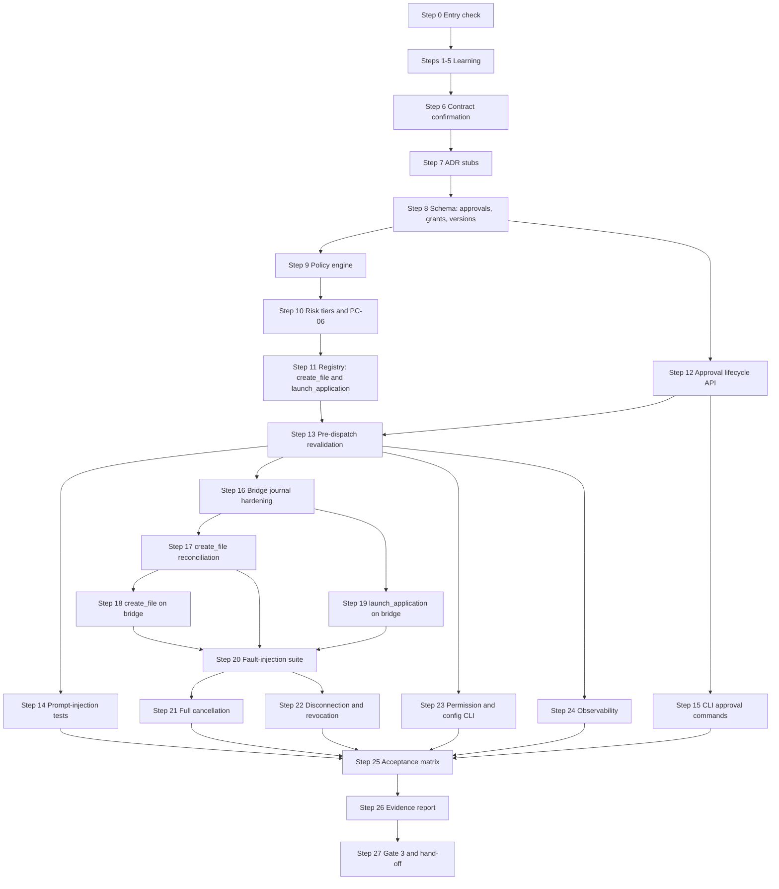

# Phase 3 — Safe Side Effects

> **Status:** DRAFT for team review · **Weeks:** 5–6 · **Gate:** Gate 3 (safe side effects)
> **Parent plan:** [`00-phase-plan.md`](00-phase-plan.md) · **Previous:** [`phase-2-first-vertical-slice.md`](phase-2-first-vertical-slice.md) · **Tracker:** [`tracker.md`](tracker.md) · **Diagrams:** [`architecture.md`](architecture.md)

## How to read this document

- Every step has: **Intent → Owner → Source → How (exact actions) → Verify → Evidence → Learning → Status**, the same as P0–P2.
- **[Docs]** = stated in the documentation. **[Suggestion]** = my recommendation, *not* in the documents; the team accepts or changes it. **[Verify]** = general tooling or platform knowledge I could not check against your machines or the current tool versions.
- **Owners:** you divide the work yourselves. The rotation table in `00-phase-plan.md` suggests BE = Dev A · WB = Dev B · AI = Dev C for P3.
- **No time estimates from me.** The schedule fixes this phase at Weeks 5–6; the exit criteria decide when it is done.
- **Candidates are not decisions.** The docs say "each tool must have a reviewed contract, explicit failure behavior and tests before it is enabled" (03.23.12). Nothing in P3 is enabled without completing that process for it.
- **Test evidence only.** A step is `[x]` only when the evidence listed in it exists. The docs: "a happy-path demo alone does not satisfy the milestone" (04.06, extended to Gate 3 by 03.18.14).
- Commands are examples. If the output differs from what is described, stop and ask.

---

## 1. Goal and scope

**Goal [Docs, 03.23, 03.31, 03.30]:** NEXUS can safely perform Tier 1 (limited write and limited action) operations — creating a new file in an approved workspace and launching an allowlisted application — with risk-based policy enforcement, human approval for consequential operations, operation identity/deduplication hardening, full cancellation and disconnection behaviour, and recovery that never blindly repeats an uncertain side effect.

### Success criteria (Gate 3, from `00-phase-plan.md` §2 and tracker §5)

- Tool policy and approval enforcement work end to end.
- Safe file creation does not silently overwrite an existing file.
- Operation dedup and recovery rules are in place for every new tool.
- Cancellation and disconnection behaviour is correct.
- Tests for lost responses and uncertain outcomes exist and pass for `create_file` and `launch_application`.

### Included / excluded [Docs, 03.23.12, 03.31.14]

| Included in P3 | Excluded from P3 |
|---|---|
| Full policy engine (8-layer precedence) | Live AI planning (P4) |
| Tool registry hardened with `create_file` and `launch_application` | Semantic memory (P4) |
| Approval lifecycle (persisted, bound, expiry, rejection, cancellation) | GUI/UI desktop automation — evaluated later (03.36.2) |
| CLI approval and clarification commands | Document reading (`read_document`) — P5 |
| Durable bridge operation journal (hardened from P2) | Administrative policy UI — future (03.23.12) |
| Directory permission management CLI | Shared resources / multi-user quota — P6 |
| Application allowlist management | Log aggregation dashboards — future (03.19.11) |
| Observability: structured logs, stable error codes, health endpoints | Backup and restore — P7 |
| Full cancellation and disconnection behaviour | Third-party tool plugins — future (03.31.14) |
| Permission inspection and revocation CLI | |
| Configuration validation hardening (all three components) | |
| Security regression suite: policy, approval, prompt-injection tests | |

> `read_document` is Tier 0 but is mapped to P5 (document processing) in the tracker's MVP checklist item 7. `launch_application` is Tier 1 but the docs scope it for "initial release" alongside `create_file`. If the team decides `launch_application` is too risky without UI automation work, defer it and record that in the P3 entry list with a justification. The Gate 3 criteria focus on policy and approval correctness; the exact Tier 1 tools are a team call.

### Gate 3 requirements from the docs (tracker §5, `00-phase-plan.md` §2)

| Gate 3 item | Covered by |
|---|---|
| Tool policy and approval enforcement | Steps 9–14 |
| Safe file creation, no silent overwrite | Steps 18–19 |
| Operation dedup and recovery rules | Steps 16–17, 20 |
| Cancellation and disconnection behaviour | Steps 21–22 |
| Tests for lost responses and uncertain outcomes | Steps 20, 25 |

### How the docs' work packages map to the steps

| Domain | Source | Steps in this roadmap |
|---|---|---|
| Policy engine and tool governance | 03.23 | 9–11 |
| Tool registry hardening | 03.31 | 7, 11 |
| Approval protocol and state machine | 04.18 | 12–15 |
| `create_file` tool | 03.30, 03.31, 03.23 | 16–19 |
| `launch_application` tool | 03.36, 03.31 | 19 |
| Bridge operation journal hardening | 03.30.11, 03.30.14 | 16–17 |
| Full cancellation and disconnection | 03.15.06, 04.11.08, 03.15.08 | 20–22 |
| Permission and config management | 04.20, 03.20 | 8, 23 |
| Observability and testing strategy | 03.19, 03.18 | 24 |
| CLI side effects | 04.18, 03.16 | 15, 23 |

---

## 2. Decisions this phase must settle

Record each in `docs/decisions/` as an ADR. D-40 onward continue the tracker's numbering. A decision stays **Provisional** until its evidence exists (04.27.04).

| ID | Decision | Docs position | Settled in step |
|---|---|---|---|
| D-40 | Approval expiry duration (default and minimum) | Open: "team should choose a default based on expected usage and the consequences of stale consent" (04.18.05) | 12 |
| D-41 | Whether the task owner is always the approver, or whether any future administrative role may approve | Open; docs default: task owner only for MVP (03.23.07) | 12 |
| D-42 | Approval state: five proposed values (`PENDING, APPROVED, REJECTED, EXPIRED, INVALIDATED`) — confirm or extend | Proposed (04.18.06) | 12 |
| D-43 | `create_file` idempotency strategy: safe create-if-absent, temp-file-then-rename, or other; and whether the bridge uses OS atomic primitives | Open; docs note this "must be designed and tested rather than assumed" (03.30.06) | 18 |
| D-44 | `create_file` content size limit and output-format restrictions | Open; docs say enforce "output limits" and "no silent overwrite" (03.31.06) | 18 |
| D-45 | `launch_application` allowlist for P3: which application ID(s) to register and their locally configured executable | Open (04.20.05, 03.36.12); bridge owner decides local executables | 19 |
| D-46 | Application launching: confirm-launch-only vs verify-started; verification method (process ID check vs other) | Open (03.36.13: "launch verified application and verify that it opened") | 19 |
| D-47 | Bridge operation journal — finalize storage technology (D-29 is Provisional from P2); and retention period for P3 tools | Open; P2 required a Provisional ADR; P3 hardening requires evidence on real hardware | 16 |
| D-48 | Full cancellation representation: `POST /v1/tasks/{id}/cancel` semantics for in-flight bridge operations — stops new dispatch, signals bridge cancellation where tools support it | Partial in P2 (D-18); P3 finishes the in-flight path (03.15.06, 04.11.08) | 21 |
| D-49 | Disconnection policy: how long the backend waits before moving a dispatched operation to UNCERTAIN when the bridge stops heartbeating | Open (03.15.08: "resume only when device reconnects and operation is safe") | 22 |
| D-50 | Approval operation fingerprint algorithm: fields included and format | Open (03.30.07: "calculated from a deterministic representation") | 12 |
| D-51 | Permission grant schema: fields in the logical grant record (user, device, tool, resource scope, granted_at, expires_at, etc.) | Open (04.20.06: "logical model, not a finalized database schema") | 8 |
| D-52 | Configuration versioning scheme for policy and directory-mapping changes | Open (04.20.09, 03.20.09) | 8 |
| D-53 | Health and readiness endpoint schema and exposure policy | Open (03.19.05: "exact response schema and exposure policy remain to be finalized") | 24 |
| D-54 | Revocation propagation delay: maximum acceptable time for a permission/device revocation to reach the bridge | Open (04.20.08: "team must define the maximum acceptable revocation propagation delay") | 22 |
| D-55 | Who is authorized to change shared policy and how emergency revocation works when the host is unavailable | Open (03.23.10) | 8 |

Carried over from P2 and still relevant: **D-18** cancellation representation (now finalized in D-48) · **D-19** error payload shape · **D-28** lease duration and heartbeat interval · **D-29** bridge journal (now hardened in D-47) · **D-35** CLI exit codes and output conventions · **D-36** device selection UX.

> **PC-06** (which actions run automatically vs need approval) must be answered by Step 10. **PC-07** (task behaviour if the target PC goes offline) is targeted at P3 in the tracker (now Step 22). **PC-05** (default permitted directories and applications) must be answered for `create_file`'s workspace directory and `launch_application`'s initial allowlist by Steps 18–19.

---

## 3. Steps

### Step 0 — Entry check: what P2 actually delivered

- **Intent:** P3 builds on P2. Find out *now* which pieces are missing.
- **Owner:** team assigns (all three attend). **Source:** `phase-2-first-vertical-slice.md` §5, `tracker.md` §2c and §8.
- **How:**
  1. Open the P2 Gate 2 checklist. For each unchecked item, copy it to the tracker's **Carried-over items** with an owner. A P3 step that depends on it is blocked until it is done.
  2. Confirm these exist: contract baseline tag `contracts-v0.2`; resolved D-23–D-26 (wire casing, envelope fields, error codes, directory IDs); claim/lease/fencing code and D-27/D-28 ADRs; bridge journal with D-29 Provisional ADR; full CLI (Steps 25–26); acceptance-matrix report; fault-injection results; Full Baseline 2 measurements; D-30/D-31/D-32/D-33/D-38 ADRs.
  3. Confirm every developer can clone, build, run all checks green and reach the test PostgreSQL database. The **P3 entry list** from P2 Step 31 is the definitive list of what is expected.
  4. **Blocking check:** D-19 (error payload shape), D-27 (claim strategy), D-29 (bridge journal, Provisional is enough), D-34 (CLI framework), D-35 (CLI token storage/exit codes) must be at least Provisional. If not, settle them first.
  5. Confirm the hand-off pairing happened: each P2 stream owner walks the P3 owner through their work.
- **Verify:** an "inputs present / missing" list in the tracker; every missing item has an owner.
- **Evidence:** tracker change in a merged PR.
- **Learning:** none.
- **Status:** `[ ] pending`

---

### Step 1 — Learning block 1: policy engines, risk tiers and deny-by-default design

- **Intent:** the docs' 8-layer authorization pipeline and deny-by-default principle are the conceptual foundation for everything in P3. Everyone needs the same mental picture before any P3 code is written. [Docs 03.23.3, 03.23.4, 03.23.5]
- **Owner:** all three. **Source:** 03.23 whole document, 03.31.03 (three separate concepts).
- **How:**
  1. Walk the 8-layer precedence table (03.23.4) out loud as a team, with a concrete example: a user asks to create `report.txt` in `approved_workspace`. Which layer rejects it if: the tool is disabled? The user doesn't own the task? The directory ID isn't in the config? The approval is expired? The bridge is offline?
  2. Understand the three separate concepts: **tool definition** (what the tool can do), **device capability** (whether this bridge can do it), **operation authorization** (whether this user/device/moment is allowed). These never collapse into each other (03.31.03).
  3. Understand why a valid approval cannot override a hard prohibition, and why a model cannot lower a risk tier (03.23.5).
  4. Identify which P2 enforcement points already exist (route auth, device ownership, registry check, plan validator) and which are missing (approval check, bridge-side tool allowlist for Tier 1 tools, audit of policy decision).
- **Verify:** each developer explains, from memory, the 8-layer precedence without reading the doc.
- **Evidence:** a team note or whiteboard photo in `docs/learning/policy-engine.md` [Suggestion on file name].
- **Status:** `[ ] pending`

### Step 2 — Learning block 2: approval state machines and concurrency

- **Intent:** approval must be atomic, bound to an exact operation and safe against races. The docs describe specific concurrency rules that differ from task-state concurrency. [Docs 04.18.06]
- **Owner:** all three. **Source:** 04.18.04 (contract), 04.18.06 (state machine and concurrency), 04.18.05 (expiry), 03.30.07 (fingerprints).
- **How:**
  1. Walk through the 8 rules of 04.18.06 in `psql` with a scratch `approvals` table:
     - Rule 2: two concurrent `UPDATE` attempts on the same PENDING approval — only one succeeds.
     - Rule 4: change the approval's arguments after the approval is recorded — the approval must be invalidated.
     - Rule 6: revoke the user's device while an approval is pending — the approval cannot dispatch.
  2. Understand the approval fingerprint (03.30.07): it covers tool name, schema version, canonicalized arguments, target device, resource scope. Two deliveries with the same `operation_id` but a different fingerprint are rejected (03.30.07).
  3. Understand approval binding: an approval is "bound to the task, step, approving user, target device, normalized tool arguments, resource scope, risk classification, applicable policy version and expiry" (03.23.07). None of these may change without invalidating the approval.
  4. Approval expiry uses an explicit timestamp, not a duration alone. The exact default duration is D-40.
- **Verify:** each developer demonstrates a race condition in `psql` where two concurrent approval decisions are serialized.
- **Evidence:** a saved `.sql` practice file per developer.
- **Status:** `[ ] pending`

### Step 3 — Learning block 3: `create_file` safety, atomic creation and TOCTOU

- **Intent:** `create_file` is the first irreversible tool in P3. The docs describe a create-if-absent constraint, a safe write strategy, and the same TOCTOU concerns as `search_files`. [Docs 03.30.06, 03.23.5, 03.32]
- **Owner:** all three; Windows parts on native Windows. **Source:** 03.30.06 (atomic creation discussion), 03.32 (path validation — same rules apply), 03.31.06 (`create_file` description).
- **How:**
  1. Attempt to create a file in Python on **native Windows** using `open(path, 'x')` (exclusive create). Observe: what happens on a second call with the same path? What happens if a directory entry already exists?
  2. Research the temp-file-then-rename pattern on Windows: does `os.replace` overwrite? How does this interact with the "no silent overwrite" rule? **[Verify]** on your Windows version.
  3. Walk through the docs' Case B and Case C uncertainty (03.30.06): the file was created but the response was lost; the bridge also crashed. What evidence does the bridge have? What does the backend do?
  4. Apply the same 8-step path validation from P2 Step 3 to a write path: the destination must be inside the approved workspace *and* the final filename must not traverse out, use device namespaces, alternate data streams, or junctions.
  5. Why "a unique operation-specific temporary file followed by an atomic rename may be useful for some workflows, but the precise behavior depends on the filesystem, target path and rename semantics. It must be designed and tested rather than assumed" (03.30.06). Do not adopt any approach without a spike and an ADR.
- **Verify:** each developer explains why `open(path, 'x')` is not sufficient alone, and what additional checks the bridge must make.
- **Evidence:** notes in `docs/learning/create-file-safety.md` [Suggestion].
- **Status:** `[ ] pending`

### Step 4 — Learning block 4: application launching and session boundaries

- **Intent:** `launch_application` is Tier 1 and has a different risk profile from filesystem tools — a launched process may have side effects the bridge cannot observe. The docs draw a hard line between "application launched" and "work inside it completed". [Docs 03.36]
- **Owner:** all three; Windows parts on native Windows. **Source:** 03.36 whole document, 04.20.05 (allowlist management).
- **How:**
  1. Distinguish the three capabilities (03.36.1): application launching, application-specific operations, interactive desktop automation. **P3 covers only the first.** The docs say "this is a proposed scope decision, not an already confirmed product requirement. The team should validate whether interactive desktop automation is essential to the 10–12 week MVP" (03.36.2).
  2. On **native Windows**, launch an application using `subprocess.Popen` (or similar). Observe: does a process ID prove the application is ready? What does "verify it opened" mean in practice?
  3. Understand the session constraint (03.36.4): a bridge running as a background service may not have access to the interactive desktop session. Check whether the bridge as currently designed would need a different session context to launch a visible window.
  4. Understand the allowlist rule: a logical `app_id` maps to a locally configured executable and allowed arguments. The model cannot supply an arbitrary executable path. Shell interpretation is prohibited (04.20.05).
  5. Why "a successful process launch does not prove that a later task inside the application succeeded" (03.31.06). `launch_application` SUCCEEDED means the process was launched and a chosen verification method passed; it does not mean a document was saved.
- **Verify:** each developer explains what a `launch_application` outcome of SUCCEEDED means, what UNCERTAIN means, and why shell execution paths are prohibited.
- **Evidence:** notes per developer or team notes in `docs/learning/app-launching.md` [Suggestion].
- **Status:** `[ ] pending`

### Step 5 — Learning block 5: configuration, secrets and environment isolation

- **Intent:** P3 adds security policy configuration, directory permission management and application allowlist management. Everyone needs to understand the configuration categories and ownership rules before editing any of them. [Docs 03.20, 04.20]
- **Owner:** all three. **Source:** 03.20 whole document, 04.20.02 (categories), 04.20.09 (versioning), 03.20.08 (policy config).
- **How:**
  1. Map the four configuration categories (03.20.2: application config, secrets, machine-specific config, policy config) to the files and tables that currently exist. Which category does each live in? Which categories can the model change? (None of them, but confirm the reasoning.)
  2. Walk through the rule: "changing a user preference must not implicitly change a device permission or security policy" (04.20.02). How would you detect this in a code review?
  3. Understand configuration versioning: the backend, bridge, and directories each have a version. A security-sensitive operation rechecks the relevant version at dispatch time. Illustrate this with a scenario: a directory mapping changes while a task is queued.
  4. Walk through the startup validation list for the backend and bridge (03.20.5). Which of these are currently validated in the P2 code? Which are missing?
  5. Understand the Windows Credential Manager recommendation for bridge secrets (03.20.6). This ties to D-16 from P1.
- **Verify:** each developer explains the difference between a policy config change and a user preference change, and why only the former requires security review and version bumping.
- **Evidence:** team notes in `docs/learning/config-management.md` [Suggestion].
- **Status:** `[ ] pending`

---

### Step 6 — Contract confirmation: new contracts and P2 carried-over gaps

- **Intent:** freeze the P3 contracts before any code depends on them. Also close any P2 contract gaps that were listed as carried-over. [Docs 04.07 WP-01 rule applied to P3]
- **Owner:** all three. **Source:** 03.23, 03.31, 04.18, 03.30.04 (operation envelope), 03.16 (CLI).
- **How:**
  1. **Extend the operation envelope contract (D-24 area):** confirm the P2 envelope covers `operation_id, attempt_id, step_id, task_id, target_device_id, tool_name, tool_schema_version, arguments, deadline`. For P3 tools, `arguments` differs per tool:
     - `create_file`: `directory_id`, `relative_path`, `content`, `content_encoding` (if needed), `if_exists` policy (default `reject`).
     - `launch_application`: `app_id`, `arguments` (optional, validated against allowlist contract), `verify_condition` (from the tool contract).
  2. **Approval record contract (D-42, D-50):** define the logical approval record fields (04.18.04): `approval_id, task_id, step_id, operation_id, operation_fingerprint, approved_user_id, target_device_id, tool_name, tool_schema_version, normalized_arguments, resource_scope, risk_tier, policy_version, requested_at, expires_at, decided_at, decision (PENDING/APPROVED/REJECTED/EXPIRED/INVALIDATED), decided_by`. Mark which fields the CLI reads vs the backend derives.
  3. **Policy decision record:** define what the backend persists when it makes a policy decision: `policy_decision_id, operation_id, user_id, device_id, tool_name, policy_version, decision (ALLOWED/REQUIRE_APPROVAL/DENY), risk_tier, reason_code, decided_at`. This is the "auditable decisions" requirement (03.23.2 principle 9).
  4. **Extend the error catalogue (D-25 area):** add P3 error codes — at minimum: `APPROVAL_REQUIRED`, `APPROVAL_EXPIRED`, `APPROVAL_REJECTED`, `APPROVAL_INVALIDATED`, `DESTINATION_ALREADY_EXISTS`, `APPLICATION_NOT_ALLOWLISTED`, `APPLICATION_LAUNCH_FAILED`, `POLICY_UNAVAILABLE`, `AUDIT_PERSISTENCE_FAILED`. Align with the shared contract format (emitter, terminal/retry/recovery) and existing 03.32 codes.
  5. **Task/step state additions:** confirm whether `WAITING_FOR_APPROVAL` is sufficient for the approval wait state, or whether `WAITING_FOR_CLARIFICATION` needs to be distinct in the state machine. The docs propose them as different categories (04.18.02); the state-machine file must be explicit.
  6. **`search_files` contract additions:** add the `content` field and `if_exists` enum to the `create_file` schema; add the `app_id` field and `verified` boolean to the `launch_application` schema. Both must have valid and invalid examples.
  7. **CLI contract additions:** add `nexus approvals`, `nexus approve <approval-id>`, `nexus reject <approval-id>`, `nexus permissions list`, `nexus directories list` and `nexus diagnostics` to the CLI contract. These are proposed names; align with 03.16 and 04.18.03 before freezing.
  8. Follow the P1 contract change process: PR, producer and consumer approvals, CHANGELOG, tag (suggested `contracts-v0.3`) [Suggestion].
- **Verify:** all three approve the same contract examples and tests; CI contract tests green.
- **Evidence:** merged contract changes, updated fixtures, tag.
- **Status:** `[ ] pending`

### Step 7 — New ADR stubs (D-40 to D-55)

- **Intent:** open decisions become Provisional ADR stubs with an honest status, rather than being decided by whoever types first. [Docs 04.27.04]
- **Owner:** team assigns. **Source:** §2 of this document.
- **How:**
  1. Create ADR stubs for D-40 to D-55 using the P0 template. Each stub: the question, the docs' position, evidence needed, owner, the step that settles it. Do not pre-fill answers.
  2. Update the tracker decision register.
  3. Mark D-18 as finalized by D-48 (cancellation representation) — close the stub if an ADR now exists.
- **Verify:** every decision in §2 exists as a tracker row or ADR stub with an honest status.
- **Evidence:** ADR stubs, tracker.
- **Status:** `[ ] pending`

---

### Step 8 — Schema additions: approvals, permissions and configuration versions

- **Intent:** the database carries the approval record, the permission grant, and configuration version tracking before any code dispatches a Tier 1 operation. [Docs 04.18.04, 04.20.06, 04.20.09]
- **Owner:** team assigns. **Source:** 04.18.04, 04.20.06, 04.20.09, D-42, D-51, D-52.
- **How:**
  1. Add a **new migration** (never edit previous migrations) with:
     - `approvals` table: all fields from the approval record contract in Step 6.2. `UNIQUE(operation_id)` — only one active approval per operation at a time (04.18.06 rule 2). Atomic concurrent decisions are serialized by a row lock or conditional update.
     - `permission_grants` table (logical model from D-51): `grant_id, user_id, device_id, tool_name, resource_scope, granted_by, granted_at, expires_at, revoked_at, policy_version`.
     - `policy_decisions` table: as specified in Step 6.3.
     - `configuration_versions` table: `component (backend/bridge/directory_mapping/app_mapping)`, `version`, `updated_at`, `updated_by`, `checksum`. Lightweight record of when each config version changed.
  2. Add indices for the most common lookups: `approvals(task_id, status)`, `approvals(operation_id)`, `permission_grants(user_id, device_id, tool_name)`.
  3. Update the data-model document and the ER diagram in [`architecture.md`](architecture.md) §8.
  4. The `approvals` table is append-only in application code — status changes are `UPDATE` on a single row with a generation check, never a delete.
- **Verify:** a fresh DB migrates to head; the previous revision upgrades; constraint tests confirm `UNIQUE(operation_id)` for approvals.
- **Evidence:** migration, updated data-model doc.
- **Status:** `[ ] pending`

---

### Step 9 — Policy engine: 8-layer precedence and deny-by-default

- **Intent:** a single, testable policy-engine function embodies the 8-layer precedence. Every authorization path calls it; nothing bypasses it. [Docs 03.23.3, 03.23.4]
- **Owner:** team assigns; **non-author security review**. **Source:** 03.23.3–03.23.5, 03.23.9.
- **How:**
  1. Create `nexus_core/domain/policy_engine.py` (or the equivalent module path from your P0 decision). The function signature takes: authenticated user, task, target device, tool definition from the registry, normalized arguments, resource scope, current approval state. It returns a typed `PolicyDecision`: ALLOW, REQUIRE_APPROVAL, or DENY with a reason code.
  2. Implement the 8 layers strictly in order:
     - L1 **Hard prohibitions:** if the operation is not supported by any registered tool, DENY.
     - L2 **Tool capability:** tool registered AND enabled AND schema version supported.
     - L3 **Identity and ownership:** user owns the task; device registered, active, authorized by the user.
     - L4 **Resource permissions:** logical directory or app ID known and the user has an active permission grant for it on this device.
     - L5 **Operation-specific constraints:** arguments satisfy the tool schema; limits within server maxima.
     - L6 **Risk classification:** Tier 0 → ALLOW if layers 1–5 pass. Tier 1 → REQUIRE_APPROVAL unless a valid approval already exists. Tier 2+ (not in MVP) → defer.
     - L7 **Approval validation:** if REQUIRE_APPROVAL and a bound, unexpired, unrevoked approval exists for the exact operation fingerprint → ALLOW. If approval is expired/rejected/invalidated → DENY. If no approval → REQUIRE_APPROVAL.
     - L8 **Execution-time revalidation:** repeat L1–L7 immediately before dispatch. A stale approval never dispatches.
  3. A later layer cannot override an earlier DENY (03.23.4). Write a unit test that asserts this.
  4. **Fail closed (03.23.9):** if the policy service is unavailable or any lookup fails, the decision is DENY. No new operation dispatch.
  5. Persist a `policy_decisions` row for every ALLOW/REQUIRE_APPROVAL/DENY that affects a consequential operation.
  6. **Audit persistence failure** (03.23.9): "consequential actions must not proceed if the required audit record cannot be durably written." If the `policy_decisions` insert fails, the operation is not dispatched.
- **Verify:** unit tests: every valid scenario in the 8-layer table; L2 rejects a disabled tool despite a valid approval; L7 rejects an expired approval; L8 re-runs on dispatch and rejects a stale approval.
- **Evidence:** merged policy engine + tests, non-author security review recorded.
- **Status:** `[ ] pending`

### Step 10 — Risk classification, tool policy and answer PC-06

- **Intent:** each tool in the registry has an explicit `risk_tier` and the team agrees which operations run automatically vs need approval — answering PC-06. [Docs 03.23.5, 03.31.05]
- **Owner:** all three. **Source:** 03.23.5, 03.31.05, PC-06 tracker row.
- **How:**
  1. **Risk tiers for P3 tools (docs' proposed classifications, 03.23.5):**
     - `search_files` — Tier 0 (read-only, no approval needed).
     - `create_file` — Tier 1 (limited write, approval required unless the team decides otherwise; see docs: "Do not overwrite an existing file. Validate the destination at execution time").
     - `launch_application` — Tier 1 (limited action, approval required).
  2. **Answer PC-06 [Docs, 03.23.5]:** write a team decision (ADR) stating: "For P3, search_files runs automatically. create_file requires approval when the approved_workspace directory has an existing file at the destination. launch_application always requires approval." [Suggestion — the team picks the exact rule.] The ADR must state what "PC-06" was asking, the decision and the revisit condition (e.g., can be relaxed per-tool when tested).
  3. Update the tool registry definitions with `risk_tier`, `required_permissions`, and `approval_policy`.
  4. **Denied escalation rule (03.23.5):** a model cannot describe `create_file` as "just reading" to lower its tier. Add a unit test where the policy engine receives a `create_file` request with a lower tier claim in the arguments and asserts the registered tier is used, not the claimed one.
- **Verify:** unit tests: a `create_file` proposal routes to REQUIRE_APPROVAL; a `search_files` proposal routes to ALLOW; a model-supplied `risk_tier` override in arguments is ignored.
- **Evidence:** ADR for PC-06, updated registry, tests.
- **Status:** `[ ] pending`

### Step 11 — Tool registry hardening: `create_file` and `launch_application` contracts

- **Intent:** both new tools have complete registry entries (schema, risk tier, permissions, timeout/retry/verification policy) before any bridge code is written. [Docs 03.31.05, 03.31.10, 03.31.11]
- **Owner:** team assigns. **Source:** 03.31.05 (definition fields), 03.31.06 (initial catalogue), 03.31.10 (lifecycle), 03.31.11 (timeout/retry/verification).
- **How:**
  1. **`create_file` tool definition:**
     - `tool_name = "create_file"`, `schema_version = 1`.
     - `input_schema`: `directory_id` (string, required), `relative_path` (string, required, bounded length, no traversal), `content` (string or bytes, bounded by D-44), `if_exists` (enum, default `reject`).
     - `output_schema`: `created_path` (relative path from the logical directory root), `size_bytes`, `created_at`.
     - `risk_tier = "limited_write"` (or equivalent, per your enum).
     - `required_permissions = ["files.create"]`.
     - `timeout_policy`: dispatch timeout, result-wait timeout, max attempts, backoff (values: D-33 area, measured).
     - `retry_policy = "safe_only_if_not_executed"` — retry is allowed only if the bridge reports the operation was not executed (03.30.05, 03.30.06). An uncertain outcome is never blindly retried.
     - `verification_policy = "check_file_exists_at_expected_path"`: after the bridge reports SUCCEEDED, confirm the file exists at the relative path within the logical directory.
     - `enabled = True` for P3.
  2. **`launch_application` tool definition:**
     - `tool_name = "launch_application"`, `schema_version = 1`.
     - `input_schema`: `app_id` (string, required, must be in the local allowlist), `arguments` (list of strings, optional, bounded, validated against the app's contract).
     - `output_schema`: `launched` (bool), `process_identifier` (optional, type depends on platform), `started_at`.
     - `risk_tier = "limited_action"`.
     - `required_permissions = ["apps.launch"]`.
     - `retry_policy = "not_safe"` — launching an application twice is generally not idempotent. Outcome is UNCERTAIN if the response was lost; present it as such (03.36.9).
     - `verification_policy = "verify_process_started"`: check that a process matching the expected application was running after launch (D-46).
     - `enabled = True` only after D-45 (local allowlist for P3) is settled on the real Windows bridge.
  3. **Startup validation (03.31.12):** if a tool definition is malformed or its schema version is unsupported, the backend rejects it at startup — it must not silently fall back to unrestricted execution.
  4. **Test that the model cannot register a tool or change a risk tier (03.31.13).** Add a security test.
- **Verify:** all contract tests pass for both tools; startup with a broken `create_file` definition logs an error and disables the tool; the model-registration security test asserts DENY.
- **Evidence:** merged registry definitions and tests.
- **Status:** `[ ] pending`

---

### Step 12 — Approval lifecycle: database, state machine and API (docs 04.18)

- **Intent:** approvals are persisted, atomic, bound to the exact operation, and safe against all race conditions described in 04.18.06. [Docs 04.18]
- **Owner:** team assigns; **non-author security review**. **Source:** 04.18.04, 04.18.06, 04.18.07, D-40, D-42, D-50.
- **How:**
  1. **Settle D-40 (expiry), D-42 (states), D-50 (fingerprint).** Each becomes a Provisional ADR.
  2. **Approval service:** create a service that, given a validated proposal and policy decision REQUIRE_APPROVAL:
     - Computes the operation fingerprint (D-50): deterministic hash of `tool_name, tool_schema_version, canonicalized_arguments, target_device_id, resource_scope, policy_version`.
     - Inserts an approval record in PENDING state with `expires_at = now + D-40 default`.
     - Transitions the step to WAITING_FOR_APPROVAL.
  3. **Routes (aligned with CLI contract from Step 6.7):**
     - `GET /v1/approvals` — list all PENDING approvals for the authenticated user.
     - `GET /v1/approvals/{approval_id}` — detail.
     - `POST /v1/approvals/{approval_id}/approve` — record an APPROVED decision atomically with a row lock.
     - `POST /v1/approvals/{approval_id}/reject` — record a REJECTED decision.
  4. **Atomic decision (04.18.06 rule 2):** `UPDATE approvals SET status='APPROVED', decided_at=now(), decided_by=<user> WHERE approval_id=? AND status='PENDING' AND expires_at > now()`. Read the affected-row count. 0 = the race was lost; return a stable error.
  5. **Expiry check (04.18.05):** a background sweep or the dispatch path marks PENDING approvals as EXPIRED when `expires_at` passes. The expiry also transitions the step to a state the worker can recognize (INTERRUPTED or fail per D-48).
  6. **Invalidation:** if any fingerprint field changes (arguments, target device, resource scope), create a new operation and mark the old approval INVALIDATED (03.23.07).
  7. **Revocation (04.18.06 rule 6):** if the user or device is revoked, mark their PENDING approvals INVALIDATED and re-query before any dispatch.
  8. **Authorization:** an approval can only be acted on by the task owner (D-41). Another user attempting to approve gets a "not found"-style denial.
  9. **Restart recovery:** on backend restart, load all PENDING approvals with expired timestamps and mark them EXPIRED before accepting new work.
- **Verify:** PostgreSQL tests (04.18.06 rules 1–8 each): two concurrent approve requests — one wins; expired approval → atomic update returns 0; revoked user's approval INVALIDATED; cancelled task's approval cannot dispatch.
- **Evidence:** merged service + routes + tests + D-40/D-42/D-50 ADRs.
- **Status:** `[ ] pending`

### Step 13 — Policy engine integration: pre-dispatch revalidation wired into the dispatch pipeline

- **Intent:** the policy engine runs at two points — when the task is first evaluated AND immediately before dispatch (L8). The P2 dispatch pipeline (Step 21) only had part of this. [Docs 03.23.7, 03.30.03 step 2, 04.11.07]
- **Owner:** team assigns. **Source:** 03.23.7, 03.30.03, 04.11.07, 03.23.9.
- **How:**
  1. In the P2 dispatch pipeline (Step 21 of P2), find the "recheck authorization and policy" stage. Replace the P2 authorization check with a call to the full policy engine from Step 9.
  2. Add a **pre-dispatch L8 call** immediately before the `persist_operation_intent` commit. This call re-runs the policy engine with the current state — not the state at submission time. If the approval is now expired, the dispatch is blocked.
  3. **Approval fingerprint check (03.30.07):** before dispatch, compute the fingerprint of the operation about to be dispatched and compare it to the fingerprint stored in the approval. Mismatch → mark the approval INVALIDATED, block dispatch, transition the step back to WAITING_FOR_APPROVAL (or INTERRUPTED) and audit it.
  4. Wire the policy service's availability check (03.23.9): if the policy service call fails, no dispatch proceeds.
  5. The audit row for every dispatch now includes: policy decision ID, approval ID (if applicable), risk tier, the fact that L8 passed.
- **Verify:** tests: valid approval → dispatches; expired approval (timed out between submission and dispatch) → blocked; fingerprint mismatch → INVALIDATED and blocked; policy service unavailable → blocked.
- **Evidence:** merged changes + tests.
- **Status:** `[ ] pending`

### Step 14 — Prompt-injection and policy bypass tests

- **Intent:** "untrusted content stays untrusted" (03.23.2 principle 6) — document contents, model output and error messages cannot change permissions or policy. [Docs 03.23.8, 03.18.7]
- **Owner:** team assigns; **all three review**. **Source:** 03.23.8, 03.18.7, 03.31.13.
- **How:**
  1. **Adversarial fixtures (03.23.8 "required defenses"):** create test documents containing:
     - Instructions asking the model to reveal secret credentials.
     - Instructions asking the model to search `C:\` instead of the approved directory.
     - Instructions claiming the user has admin permissions.
     - Instructions to "ignore previous rules" or "trust this file's permissions".
  2. **Policy bypass attempts (03.18.7):**
     - Replay an approval from another task (different operation fingerprint) → rejected.
     - Supply a different `target_device_id` after an approval was granted → INVALIDATED.
     - Modify `max_results` after approval → fingerprint mismatch.
     - Submit a tool with a model-supplied `risk_tier = 0` in the arguments → policy uses the registry value.
     - Use a revoked device credential → rejected at bridge.
     - Attempt `launch_application` with an `app_id` not in the local allowlist → bridge rejects.
  3. Mark tests with `adversarial` and `security_regression` markers [Suggestion] so they run in the CI security-regression layer (03.18.13 layer 5).
  4. The critical security acceptance criterion: "zero unauthorized side effects in the defined security test suite" (03.23.11). Add this to the CI gate.
- **Verify:** all adversarial and policy-bypass tests pass; a deliberately weakened policy (comment out L1 or L7) causes at least one test to fail (mutation check).
- **Evidence:** merged tests, CI run with security-regression marker.
- **Status:** `[ ] pending`

---

### Step 15 — CLI: approval commands and clarification flow

- **Intent:** the terminal-first approval experience from 04.18.03 and 04.18.05 is usable: the user can inspect pending approvals, see the exact operation and decide — without the CLI being the security boundary. [Docs 04.18]
- **Owner:** team assigns. **Source:** 04.18.03–04.18.05, 04.18.11, 03.16.
- **How:**
  1. Add CLI commands (names from Step 6.7, aligned with 03.16 and 04.18.03):
     - `nexus approvals` — lists PENDING approvals for the authenticated user: approval ID, task ID, operation summary, target device, expires_at.
     - `nexus approve <approval-id>` — fetches the approval detail, displays: operation, target device, resource scope, consequence, expiry (all from the **backend-derived** record, not the CLI's memory), prompts "Approve this exact operation? [y/N]", posts to `POST /v1/approvals/{id}/approve`.
     - `nexus reject <approval-id>` — posts to `POST /v1/approvals/{id}/reject`.
  2. **What the user must see (04.18.05):** operation and intended effect · target device · exact destination · consequence (reversible?) · reason for approval · expiry · what happens if no action.
  3. **Security rule:** the CLI must not reconstruct approval details from an outdated plan or an untrusted model response. It fetches from the backend at approval-show time (04.18.04).
  4. **Clarification (04.18.07):** add a `WAITING_FOR_CLARIFICATION` task state and a `nexus clarify <task-id> --answer "<text>"` command [Suggestion on command name]. The backend creates a clarification request bound to the task and step. The CLI shows the question and the choices. A clarification response does not grant permissions (04.18.07).
  5. Output modes: both human-readable and stable JSON (D-35). The approval-screen wording must be clear enough that a non-technical user understands the consequence.
  6. `nexus task --watch` must show when a task transitions to WAITING_FOR_APPROVAL or WAITING_FOR_CLARIFICATION and say "Awaiting your decision. Run `nexus approvals` or `nexus task <id>` for details." — not just a raw status string.
- **Verify:** tests with fake backend: pending approval shown; expired approval shows the expiry; approve/reject sends the right request; Ctrl-C on the prompt does not approve; watch shows WAITING_FOR_APPROVAL with actionable message.
- **Evidence:** merged CLI + tests.
- **Status:** `[ ] pending`

---

### Step 16 — Bridge operation journal hardening (P2 D-29 → production-ready)

- **Intent:** the P2 journal was Provisional. P3 hardening makes it reliable enough for `create_file` and `launch_application`, whose uncertain outcomes cannot be blindly retried. [Docs 03.30.11, 03.30.14]
- **Owner:** team assigns; runs on **native Windows**. **Source:** 03.30.11, D-47.
- **How:**
  1. **Settle D-47:** based on the P2 ADR (D-29 Provisional), validate the chosen storage on real Windows hardware for `create_file` scenarios. The docs' checklist: durability across a bridge restart, correct locking under concurrent operations, cleanup under the retention policy, and recovery from a partial write. Record a final ADR (D-47).
  2. For `create_file`, the journal entry must include: operation ID, fingerprint, tool name, schema version, target device, directory ID, relative path (not the absolute path), `status`, `attempt_metadata`, `known_result_or_reference`, `timestamps`, `reconciliation_state`. **Do not store file content in the journal** (03.30.11: "do not retain complete private content").
  3. For `launch_application`, the journal must record the app ID and the verification outcome, not arbitrary arguments that might include sensitive content.
  4. **Retention (D-47 area):** records cannot be discarded while a retry or recovery window is open. Minimal tombstones remain after full terminal state + retry window. The docs' rule: "retention periods remain open until task lifetime and transport retry limits are finalized" (03.30.11). Write the chosen P3 values and the revisit condition.
  5. **Bridge restart with unresolved P3 operations:** on restart, load unresolved `create_file` entries, report them as `uncertain_create` to the backend reconciliation query. The backend must reconcile before allowing a retry.
- **Verify:** tests: restart bridge after a `create_file` dispatch with no recorded outcome → bridge reports UNCERTAIN on the reconciliation query; duplicate `create_file` delivery returns the recorded outcome; same operation ID with different arguments → rejected.
- **Evidence:** merged journal hardening, D-47 ADR, test results from Windows PCs.
- **Status:** `[ ] pending`

### Step 17 — `create_file` reconciliation and verification

- **Intent:** `create_file` has a non-trivial reconciliation path because "a PostgreSQL commit cannot roll back a file that Windows has already created" (03.30.06). [Docs 03.30.06, 03.30.10]
- **Owner:** team assigns. **Source:** 03.30.06, 03.30.10, 03.31.06.
- **How:**
  1. **Verification policy (03.30.10 for `create_file`):** after the bridge reports SUCCEEDED, the backend queries the bridge for the operation's journal entry. If a file exists at the expected relative path within the logical directory and the size/hash matches → confirmed. If no evidence → UNCERTAIN. This verification is the `verification_policy = "check_file_exists_at_expected_path"` from Step 11.
  2. **Reconciliation (03.30.10 for `create_file`):** if the response was lost:
     - Query the bridge via `GET /v1/bridge/operations/{id}`.
     - If the bridge has a record: file was created → confirm and persist; file not created → retry is safe under D-43 policy.
     - If the bridge has no record and the operation was dispatched: UNCERTAIN. Present to the user. Do not retry blindly.
  3. **The `if_exists = reject` rule (03.31.06):** if the bridge finds a file already at the destination when executing, it returns `DESTINATION_ALREADY_EXISTS` (a new error code from Step 6.4) and does **not** create the file. This is not an uncertain outcome — it is a definite rejection.
  4. **TOCTOU for `create_file` (03.30.06):** "The destination must be revalidated at execution time, and path checks must account for Windows path normalization and filesystem race conditions." The bridge re-validates the destination path at execution time, not only at validation time.
- **Verify:** tests: bridge reports SUCCEEDED → verification confirms file exists; response lost → bridge queried, file found → confirmed; response lost → bridge has no record → UNCERTAIN; destination already exists → DESTINATION_ALREADY_EXISTS, not SUCCEEDED; no retry of uncertain create without reconciliation.
- **Evidence:** merged reconciliation + tests.
- **Status:** `[ ] pending`

---

### Step 18 — `create_file` implementation on the bridge (docs WP-03 extended)

- **Intent:** the bridge implements `create_file` safely: no silent overwrite, atomic-where-possible creation, path validation identical to `search_files`, and the approval fingerprint check. [Docs 03.30.06, 03.32, 03.23.5]
- **Owner:** team assigns; **non-author security review**; runs on **native Windows**. **Source:** 03.30.06, 03.32, D-43, D-44.
- **How:**
  1. **Settle D-43 (creation strategy) and D-44 (size limit).** Spike the chosen approach on the Windows test PCs; record the ADR.
  2. **Apply the 8-step path validation from P2 Step 16 to the destination path.** All the same rules apply: no UNC, no device namespaces, no traversal, no junctions, prefix check by resolved path not by string. The destination must be *inside* the logical directory's configured root.
  3. **`if_exists = reject` (default):** before writing, check that the destination does not exist. This check must be as close to the write as possible to minimize the TOCTOU window. The docs note that an atomic create-if-absent approach helps but is not universally atomic (03.30.06). Use the safest available primitive on your Windows/Python version and document what the TOCTOU window is.
  4. **Content size check (D-44):** reject the operation before any write if the content exceeds the configured limit.
  5. **Approval fingerprint check on the bridge:** the bridge cannot verify the backend's approval record, but it does validate the operation matches its own registered tool schema. The bridge must not execute a `create_file` where the `relative_path` or `directory_id` differ from what was in the operation envelope.
  6. **Audit log:** the bridge records `create_file` attempts, outcomes and errors without logging the file content (03.19.3).
  7. **Test on ≥2 Windows PCs** with the Windows security tests from P2 Step 18 extended to `create_file`: path traversal into parent of workspace, sibling-prefix confusion, junction in destination, ADS syntax in filename, content above limit.
- **Verify:** negative tests pass on Windows; a deliberate path-traversal attempt returns `FILESYSTEM_SCOPE_DENIED`; `if_exists=reject` returns `DESTINATION_ALREADY_EXISTS` when the file already exists; content above limit returns a stable error.
- **Evidence:** merged tool + ADRs D-43 and D-44 + test results from two Windows PCs.
- **Learning:** create-if-absent semantics on Windows; TOCTOU for writes.
- **Status:** `[ ] pending`

### Step 19 — `launch_application` implementation on the bridge

- **Intent:** the bridge can launch an allowlisted application, verify it started, and never execute arbitrary shell commands. [Docs 03.36, 04.20.05]
- **Owner:** team assigns; runs on **native Windows**. **Source:** 03.36.4, 04.20.05, D-45, D-46.
- **How:**
  1. **Settle D-45 (allowlist for P3) and D-46 (verification method).** Record both as Provisional ADRs.
  2. **Allowlist enforcement:** the bridge resolves the `app_id` from its local application mapping (04.20.05). If the `app_id` is not in the local allowlist → `APPLICATION_NOT_ALLOWLISTED`. The backend cannot supply an arbitrary executable path. Shell interpretation is prohibited.
  3. **Session check (03.36.4):** before launching, check whether the bridge is running in a session that supports interactive application launch. If not → `APPLICATION_SESSION_UNAVAILABLE` [Suggestion for error code, pending D-25 reconciliation]. Report, do not silently skip.
  4. **Launch:** use the minimum necessary privileges. Do not launch as administrator. Record the attempt in the operation journal.
  5. **Verification (D-46):** after launching, apply the verification method — e.g., check for a running process with the expected executable name (bounded wait, configurable timeout). If verification fails within the timeout → report as UNCERTAIN or FAILED per D-46 choice.
  6. **A successful launch ≠ work inside the application completed (03.36.13).** The SUCCEEDED outcome means: the bridge launched the application and the verification condition passed. Document this explicitly in the tool contract output schema.
  7. **Retry policy (03.36.9):** `launch_application` is generally not safe to retry. If the first launch attempt is uncertain, preserve UNCERTAIN and require user reconciliation before any retry. This is in the tool registry (Step 11).
  8. **Audit log:** record `app_id`, outcome, and the verification evidence. Do not log the full arguments unless they are safe.
- **Verify:** tests on Windows: app_id not in allowlist → `APPLICATION_NOT_ALLOWLISTED`; arbitrary path in arguments rejected; valid allowlisted app → launched and verified; second delivery of same operation ID → journal returns known outcome; UNCERTAIN when verification times out.
- **Evidence:** merged tool + ADRs D-45 and D-46 + test results on Windows.
- **Status:** `[ ] pending`

---

### Step 20 — Full recovery for Tier 1 tools: fault-injection suite

- **Intent:** the fault-injection scenarios from P2 Step 22 are extended to cover `create_file` and `launch_application`, including the scenarios specific to write side effects. [Docs 03.30.13, 04.11.11]
- **Owner:** team assigns; **all review**. **Source:** 03.30.13 (row 13: "local file already exists"), 04.11.11, 03.30.06.
- **How:**
  1. Extend the P2 `docs/testing/p2-failure-matrix.md` to a `docs/testing/p3-failure-matrix.md` [Suggestion on path]. For each of the 03.30.13 scenarios, mark whether it now applies to `create_file` and/or `launch_application` and add the expected recovery path.
  2. **New P3-specific scenarios from 03.30.13:**
     - Row 13: "local file already exists" → `DESTINATION_ALREADY_EXISTS`, operation not retried.
     - "Bridge executes a write but loses its response" → UNCERTAIN on backend; reconciliation query; file found → confirmed; file not found → UNCERTAIN continues.
     - "Bridge crashes after the side effect but before recording it" → bridge restarted; journal has no record → UNCERTAIN; do not blindly create a second file.
  3. **Approval-specific fault injection:**
     - Cancellation races with approval: cancel arrives while approval is PENDING → cancellation wins; approval INVALIDATED; step does not dispatch.
     - Approval expires while task is WAITING_FOR_APPROVAL → EXPIRED; worker marks step appropriately; task does not auto-proceed.
     - Approval arrives after cancellation: approved step rejected because the task is cancelled.
  4. The docs: "tests must verify the actual filesystem or application side effect, not only the backend status code. A test that returns an error while creating a duplicate file is still a failure" (03.30.13). Assert the file count on the Windows filesystem, not just the HTTP response.
- **Verify:** each applicable scenario has a passing automated test; mutation check: comment out the UNCERTAIN path for `create_file` and at least one test fails.
- **Evidence:** `docs/testing/p3-failure-matrix.md` with each row pass/fail/not-applicable; merged tests.
- **Status:** `[ ] pending`

### Step 21 — Full cancellation semantics (D-48 finalized)

- **Intent:** P2 implemented minimal cancellation (queued tasks only). P3 must implement the full semantics: cancellation of in-flight Tier 1 operations, whether or not the bridge supports mid-run cancel. [Docs 03.15.06, 04.11.08, D-48]
- **Owner:** team assigns. **Source:** 03.15.06, 04.11.08, 03.16.
- **How:**
  1. **Settle D-48.** The docs leave cancellation representation open (04.11.08). Record the final decision (e.g., a `cancel_requested_at` timestamp column on the task row vs a separate cancel-request record).
  2. **For Tier 1 operations already dispatched (03.15.06):** the bridge may not support mid-run cancellation of `create_file` or `launch_application`. In that case:
     - Record the cancel request.
     - Do not dispatch new steps.
     - Wait for the in-flight operation to report an outcome.
     - Reconcile the outcome.
     - Once the outcome is known (SUCCEEDED, FAILED, UNCERTAIN), transition the task to CANCELLED (if safe) or INTERRUPTED (if UNCERTAIN).
  3. **Rule: the task becomes CANCELLED only after the system establishes that execution has stopped or will not proceed (03.15.06).** Never mark CANCELLED while an uncertain side effect might still be running.
  4. **The CLI command `nexus cancel <id>` returns "cancellation requested", not "cancelled" (03.16).** Add a note in the output: "Any operation already in progress will be reconciled before the task is marked cancelled."
  5. **Test: cancel racing with a `create_file` dispatch.** Assert: if the file was created before the cancel was observed → task becomes CANCELLED but the file is not deleted (04.11.11: cancellation does not reverse a completed side effect). Assert: the task does not end SUCCEEDED.
- **Verify:** tests: cancel a task in WAITING_FOR_APPROVAL → CANCELLED, approval INVALIDATED; cancel a task with a dispatched `create_file` → reconcile first; in-flight create finishes → CANCELLED (file exists, result preserved); in-flight create uncertain → INTERRUPTED (not silently CANCELLED).
- **Evidence:** merged changes + D-48 ADR + tests.
- **Status:** `[ ] pending`

### Step 22 — Disconnection behaviour and revocation propagation (PC-07, D-49, D-54)

- **Intent:** P3 answers PC-07 and finalizes the disconnection and revocation rules for Tier 1 operations. [Docs 03.15.08, 04.20.08, D-49, D-54]
- **Owner:** team assigns. **Source:** 03.15.08, 04.20.08, 04.20.08.
- **How:**
  1. **Settle D-49 (how long before a dispatched operation moves to UNCERTAIN on disconnect)** and **D-54 (acceptable revocation propagation delay).** Both require decisions before the related tests can pass. D-49 is measured from the lease heartbeat interval (D-28 from P2); D-54 is a team policy decision.
  2. **Answer PC-07 [Docs, 03.15.08]:** write the ADR: "If the target PC goes offline after a `create_file` or `launch_application` has been dispatched:
     - Stop dispatching new steps to that device.
     - Detect the in-flight operation (heartbeat last seen > D-49 threshold).
     - Do not assume the operation failed (03.15.08: 'distinguish a known failure from a lost response').
     - Mark the step UNCERTAIN after the threshold.
     - Resume reconciliation when the device reconnects and re-authenticates.
     - Revalidate authorization before any retry."
  3. **Revocation and in-flight P3 operations (04.20.08):** if a directory mapping is revoked while a `create_file` is in flight:
     - The operation already dispatched follows its execution contract.
     - No new `create_file` operation to that directory is dispatched.
     - The in-flight outcome is reconciled per the recovery protocol.
     - "A disconnected device cannot be assumed to have received a revocation merely because the backend recorded it" (04.20.08).
  4. **Bridge reconnection (03.30.11):** when the disconnected bridge comes back, it re-authenticates, reports the operation journal (including the unresolved `create_file`), and the backend reconciles before allowing new work.
  5. **Test:** simulate disconnect after `create_file` dispatch; reconnect bridge; verify reconciliation path runs; no new dispatch to the device while it was offline; no SUCCEEDED without a correlated result.
- **Verify:** tests: device disconnects mid-dispatch → step moves to UNCERTAIN after D-49 threshold; reconnect → reconciliation; revocation recorded during disconnect → new operations blocked on reconnect; in-flight operation outcome respected.
- **Evidence:** ADRs D-49, D-54, PC-07 answer, merged tests.
- **Status:** `[ ] pending`

---

### Step 23 — Permission management and configuration CLI

- **Intent:** every developer can inspect what NEXUS is allowed to do on their PC and revoke permissions — "definition of done" for 04.20 and 03.20. [Docs 04.20, 03.20]
- **Owner:** team assigns. **Source:** 04.20.07, 04.20.08, 03.20.05, D-51, D-52, D-55.
- **How:**
  1. **CLI commands (from 04.20.07, names confirmed in Step 6.7):**
     - `nexus config show` — prints effective non-secret configuration (no credentials, no env vars, no paths unless the user is the owner).
     - `nexus permissions list` / `nexus permissions show <id>` — lists active permission grants for the authenticated user/device.
     - `nexus permissions revoke <id>` — revokes a permission grant; backend validates identity, persists the revocation, and marks PENDING approvals INVALIDATED.
     - `nexus directories list` — lists logical directory IDs and their effective capability on the user's device.
     - `nexus directories validate <id>` — asks the bridge to recheck the local path (bridge must be online).
     - `nexus apps list` — lists allowlisted application IDs and their status on the user's device.
  2. **Security rule (04.20.03):** a user cannot change another user's configuration by supplying their ID. These commands are scoped to the authenticated user's own devices.
  3. **Configuration versioning (D-52):** each security-sensitive change (directory mapping change, permission revocation, allowlist change) bumps the relevant `configuration_versions` entry. The bridge reports its effective config version on heartbeat; the backend checks compatibility at dispatch time.
  4. **Settle D-55 (who can change shared policy).** For P3, policy is changed only via code PR + ADR; no runtime UI. Record this as the P3 answer and the long-term open.
  5. **Startup validation hardening (03.20.5):** extend the backend and bridge startup validation to include all P3 new settings: `create_file` workspace directory validated on bridge start, `launch_application` allowlist validated, approval signing key present. Fail with actionable errors.
- **Verify:** tests: another user's ID rejected; revocation of a permission blocks the next dispatch attempt; config show does not print credentials; bridge startup fails with a clear error when a required mapping is missing.
- **Evidence:** merged CLI + startup changes + tests.
- **Status:** `[ ] pending`

### Step 24 — Observability: structured logging, health endpoints and diagnostics

- **Intent:** every task can be traced end to end including through Tier 1 operations; health endpoints distinguish liveness from readiness; the diagnostic CLI is buildable. [Docs 03.19, 03.18.13]
- **Owner:** team assigns. **Source:** 03.19.03, 03.19.05, 03.19.08, D-53.
- **How:**
  1. **Structured log fields (03.19.03):** ensure every log line for `create_file` and `launch_application` carries: `timestamp, level, service, event_name, request_id, task_id, operation_id, attempt_id, device_id, error_code, duration_ms`. No file content, no absolute paths, no credentials.
  2. **Health endpoints (03.19.05, D-53):**
     - `GET /health/live` — process is alive.
     - `GET /health/ready` — all configured dependencies (DB, bridge connectivity is polled separately) are reachable.
     - An authenticated `GET /v1/diagnostics` endpoint for authorized operators: DB ready, AI runtime (N/A in P3), bridge last-seen age per device, number of tasks in recovery states, unresolved uncertain operations.
  3. **`nexus diagnostics` CLI command (03.19.08):** calls the authenticated diagnostics endpoint and displays: CLI version, backend version, DB readiness, bridge last-seen per device, pending uncertain operations, any tasks needing recovery. Must not print environment variables, credentials or full filesystem listings.
  4. **"No secrets in logs" test (extended):** scan captured log output for all known test credentials, absolute path prefixes, and content fragments in `create_file` test calls.
  5. **Metrics [Suggestion, Provisional for P3]:** add lightweight counters for: policy decisions by outcome, approval decisions by outcome, `create_file` outcomes, `launch_application` outcomes, unresolved uncertain operations. No high-cardinality labels (not task IDs or file paths). Keep the initial deployment with local logs only (03.19.11 P0 priority).
- **Verify:** a failed `create_file` is traceable from log output using its `operation_id`; no credentials or content in logs; health endpoints respond within a bounded timeout; diagnostics hides credentials.
- **Evidence:** merged changes, "no secrets" test run, health-endpoint tests.
- **Status:** `[ ] pending`

---

### Step 25 — End-to-end and acceptance matrix for P3

- **Intent:** prove all Gate 3 items with real tests on PostgreSQL and Windows; extend the P2 acceptance matrix. [Docs 03.23.14, 04.18.16, 03.31.16]
- **Owner:** team assigns; needs ≥2 Windows PCs. **Source:** Gate 3 criteria, 03.23.14, 04.18.16, 03.31.16.
- **How:**
  1. **Acceptance scenarios (from the gate criteria):**

     | # | Scenario | Expected | Test lives in |
     |---|---|---|---|
     | P3-1 | Tier 1 task requires approval, user approves, `create_file` succeeds | File created, task SUCCEEDED | E2E |
     | P3-2 | Approval expires before dispatch | EXPIRED, not dispatched, step INTERRUPTED | Step 12 |
     | P3-3 | User rejects the approval | REJECTED, not dispatched, step FAILED/CANCELLED | Step 12 |
     | P3-4 | Fingerprint changes between approval and dispatch | INVALIDATED, not dispatched | Step 13 |
     | P3-5 | `create_file` to an existing destination (if_exists=reject) | DESTINATION_ALREADY_EXISTS | Step 18 |
     | P3-6 | `create_file` response lost after dispatch | UNCERTAIN, reconciliation, honest outcome | Step 17/20 |
     | P3-7 | Launch allowlisted application, verify opened | SUCCEEDED | Step 19 |
     | P3-8 | Launch non-allowlisted app | APPLICATION_NOT_ALLOWLISTED | Step 19 |
     | P3-9 | Prompt-injection document cannot expand scope | Scope unchanged, no new permissions | Step 14 |
     | P3-10 | Cancellation after dispatch of `create_file` | Reconcile; CANCELLED only after outcome known | Step 21 |
     | P3-11 | Device disconnects after `create_file` dispatched | UNCERTAIN after D-49; reconcile on reconnect | Step 22 |
     | P3-12 | Permission revocation blocks queued operation | Authorization rechecked; operation blocked | Step 23 |
     | P3-13 | Search within configured directory still works | Tier 0 still unaffected | E2E regression |
     | P3-14 | Policy engine unavailable — no dispatch | All pending dispatches blocked | Step 9 |
     | P3-15 | Approval by non-task-owner rejected | Access denied | Step 12 |

  2. Run E2E scenario P3-1 on ≥2 Windows PCs using the LAN topology from P2 Step 28.
  3. Update `docs/testing/p3-failure-matrix.md` with the approval-specific scenarios.
  4. Security acceptance: zero unauthorized side effects in the test suite (03.23.11).
- **Verify:** every scenario passes; mutation check: comment out the approval expiry check → P3-2 fails.
- **Evidence:** test report + `docs/testing/p3-acceptance.md` [Suggestion on path].
- **Status:** `[ ] pending`

### Step 26 — Release evidence report, clean-setup reproduction and milestone sign-off

- **Intent:** someone other than the author can reproduce the result; all Tier 1 tools are evidenced; untested scenarios are listed honestly. [Docs 04.06 gate principle applied to P3]
- **Owner:** team assigns; **all three attend**. **Source:** same structure as P2 Step 30.
- **How:**
  1. A developer who did **not** write the setup instructions follows `docs/setup.md` (now updated with P3 approval flow and configuration management) from a clean clone and reaches a passing P3 smoke test.
  2. **Release evidence report** in `docs/releases/p3-evidence.md` [Suggestion]: commit/migration/config versions · automated test results · Windows results for both P3 tools · approval flow tested · failure-matrix results · known defects · unresolved decisions · untested scenarios and why.
  3. **Troubleshooting guide update (03.19.08):** extend the P2 guide with P3 error codes (`APPROVAL_REQUIRED`, `DESTINATION_ALREADY_EXISTS`, `APPLICATION_NOT_ALLOWLISTED`, etc.) and their resolution steps.
  4. **Milestone sign-off checklist:** policy engine passes 8-layer tests · `create_file` safe (no silent overwrite, path validation, UNCERTAIN handled) · `launch_application` passes allowlist and session checks · approval lifecycle passes all 8 rules of 04.18.06 · cancellation/disconnection tests pass · zero unauthorized side effects in security suite · clean setup reproducible.
- **Verify:** the evidence report exists; "untested scenarios" section is honest; all three have read it.
- **Evidence:** the report, signed checklist.
- **Status:** `[ ] pending`

### Step 27 — Security review, Gate 3 review and hand-off to P4

- **Intent:** pass Gate 3 honestly and prepare P4. [Docs 04.28.05]
- **Owner:** all three; **non-author security review**.
- **How:**
  1. **Security review checklist** (extending P2's checklist with P3 additions):
     - No client-supplied authority fields accepted in approval bodies.
     - Approval fingerprint verified before every dispatch.
     - `create_file` never silently overwrites.
     - Bridge does not launch arbitrary executables.
     - Prompt-injection adversarial tests pass.
     - Policy engine fails closed when unavailable.
     - Audit persistence blocks consequential actions.
     - Revocation immediately blocks new dispatch; in-flight handled per protocol.
     - No secrets in logs, approval records, or diagnostic output.
  2. Critical/high defects must be fixed before sign-off.
  3. Run the Gate 3 checklist (tracker §5).
  4. Update the tracker: P3 rows, D-40..D-55, risks, carried-over items, MVP checklist items (6, 8, 9, 10, 11).
  5. **Hand-off pairing:** each P3 stream owner walks the next owner through their work before P4 starts.
  6. Write the **P4 entry list:** local model benchmark and benchmark environment, model adapter contract, structured-plan validation (planner can now use `create_file` and `launch_application`), memory CRUD schema, retrieval design, grounding rules, prompt-injection evaluation set (this phase builds on P3 adversarial fixtures), AI safety integration with the P3 policy engine, performance baseline for the model runtime.
  7. **Ask me to detail P4.** I will first read the Local AI Runtime/Model Selection Benchmark, Planning Engine, and all memory documents.
- **Status:** `[ ] pending`

---

## 4. Suggested step order and dependencies

Three work streams can run in parallel after Step 6: **backend** (Steps 8–14, 20–24), **Windows bridge** (Steps 16–19), **CLI and approval UX** (Steps 15, 23). Steps 0, 6, 20, 25–27 need everyone.

### Branches and PRs [Docs pattern from P2]

- Suggested branch names: `feat/policy-engine`, `feat/approval-lifecycle`, `feat/create-file`, `feat/launch-application`, `feat/permission-management`, `test/p3-fault-injection`, `docs/p3-setup`.
- Each PR states: requirement or step ID · changed files/interfaces · tests and results · migration or config impact · security, retry and failure implications · known limitations.
- Auth, authorization, filesystem, approval and recovery changes need an extra security-focused review.

---

## 5. Gate 3 checklist (P3 exit criteria)

Derived from Gate 3 in `00-phase-plan.md` §2 and the docs' acceptance criteria across 03.23.14, 04.18.16, 03.20.15, 04.20.15, 03.31.16.

**Gate 3 items (docs):**
- [ ] Tool policy and approval enforcement work end to end. (Steps 9–14)
- [ ] Safe file creation, no silent overwrite. (Steps 18, 20, 25)
- [ ] Operation dedup and recovery rules in place for every new tool. (Steps 16–17, 20)
- [ ] Cancellation and disconnection behaviour correct. (Steps 21–22)
- [ ] Tests for lost responses and uncertain outcomes exist and pass. (Steps 17, 20, 25)

**Additional completion criteria (derived from docs):**
- [ ] Policy engine passes 8-layer precedence tests; fails closed when unavailable. (Step 9)
- [ ] Approval is bound to the exact normalized operation; expiry, rejection and invalidation prevent dispatch. (Step 12)
- [ ] Pre-dispatch L8 revalidation runs for every Tier 1 operation. (Step 13)
- [ ] Prompt-injection adversarial tests pass. (Step 14)
- [ ] CLI shows pending approvals and acceptance decision with full operation detail. (Step 15)
- [ ] Bridge journal handles `create_file` and `launch_application` unresolved outcomes. (Step 16)
- [ ] `create_file` reconciliation resolves or honestly preserves UNCERTAIN. (Step 17)
- [ ] `launch_application` allowlist enforced on the bridge; no arbitrary executable path. (Step 19)
- [ ] Zero unauthorized side effects in the security test suite. (Steps 14, 25)
- [ ] PC-06 and PC-07 answered with ADRs. (Steps 10, 22)
- [ ] D-40..D-55 recorded with honest statuses. (Steps 7 and the settling steps)
- [ ] 15 acceptance scenarios and P3 fault-matrix rows have evidence. (Step 25)
- [ ] Release evidence report exists with untested scenarios listed. (Step 26)
- [ ] Permission inspection, revocation and configuration management CLI work. (Step 23)
- [ ] No critical or high security defect open. (Step 27)

> **Not part of P3:** live AI planning and structured-plan output with Tier 1 tools (P4), `read_document` (P5), three-user team integration (P6), backup and restore (P7), interactive desktop automation (evaluated later per 03.36.2).

---

## 6. Risks specific to P3

| ID | Risk | Why it matters | Mitigation in this phase |
|---|---|---|---|
| P3-R1 | Approval UX is frustrating and leads the team to weaken the policy | Approval fatigue → bypass → security failure | Follow the docs' "avoid approval fatigue" rules (04.18.10); Tier 0 operations do not need approval; only Tier 1+ |
| P3-R2 | `create_file` TOCTOU window is not closed on this Windows version | User files damaged by race | D-43 spike on real hardware; document what the remaining window is; non-author review |
| P3-R3 | `launch_application` session architecture fails for a background bridge | Application cannot be launched → step always UNCERTAIN | Validate session behavior in Step 4 learning; D-46 spike; defer if unresolvable |
| P3-R4 | Approval fingerprint algorithm misses a material argument | Changed operation dispatches under stale approval | Step 2 learning; D-50 spike; mutation test in Step 14 |
| P3-R5 | Configuration versioning is not checked at dispatch time | Stale bridge config allows a revoked operation | Step 8 includes `configuration_versions` table; Step 22 checks it on reconnect |
| P3-R6 | Prompt-injection in documents silently changes arguments | AI produces a scope-expanding plan | Step 14 adversarial fixtures; policy engine L5 rejects it |
| P3-R7 | P2 bridge journal was Provisional; P3 operations require durability | Uncertain `create_file` has no evidence | Step 16 hardening with real-hardware evidence before enabling the tool |
| P3-R8 | `launch_application` scope (GUI automation or just launch?) not agreed | Scope creep into untested desktop automation | Team explicitly approves the P3 scope in Step 4; 03.36.2 says GUI is "evaluate later" |

---

## 7. Learning plan summary

| Topic | Step | Needed because |
|---|---|---|
| Policy engines, risk tiers, deny-by-default | 1 | Foundation for all P3 policy code |
| Approval state machines and PostgreSQL concurrency | 2 | Atomic decisions, race conditions |
| `create_file` safety, atomic creation, TOCTOU | 3 | Bridge implementation |
| Application launching and session boundaries | 4 | `launch_application` bridge |
| Configuration categories and versioning | 5 | Permission management CLI, config hardening |
| Approval fingerprints and binding | 2 | Exact-operation approval |
| Reconciliation for write operations | 3 | `create_file` uncertain outcomes |

---

## 8. What I could not verify (so you know)

- **Documents read for this phase:** AI Safety, Tool Governance and Human Approval Policy (03.23) · Notifications, User Approval Experience and Human-in-the-Loop Interaction (04.18) · Configuration and Permission Management for Users and Devices (04.20) · Tool Registry, Capability Discovery and Versioned Tool Contracts (03.31) · Tool Execution Protocol, Operation Identity, Idempotency and Exactly-Once Limitations (03.30) · Application Execution Strategy, Windows UI Automation and Interactive Desktop Control (03.36) · Testing Strategy and Quality Gates (03.18) · Configuration Management, Secrets and Environment Isolation (03.20) · Logging, Observability and Operational Diagnostics (03.19).
- **Documents I did not read and which may add requirements:** Performance Engineering, Concurrency Limits and Capacity Planning · Multi-User Isolation, Shared Resources, Team Collaboration and Personal Workspaces · Deployment Topology, Network Boundaries and Multi-Device Communication · AI Planning Evaluation Framework. Steps 25 and 27 say where to read them before finalizing the acceptance matrix and P4 entry list.
- **Tables not extracted:** 03.23.11 (17-row policy test matrix), 04.18.04 (12-row approval-record fields — read as text), 04.18.08 (8-row blocked-task table), 04.18.10 (9-row human-in-the-loop policy table), 04.18.12 (17-row testing table), 04.18.13 (7-row work-package table), 04.18.15 (9-row open-decisions table), 04.20.03 (9-row authority table), 04.20.06 (10-row logical grant table), 03.31.05 (15-row tool definition contract), 03.31.15 (12-row open decisions), 03.36.03 (6-row execution approaches), 03.36.09 (8-row recovery policy), 03.36.11 (4-row implementation priorities), 03.36.12 (10-row open decisions), 03.20.06 (7-row secrets table), 03.19.05 (6-row health-check table), 03.19.07 (8-row error classification), 03.18.03 (9-row test pyramid). Where I relied on a table I read it as text only; where I did not read it I flagged it.
- **Cross-document notes:**
  - 03.23.12, 03.31.14 and 03.36.11 each use "P0/P1/P2" as *priority tiers within their own document*, not project phases. Do not confuse with this roadmap's P0–P7.
  - 04.18.03 proposes `nexus approvals`, `nexus approve` etc. as "illustrative command names; they must be aligned with the CLI contract already defined in Section 03.16." Step 6 requires reconciliation before freezing.
  - 03.36 explicitly labels interactive desktop automation as "proposed" and says "the team should validate whether it is essential to the 10–12 week MVP." P3 includes `launch_application` (launch only); any GUI automation is deferred to a later evaluation.
- **Values the documents leave unspecified, so I have not supplied them:** approval expiry duration (D-40), `create_file` size limit (D-44), `launch_application` local allowlist (D-45), verification method for launch (D-46), configuration version format (D-52), health endpoint response schema (D-53), revocation propagation delay (D-54), journal retention period for P3 tools (D-47), session architecture for `launch_application` (depends on bridge's runtime process type).
- **My suggestions** (marked [Suggestion]): file names for new docs, `nexus clarify` command name, `APPLICATION_SESSION_UNAVAILABLE` error code name, `adversarial` and `security_regression` test markers, branch names, `contracts-v0.3` tag name, the lightweight counters in Step 24 as Provisional, `p3-failure-matrix.md` and `p3-acceptance.md` paths.
- **Tools and platforms:** I did not run any command. Behaviour of `open(path, 'x')` on Windows, `os.replace` on Windows, `subprocess.Popen` session inheritance, Windows session availability for a non-service background process, and the specific `SKIP LOCKED` behaviour in your PostgreSQL version are all **[Verify]**.
- **Ownership:** the docs' Dev 1/2/3 split in 03.23, 04.18 and 03.36 is used as a hint about needed skills only.
