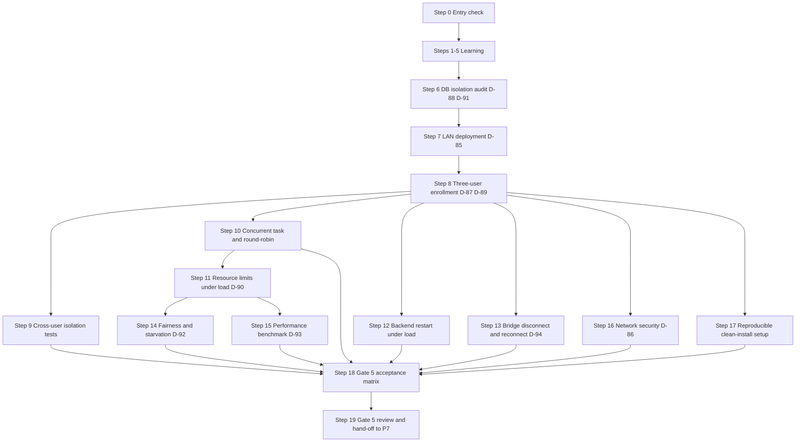

# Phase 6 — Team Integration

> **Status:** DRAFT for team review · **Week:** 10 · **Gate:** Gate 5 (team integration)
> **Parent plan:** [`00-phase-plan.md`](00-phase-plan.md) · **Previous:** [`phase-5-user-facing-workflows.md`](phase-5-user-facing-workflows.md) · **Tracker:** [`tracker.md`](tracker.md) · **Diagrams:** [`architecture.md`](architecture.md)

## How to read this document

- Every step has: **Intent → Owner → Source → How → Verify → Evidence → Learning → Status**, same as P0–P5.
- **[Docs]** = stated in the documentation. **[Suggestion]** = my recommendation, not in the documents. **[Verify]** = knowledge I could not check against your machines or tool versions.
- **Owners:** you divide the work yourselves. The rotation table in `00-phase-plan.md` suggests BE = Dev A · WB = Dev B · AI = Dev C for P6.
- **No time estimates from me.** The schedule fixes this phase at Week 10.
- **Gate 5 requirement (04.28.05):** "Three registered users and devices · cross-user and cross-device isolation · concurrent task and shared-resource tests · restart, disconnect and recovery scenarios · reproducible setup for each developer." A gate must not be marked complete based on a demonstration that lacks repeatable tests (04.28.05).
- **Test evidence only.** A step is `[x]` only when its evidence exists.

---

## 1. Goal and scope

**Goal [Docs, 04.28.05 Gate 5, 03.37.13]:** All three developers can use one NEXUS backend concurrently, each retaining a private workspace, with no unauthorized access to another user's memory, tasks, devices or execution results. The LAN deployment is reachable only through the intended network path. Setup, startup, shutdown and recovery are reproducible.

### Success criteria (Gate 5, from `00-phase-plan.md` §2 and tracker §5)

- Three registered users and devices.
- Cross-user and cross-device isolation proven with tests.
- Concurrent task and shared-resource tests pass.
- Restart, disconnect and recovery scenarios tested.
- Reproducible setup for each developer.

### Included / excluded [Docs, 03.37.11, 03.28.13, 04.12.13]

| Included in P6 | Excluded from P6 |
|---|---|
| Three-user, three-device integrated deployment | Shared project memory — deferred (D-91) |
| Cross-user and cross-device isolation tests (15 scenarios from 03.37.10) | Public internet exposure or cloud deployment |
| Concurrent task submission: all three users simultaneously | Advanced priority scheduling / dedicated message broker (unless tests show PostgreSQL insufficient) |
| Per-user and per-device concurrency limit validation | Device sharing between users (D-87, owner-only for P6 MVP) |
| Round-robin fair scheduling test under three-user workload | Tamper-evident audit storage |
| LAN connectivity: designated host → all three Windows PCs | Additional tool types beyond P2–P5 set |
| Network security: bind address, firewall, port policy, TLS decision (D-86) | Automated scaling or multi-inference-host setup |
| Startup / shutdown documented procedure (8-step + 6-step) | Advanced deduplication or cross-document analysis |
| Restart recovery: backend restart while all three users have tasks running | Full document indexing (03.37.11 P1-priority, deferred) |
| Bridge disconnect/reconnect under concurrent workload | Automated CI for multi-device hardware tests |
| Reproducible clean-install setup for each developer | |
| Performance baseline under three-user load | |
| P5 carried-over items that Gate 5 needs | |

> The docs' "P0/P1/P2" inside 03.37, 03.22, 03.28 and 04.12 are *priority tiers within those documents*, not project phases. "P0 required" items in those documents are all in P6 scope here.

### How the docs' areas map to the steps

| Domain | Source | Steps |
|---|---|---|
| Multi-user isolation model and workspace rules | 03.37.2–3, 03.37.7 | 6 |
| LAN deployment, networking and port policy | 03.22.04–07 | 7 |
| Three-user device enrollment and startup procedure | 03.22.10, 03.22.06 | 8 |
| Cross-user isolation tests (15 scenarios) | 03.37.10 | 9 |
| Concurrent tasks and round-robin scheduler validation | 03.28.05–06, 04.12.05 | 10 |
| Per-user and per-device resource limits under load | 03.28.07–08, 04.12.06 | 11 |
| Restart and recovery under multi-user load | 03.22.09–10, 04.12.09, 03.37.8 | 12 |
| Bridge disconnect/reconnect and revocation propagation | 03.22.09, 03.37.8 | 13 |
| Fairness and starvation tests | 03.28.06, 04.12.05 | 14 |
| Performance under three-user workload | 03.28.09 (via 03.27), 04.28.09 | 15 |
| Network security and TLS decision | 03.22.08, D-86 | 16 |
| Reproducible setup: clean-install for each developer | 03.22.13, 04.28.04 | 17 |
| Gate 5 acceptance matrix and release evidence | 04.28.05, 03.37.10 | 18–19 |

---

## 2. Decisions this phase must settle

Record each in `docs/decisions/` as an ADR. D-85 onward continue the tracker's numbering.

| ID | Decision | Docs position | Settled in step |
|---|---|---|---|
| D-85 | Designated host LAN address: static DHCP reservation vs. stable local hostname vs. other | Open; "the team should select the simplest reliable option" (03.22.11) | 7 |
| D-86 | TLS for LAN communication: required now vs. defer if network is genuinely trusted and isolated | Open; "if credentials and sensitive data cross a network where interception is a concern, use properly configured TLS" (03.22.08) | 16 |
| D-87 | Device sharing for P6 MVP: owner-only or explicit grant model | Open; docs provisional: "owner-only unless an explicit device-sharing feature is designed and tested" (03.37.4, 03.22.06) | 8 |
| D-88 | PostgreSQL row-level security: application-only authorization vs. RLS as defense-in-depth | Open; "the team should not claim database-enforced isolation unless it has been configured and tested" (03.37.7) | 6 |
| D-89 | Startup and shutdown documented procedure: exact service order and documented health checks | Open; "one documented startup and shutdown procedure" (03.22.10) | 8 |
| D-90 | Three-user concurrency limits confirmed: per-user active tasks, per-device operations, inference concurrency | Open; "finalize after benchmarking three-user workload" (03.28.05, 04.12.05); extends D-60 | 11 |
| D-91 | Shared project memory for P6: defer to P7 or explicitly out of MVP scope | Open; docs: "safer choice is to keep personal memory private and defer shared project memory" (03.37.5) | 6 |
| D-92 | Priority aging: implement in P6 or defer until starvation tests show a need | Open; "implement priority aging only if tests show that chosen priority classes can starve lower-priority work" (03.28.06) | 14 |
| D-93 | PostgreSQL-backed scheduler vs. separate broker: decision point after P6 load tests | Open; "consider a separate broker only when measurements demonstrate PostgreSQL coordination is no longer adequate" (03.28.09, 04.12.10) | 15 |
| D-94 | Bridge local persistence for operation outcomes: SQLite vs. in-memory vs. other | Open; "whether the bridge will persist operation outcomes in a local SQLite database or use another durable mechanism remains open" (03.22.09) | 13 |

Carried over from earlier phases and still relevant: **D-05** WSL networking mode (now verified in Step 7) · **D-28** lease duration and heartbeat interval (now confirmed under three-user workload in Step 11) · **D-32** poll interval, request timeout (now confirmed in Step 11) · **PC-02** where backend, PostgreSQL and model runtime run (now answered in Step 8).

---

## 3. Steps

### Step 0 — Entry check: what P5 actually delivered

- **Intent:** P6 needs P5's outputs. Find out now which pieces are missing.
- **Owner:** team assigns (all three attend). **Source:** `phase-5-user-facing-workflows.md` §5, `tracker.md` §2f and §8.
- **How:**
  1. Open the P5 Gate 5 prerequisite checklist. For each unchecked item, copy it to the tracker's **Carried-over items** with an owner and a target phase.
  2. Confirm these exist from P5: CLI command vocabulary (`contracts-v0.5` tag), task event table, artifact schema, task history CLI, `read_document` bridged and tested, D-71..D-84 ADRs.
  3. Confirm the database has migrations through P5 (artifacts, task_events). If not, block P6-06 and P6-09.
  4. **Blocking check for Gate 5:** All three developers must have active accounts and registered devices before any multi-user isolation test can run. If any developer does not have a working setup, block P6-09.
  5. Confirm the hand-off pairing happened.
- **Verify:** "inputs present / missing" list in the tracker with owners.
- **Evidence:** tracker change in a merged PR.
- **Status:** `[ ] pending`

---

### Step 1 — Learning block 1: the four ownership boundaries and isolation model

- **Intent:** everyone needs the same mental model of user/device/resource/operation separation before running multi-user tests. [Docs 03.37.2, 03.37.3]
- **Owner:** all three. **Source:** 03.37.2 (four boundaries), 03.37.3 (8 isolation rules).
- **How:**
  1. Walk through the four ownership boundaries in 03.37.2: user identity, device identity, resource scope, operation authorization. Draw one example where confusing two of these would create a security issue.
  2. Read the 8 isolation rules from 03.37.3. For each, check whether it is enforced by a test in the current codebase. Mark the ones that are not yet tested.
  3. Understand the host-compromise consideration (03.37.9): "The MVP should reduce exposure through private network binding, restricted database access, protected secrets, least privilege, backups and auditability. It should not claim that logical multi-user isolation protects users against a fully compromised backend host." Record this as a known limitation in `docs/operations/known-limitations.md` [Suggestion].
  4. Understand what "shared infrastructure, private user data" means operationally: one database, one FastAPI process, one model runtime — but every query carries an ownership filter, no cross-user results, no credential mixing.
- **Verify:** each developer can name the four boundaries without notes, and name one isolation rule that is currently untested.
- **Evidence:** notes per developer; `docs/operations/known-limitations.md` section added.
- **Status:** `[ ] pending`

### Step 2 — Learning block 2: round-robin scheduling, resource limits and starvation prevention

- **Intent:** the team must understand the scheduler design before testing it. [Docs 03.28.05, 04.12.05]
- **Owner:** all three. **Source:** 03.28.03–06, 04.12.02–05.
- **How:**
  1. Walk through the two-level distinction (03.28.03, 04.12.02): Level A = task eligibility (authorization, approval, dependencies), Level B = resource availability (worker, model slot, device). A task denied by policy must never become runnable merely because resources are idle.
  2. Trace the 10-step dependency resolution algorithm (04.12.04). For each step, identify what data comes from PostgreSQL.
  3. Understand the round-robin selection: "select the next eligible user in the rotation; skip a user if they have no eligible step for a required resource" (04.12.05). What does "skipping" mean for a three-user scenario where one user has no eligible work?
  4. Understand starvation safeguards (03.28.06): round-robin fairness; blocked-task exclusion; bounded priority; priority aging (if implemented). Understand why "priority aging should not allow a prohibited or unauthorized operation to run" (03.28.06).
  5. Understand that a task waiting for approval is a blocked state, not a lower-priority execution task: it consumes no model slot or worker while waiting (03.28.04).
- **Verify:** each developer can trace what happens when: User A has 3 queued tasks, User B has 1 task awaiting approval, User C has 1 eligible task — which tasks run next?
- **Evidence:** notes per developer.
- **Status:** `[ ] pending`

### Step 3 — Learning block 3: LAN networking, WSL 2 modes and port policy

- **Intent:** the team must understand the actual networking constraints before verifying them. [Docs 03.22.04–07]
- **Owner:** all three; the developer responsible for the designated host does the Windows/WSL parts. **Source:** 03.22.04, 03.22.07, 03.22.08.
- **How:**
  1. Walk through the four network boundaries (03.22.04): CLI→FastAPI, bridge→backend, FastAPI→PostgreSQL, FastAPI→model runtime. Confirm which of these exist in the current deployment and which are assumed but not verified.
  2. Understand the WSL 2 networking modes (03.22.07): NAT (default) vs. mirrored (Windows 11 supported configurations). Understand what each means for: a second developer's machine reaching FastAPI; the bridge reaching the backend from the same machine; PostgreSQL reachability. Understand why "neither mode should be assumed to work correctly without testing the actual host, firewall and network setup."
  3. Read the required connectivity checks (03.22.07): 6 checks that must be performed from a second machine, not only from the host. Record these as a checklist in `docs/operations/connectivity-checks.md` [Suggestion].
  4. Understand the proposed port policy (03.22.04 table, 6 rows — not extracted; read it in Step 7 during implementation): what services expose what ports to which network interfaces.
- **Verify:** each developer can explain why "a successful localhost request on the host does not prove that another computer can reach the backend" (03.22.07).
- **Evidence:** notes per developer; connectivity-checks checklist drafted.
- **Status:** `[ ] pending`

### Step 4 — Learning block 4: device availability, task scheduling under disconnection

- **Intent:** device disconnection during a concurrent workload is the highest-risk scenario for P6. [Docs 04.12.08]
- **Owner:** all three. **Source:** 04.12.08, 03.22.09.
- **How:**
  1. Walk through the 6-step response when a target device becomes unavailable (04.12.08): stop dispatch → preserve task → release worker/model slot → mark waiting/interrupted/recovery → reconcile → re-evaluate on reconnect. Confirm each step is already implemented from P2/P3.
  2. Understand configuration-change handling (04.12.08): "a plan that was valid under an earlier configuration is not automatically valid under the new one." What happens if a device's directory mapping changes while three users have tasks queued for it?
  3. Understand the host failure cascade (03.22.09): the shared API becomes unavailable, tasks remain incomplete or have uncertain external outcomes. What does the CLI show to a developer whose `--watch` session loses the backend? The CLI must distinguish backend unavailability from target device offline.
  4. Understand the replacement-host rule (03.22.09): "a replacement host must not begin dispatching restored work until its database, credentials, device registrations and active-task recovery have been validated."
- **Verify:** each developer can explain what happens to a task in DISPATCHED state when the bridge stops heartbeating, and what "reconcile" means for that task.
- **Evidence:** notes per developer.
- **Status:** `[ ] pending`

### Step 5 — Learning block 5: fairness metrics and acceptance criteria for Gate 5

- **Intent:** Gate 5 requires repeatable tests. The team must agree on what "fairness" and "isolation" mean in terms of measurable outcomes before writing tests. [Docs 04.28.05, 03.37.10]
- **Owner:** all three. **Source:** 04.28.05 (Gate 5 criteria), 03.37.10 (15 test scenarios), 03.28.12 (acceptance tests), 04.12.11 (scheduling test plan).
- **How:**
  1. Read Gate 5 (04.28.05): five items. For each, write one concrete test that would demonstrate it with evidence.
  2. Read the 15 isolation acceptance scenarios (03.37.10, table not extracted — read row by row in Step 9). Agree as a team which are already covered by existing tests and which need new ones.
  3. Read the 15 scheduling acceptance tests (03.28.12, table not extracted — read in Step 14). Same classification.
  4. Discuss: what is the minimum acceptable fairness result? (e.g., "no user's eligible task waits more than N cycles when capacity is available"). Record this as a metric in the P6 evidence report rather than leaving it as a qualitative judgement.
- **Verify:** each developer can name all five Gate 5 requirements from memory.
- **Evidence:** notes per developer; Gate 5 test plan drafted.
- **Status:** `[ ] pending`

---

### Step 6 — Database isolation, authorization enforcement audit and D-88, D-91 (contracts-v0.6 tag)

- **Intent:** before running multi-user tests, confirm that every user-owned query in the codebase applies ownership filters. [Docs 03.37.7, 03.37.5]
- **Owner:** team assigns (all three review). **Source:** 03.37.7, 03.37.3, D-88, D-91.
- **How:**
  1. **Settle D-91** (shared project memory for P6): the docs recommend "keep personal memory private and defer shared project memory until authorization and deletion behavior are fully specified" (03.37.5). Record as D-91 ADR: shared project memory is explicitly out of P6 scope; the P6 isolation tests assume personal-memory-only.
  2. **Settle D-88** (PostgreSQL row-level security). The docs say: "do not claim database-enforced isolation unless it has been configured and tested at the database boundary" (03.37.7). For P6 MVP: application-level ownership filters are the primary enforcement; PostgreSQL RLS is a candidate defense-in-depth measure but must only be claimed if configured and tested. Record as D-88 ADR with an honest statement of what is and is not tested.
  3. **Authorization audit**: for every repository function that returns a list or updates a record, confirm the query includes the `owner_user_id = authenticated_user_id` filter (or equivalent). Record each confirmed function in a checklist in `docs/security/authorization-audit.md` [Suggestion]. This is not a code review shortcut — it must be a line-by-line check of every SQL query.
  4. **Background workers**: confirm that background workers obtain the authoritative owner and target device from persisted task records (not from session state or a previous task claim) (03.37.7).
  5. **Update contract tag**: after the audit, tag `contracts-v0.6` [Suggestion] with the confirmed authorization rules as part of the P6 contract.
  6. **Cross-database session check** (03.37.7): verify that database sessions cannot accidentally carry a previous user's authorization context (connection pooling behavior). [Verify] whether your connection pool library resets session state between requests.
- **Verify:** authorization audit checklist complete; no query omits the ownership filter; D-88 ADR honest about what is and is not enforced at the DB level; workers do not use session-state auth.
- **Evidence:** `docs/security/authorization-audit.md`, D-88 ADR, D-91 ADR, tag.
- **Status:** `[ ] pending`

### Step 7 — LAN deployment: bind address, port policy, firewall and WSL networking (D-85)

- **Intent:** the backend is reachable by all three developers' PCs and only by them. PostgreSQL and the model runtime are not exposed to the LAN. [Docs 03.22.04–07]
- **Owner:** team assigns; needs the designated host and ≥2 other Windows PCs. **Source:** 03.22.04, 03.22.07, 03.22.11, D-85.
- **How:**
  1. **Settle D-85** (designated host LAN address). Options from 03.22.11: a static DHCP reservation from the router, a stable local hostname, or another reliable option. Choose based on what the team's router supports. Record as D-85 ADR with the chosen method and what to do when it changes.
  2. **Configure the bind address for FastAPI**: bind to the specific LAN interface, not `0.0.0.0` unless explicitly needed. Record the exact bind address and port in deployment configuration (not in source code).
  3. **Port policy** (03.22.04 table, 6 rows — read the table from the doc during this step): for each service (FastAPI, PostgreSQL, model runtime, bridge), record which port it uses, which interface it binds to, which machines are permitted to reach it, and the firewall rule that enforces it. Record in `docs/operations/port-policy.md` [Suggestion].
  4. **WSL 2 networking mode** (D-05 from P0): confirm which mode is in use (NAT or mirrored). Verify — from a second developer's machine, not from the host — that FastAPI is reachable. Record the mode and any portproxy rules needed.
  5. **Connectivity checks** (03.22.07, 6 checks): run all 6 from a second machine, not from the host:
     - FastAPI reachable on the expected address.
     - PostgreSQL NOT reachable from an ordinary client machine.
     - Model endpoint NOT exposed to the LAN.
     - Each bridge can authenticate and poll.
     - Disconnect/reconnect cycle for one bridge.
     - Repeat after a host restart.
  6. Record all results in `docs/operations/connectivity-checks.md`.
- **Verify:** all 6 connectivity checks pass and are documented; PostgreSQL not reachable from a non-host machine; model runtime not accessible from the LAN; D-05 ADR updated or confirmed.
- **Evidence:** `docs/operations/port-policy.md`, `docs/operations/connectivity-checks.md`, D-85 ADR.
- **Status:** `[ ] pending`

### Step 8 — Three-user enrollment, startup procedure and PC-02 answer (D-87, D-89)

- **Intent:** all three developers have registered accounts and devices; the startup and shutdown procedures are documented and tested. [Docs 03.22.06, 03.22.10]
- **Owner:** team assigns (all three participate for enrollment). **Source:** 03.22.06, 03.22.10, D-87, D-89.
- **How:**
  1. **Settle D-87** (device sharing for P6). The docs' provisional rule: "owner-only device access; a device is managed by its registering user, and other users cannot target it unless an explicit device-sharing feature is designed and enabled" (03.37.4). Record as D-87 ADR: owner-only for P6 MVP.
  2. **Settle D-89** (startup and shutdown procedure). Document the 8-step startup sequence from 03.22.10:
     1. Start PostgreSQL and verify readiness.
     2. Apply approved database migrations.
     3. Start FastAPI and verify health endpoints.
     4. Verify model-runtime readiness if AI is required.
     5. Start or connect each Windows bridge.
     6. Verify each bridge's identity, authorization and health.
     7. Reconcile tasks left active during previous shutdown.
     8. Enable normal task dispatch after required checks pass.
     And the 6-step shutdown sequence (03.22.10 steps 9–14). Record in `docs/operations/startup-shutdown.md` [Suggestion].
  3. **Enroll all three accounts and devices:**
     - Create user accounts for all three developers.
     - Enroll one Windows bridge per developer (each developer enrolls their own device following the P1 procedure).
     - Confirm each bridge authenticates and polls successfully.
     - Confirm device ownership is correctly attributed (Dev A cannot target Dev B's device).
  4. **Answer PC-02** ("where do backend, PostgreSQL and model runtime run?"): record the actual placement with the designated host's confirmed hardware, IP address, and service locations in `docs/operations/host-readiness.md` (section already started in P0/P4). Close the PC-02 open question in the tracker.
  5. **Test device ownership boundary** (03.37.4): attempt to submit a task targeting Dev A's device from Dev B's credentials → backend must reject with authorization failure.
- **Verify:** all three bridges poll successfully; device-ownership rejection test passes; startup procedure followed start to finish by a non-author with no errors; D-89 document exists.
- **Evidence:** enrollment records, D-87 ADR, D-89 ADR + `docs/operations/startup-shutdown.md`, PC-02 answer.
- **Status:** `[ ] pending`

---

### Step 9 — Cross-user isolation tests (15 scenarios from 03.37.10)

- **Intent:** prove that personal tasks, memory, history and devices are private to their owner, verified with three real accounts across the actual deployment. [Docs 03.37.10]
- **Owner:** team assigns; **all three review**. **Source:** 03.37.10 (15-row isolation test table — not extracted; read row by row from the doc during this step), 03.37.3.
- **How:**
  1. **Read the 03.37.10 table** (15 rows). For each scenario, record: what is being tested, the test input, the expected outcome, and whether it is currently covered by an existing test or needs a new one.
  2. **Implement or confirm** all 15 scenarios. The docs note: "tests should include positive cases as well: a user must still be able to access their own tasks, memory, devices and authorized project resources" (03.37.10).
  3. Suggested minimum negative test cases (from 03.37.6, 03.37.3, 03.37.4):
     - User B attempts to read User A's task by ID → not found.
     - User B attempts to cancel User A's task → authorization failure.
     - User B attempts to approve User A's operation → authorization failure.
     - User B attempts to target User A's device in a task submission → authorization failure.
     - User B attempts to read User A's memories → not found.
     - User B attempts to update User A's memory → authorization failure.
     - User B's search history query returns only User B's tasks.
     - User B's context assembly does not include User A's memories.
     - CLI `nexus history` for User B returns only User B's tasks.
  4. **Concurrent context test** (03.37.6): "the AI runtime adapter must handle concurrent requests safely... the model's context must be assembled from the current user's authorized information, not from whichever request was processed previously." Submit overlapping tasks from User A and User B simultaneously; verify each receives context scoped to their own memories.
  5. **Revocation during multi-user session** (03.37.8): disable User B's account while User B has a queued task → task cannot proceed; new requests rejected. Re-enable and confirm recovery.
- **Verify:** all 15 scenarios pass; concurrent context test shows no memory leakage; revocation test blocks the correct user's task; positive tests confirm authorized users can access their own data.
- **Evidence:** test report, isolation test checklist with each scenario's result.
- **Status:** `[ ] pending`

### Step 10 — Concurrent task submission and round-robin scheduler validation

- **Intent:** all three users submitting overlapping tasks receive fair access to shared resources. The scheduler correctly separates authorization/eligibility from resource availability. [Docs 03.28.05, 04.12.05]
- **Owner:** team assigns; needs all three Windows PCs. **Source:** 03.28.05, 04.12.05.
- **How:**
  1. **Three-user concurrent submission test**: all three developers submit tasks targeting different devices at the same time.
     - Verify each task receives a unique task ID and is persisted under the correct owner.
     - Verify tasks are not mixed: User A's task does not appear in User B's history.
     - Verify tasks are dispatched to their respective target devices only.
  2. **Round-robin fairness test** (03.28.05 illustrative cycle): User A submits 5 tasks, User B submits 1, User C submits 1. Run the scheduler and record which tasks are selected in which order. Verify that User B's and User C's tasks are not consistently dequeued last.
  3. **Blocked-task exclusion** (03.28.04): User A submits a task requiring approval. Confirm that while waiting for approval: (a) it consumes no worker or model slot, (b) User B's and User C's tasks are not blocked by User A's waiting task.
  4. **Per-user concurrency limit** (03.28.05): if the configured per-user active task limit is N, confirm that User A cannot have more than N tasks simultaneously executing (further submissions are queued, not rejected outright).
  5. **Two users targeting the same device** (D-87: owner-only): if User A and User B both try to target User A's device, User B's submission is rejected at authorization. User A's task proceeds normally.
  6. **Model inference serialization** (03.37.6): the docs note that "if the selected model runtime serializes inference, NEXUS should queue requests fairly rather than assuming three simultaneous API calls mean three simultaneous model generations." Confirm the inference concurrency limit (D-60/D-90) applies correctly when all three users request AI planning simultaneously.
- **Verify:** concurrent submissions all persisted correctly; round-robin order confirmed in test output; approval-waiting task frees its slots; per-user limit enforced; cross-device ownership enforced; inference limit respected.
- **Evidence:** concurrent test results, scheduler cycle trace, test report.
- **Status:** `[ ] pending`

### Step 11 — Per-user and per-device resource limits under load (D-90)

- **Intent:** confirm that the resource limits from P4 hold under the actual three-user workload and settle D-90. [Docs 03.28.07–08, 04.12.06]
- **Owner:** team assigns; needs all three Windows PCs and the designated host. **Source:** 03.28.07, 04.12.06, D-90.
- **How:**
  1. **Run the three-user workload benchmark** (the benchmark from P4 Step 22 is the starting point; now run it with real three-user concurrent requests):
     - All three developers submit overlapping multi-step tasks.
     - Record: per-user active tasks, per-device operations, inference concurrency, queue wait time, scheduling latency, resource utilization (CPU, RAM, GPU/VRAM).
  2. **Queue admission test** (03.28.08): submit enough tasks to hit the configured queue capacity. Confirm the backend returns a capacity rejection, not a success. Confirm the rejection is clearly communicated in the CLI (not silently queued).
  3. **Per-device operation limits** (04.12.06): confirm that no single device receives more than its configured concurrent operation limit, even if all three users target the same device. [Verify] whether any user currently has access to another user's device by mistake (D-87 should prevent this, but verify).
  4. **Overload behavior** (03.28.11): submit tasks faster than the system can process them. Confirm NEXUS applies bounded retries with backoff rather than repeatedly re-invoking a failed component. Confirm that a busy model runtime is not hammered repeatedly.
  5. **Settle D-90** (three-user concurrency limits confirmed): from the benchmark results, record the confirmed values for: max active tasks per user, max operations per device, max concurrent inference requests. Record as D-90 ADR, superseding the provisional P4 D-60 values where they differ.
  6. **Confirm D-28 and D-32** (lease duration and poll interval) still work under three-user load: no lease expiry surprises under concurrent use.
- **Verify:** queue capacity rejection works and is clearly communicated; per-device limits enforced under concurrent load; retry backoff observed; D-90 ADR records confirmed values.
- **Evidence:** benchmark results, D-90 ADR, test report.
- **Status:** `[ ] pending`

---

### Step 12 — Backend restart while all three users have tasks running

- **Intent:** backend restart does not corrupt task state for any of the three users. [Docs 04.12.09, 03.22.09]
- **Owner:** team assigns; all three PCs running. **Source:** 04.12.09, 03.22.09, 03.22.10.
- **How:**
  1. **Setup**: all three developers have tasks in RUNNING or DISPATCHED state simultaneously (tasks queued or at a bridge step, not yet terminal).
  2. **Force a backend restart** (not a clean shutdown — simulate a crash if possible).
  3. **Run the startup recovery sequence** (03.22.10 step 7, 04.12.09):
     - Load non-terminal tasks and outstanding claims.
     - Identify stale claims and operations requiring reconciliation.
     - Recover queued tasks whose state is still valid.
     - Re-evaluate dependencies and resource eligibility.
     - Revalidate device status, permissions and approvals before dispatch.
     - Resume only operations that are safe to continue.
  4. **Verify** for each of the three users' tasks:
     - QUEUED tasks: back in the queue and eventually dispatched.
     - DISPATCHED tasks: reconciled before retry (bridge queried for outcome).
     - No false SUCCEEDED results (a task must not be marked successful without evidence after restart).
     - Task timeline (from P5 Step 11) shows the restart event.
  5. **Confirm** that the replacement-host rule from 03.22.09 is documented: if the host hardware is replaced, the new host must not dispatch restored work until validation passes.
  6. After recovery, confirm all three developers can resume submitting tasks normally.
- **Verify:** no false SUCCEEDED tasks after restart; DISPATCHED tasks reconciled (not blindly retried); task timelines show the restart event; all three users' tasks resume correctly.
- **Evidence:** restart test report, task timeline screenshots or JSON output.
- **Status:** `[ ] pending`

### Step 13 — Bridge disconnect/reconnect under concurrent workload and D-94

- **Intent:** one developer's bridge disconnecting does not corrupt other users' tasks or incorrectly cancel in-flight operations. [Docs 03.22.09, 03.37.8]
- **Owner:** team assigns; runs on native Windows. **Source:** 03.22.09, 03.37.8, D-94.
- **How:**
  1. **Settle D-94** (bridge local persistence). The docs say: "whether the bridge will persist operation outcomes in a local SQLite database or use another durable mechanism remains open" and "the selected design must address the case where a Windows action succeeds but the backend never receives its response" (03.22.09). For P6: evaluate whether the current bridge journal (D-47 from P3) is sufficient, or whether an additional local persistence layer is needed for three-user concurrency. Record as D-94 ADR.
  2. **Disconnect test scenario**: Developer A's bridge disconnects while User A has a task in DISPATCHED state.
     - Confirm: User B's and User C's tasks continue unaffected.
     - Confirm: User A's task moves to UNCERTAIN after the D-49 threshold.
     - Confirm: the backend does not dispatch new operations to the disconnected device.
  3. **Reconnect test**: Developer A's bridge reconnects.
     - Confirm: the backend re-evaluates the recovered operation (bridge journal query).
     - Confirm: if the operation completed on the bridge, it is persisted as SUCCEEDED.
     - Confirm: if the operation is unknown, it stays UNCERTAIN (not fabricated as success or failure).
  4. **Revocation during concurrent use** (03.37.8): revoke Developer A's device while User A has a queued task.
     - Confirm: queued task not dispatched to the revoked device.
     - Confirm: in-flight operation reconciled (not fabricated).
     - Confirm: User B's and User C's tasks are not affected by Developer A's revocation.
  5. **Test the "device unavailable" CLI display** (from P5 Step 7): Developer A's CLI `--watch` session shows `DEVICE_UNAVAILABLE` not a generic error.
- **Verify:** User B/C tasks unaffected by Developer A's disconnect; UNCERTAIN propagated correctly; reconnect reconciliation works; revocation during concurrency doesn't corrupt other users.
- **Evidence:** disconnect/reconnect test report, D-94 ADR.
- **Status:** `[ ] pending`

### Step 14 — Fairness and starvation tests (D-92)

- **Intent:** prove that no user's eligible tasks can be starved indefinitely. [Docs 03.28.06, 04.12.05]
- **Owner:** team assigns; all three PCs. **Source:** 03.28.06, 04.12.05, 03.28.12, D-92.
- **How:**
  1. **Read the 03.28.12 acceptance tests** (15-row table — not extracted; read row by row from the doc during this step). For each, confirm coverage or implement.
  2. **Starvation scenario**: User A continuously submits new tasks at maximum rate; User B submits one task. Confirm that User B's task is dispatched within a bounded number of scheduling cycles (the round-robin guarantee).
  3. **Settle D-92** (priority aging): run the starvation test. If User B's task waits more than a configurable threshold without executing, priority aging is needed. If User B's task executes within a reasonable cycle, record D-92 as "deferred: round-robin sufficient for three-user deployment." Record as D-92 ADR.
  4. **Background work fairness** (03.28.06 "Bounded priority"): if any background indexing or diagnostic tasks exist, confirm they make progress even during peak user load (they don't block indefinitely, but they also don't starve interactive tasks).
  5. **Blocked-task exclusion** (03.28.06): User A has tasks waiting for approval. Confirm those tasks do not consume scheduling cycles; User B and User C's eligible tasks are not blocked waiting for User A's approval.
  6. **Queue wait visibility**: the CLI `nexus task <id>` must show `QUEUED` (not RUNNING) while a task is waiting for capacity; it must not pretend the task is executing.
- **Verify:** starvation test shows bounded wait for all three users; D-92 ADR records the decision; approval-waiting tasks consume no execution slots; queue wait visible in CLI.
- **Evidence:** starvation test results, D-92 ADR.
- **Status:** `[ ] pending`

### Step 15 — Performance under three-user workload and D-93 decision point

- **Intent:** confirm the system meets the provisional performance targets under real three-user load, or document why they were not met. [Docs 04.28.09, 03.28.09]
- **Owner:** team assigns; all three Windows PCs; designated host. **Source:** 04.28.09, 03.28.07–09, D-93.
- **How:**
  1. **Run the full three-user performance benchmark** (extending P4 Step 22's Scenario E):
     - All three users submit overlapping requests targeting different devices.
     - Measure: API read latency p95, task acceptance latency p95, queue wait by user, model inference time, bridge operation time, DB query time.
     - Compare against the provisional targets from 04.28.09: API read p95 < 500 ms; task acceptance p95 < 1 s.
     - Record whether targets are met or not, with the actual measurements.
  2. **Multi-step task performance**: three users submitting multi-step tasks simultaneously. Record how the scheduler handles the concurrent DAG execution.
  3. **Model inference under three-user concurrency**: all three users request AI planning simultaneously. Record queue wait time for inference. Confirm the D-60/D-90 inference concurrency limit is respected.
  4. **Resource utilization**: CPU, RAM, GPU/VRAM on the designated host. Confirm no component is being starved by another (e.g., the model runtime does not consume all RAM, leaving PostgreSQL query performance degraded).
  5. **Settle D-93** (PostgreSQL-backed scheduler vs. separate broker). From the P6 load test results: if PostgreSQL scheduling meets latency, fairness and isolation requirements → record D-93 as "PostgreSQL sufficient for P6 three-user deployment; reconsider if user count grows." If PostgreSQL contention is visible → record D-93 as "investigate dedicated broker before P7." Record as D-93 ADR.
  6. Record all results in `docs/operations/p6-benchmark.md` [Suggestion].
- **Verify:** benchmark complete; targets met or shortfall documented with reason; D-93 ADR exists; no component starved in the three-user test.
- **Evidence:** `docs/operations/p6-benchmark.md`, D-93 ADR.
- **Status:** `[ ] pending`

---

### Step 16 — Network security and TLS decision (D-86)

- **Intent:** the LAN deployment meets the minimum security requirements from 03.22.08. TLS decision is made honestly. [Docs 03.22.08]
- **Owner:** team assigns; **non-author security review**. **Source:** 03.22.08, D-86.
- **How:**
  1. **Settle D-86** (TLS requirement). The docs say: "if credentials and sensitive data cross a network where interception is a concern, use properly configured TLS. Do not treat an IP address or a device's network location as authentication" (03.22.08). The team must answer: is the LAN shared with untrusted devices? Can a developer's machine be reached by other people? If yes → TLS required before P6 Gate 5. If genuinely isolated and trusted → document the assumption and the conditions under which TLS must be added. Record as D-86 ADR with an honest statement.
  2. **Minimum security requirements checklist** (03.22.08):
     - [ ] Authentication for API clients and registered bridges.
     - [ ] Authorization on every protected resource and operation.
     - [ ] Firewall rules restricting access to intended clients and services.
     - [ ] No public router port forwarding.
     - [ ] No direct database access for ordinary clients.
     - [ ] No shared bridge credential across all three devices.
     - [ ] Protection against replayed or duplicated operation requests.
     - [ ] Bounded request sizes, timeouts and connection limits.
     - [ ] Safe handling of malformed or excessive requests.
     - [ ] Redaction of secrets and private document content from network diagnostics.
  3. **Security test**: from a non-enrolled machine on the same LAN, attempt to call the FastAPI endpoints. Confirm all sensitive routes return 401 (not data).
  4. **No shared credential**: confirm each bridge uses its own unique per-device credential (not a shared team credential).
- **Verify:** all 10 minimum requirements checked; D-86 ADR honest about TLS status; non-enrolled machine gets 401 on all protected routes; no shared bridge credential.
- **Evidence:** security checklist, D-86 ADR.
- **Status:** `[ ] pending`

### Step 17 — Reproducible setup: clean-install for each developer

- **Intent:** each developer can set up from a clean machine following written instructions, without help from the author. [Docs 03.22.13, 04.28.04]
- **Owner:** team assigns; each developer sets up at least once following the written instructions. **Source:** 03.22.13, 04.28.04 (shared responsibilities).
- **How:**
  1. Update `docs/setup.md` with all P6-specific steps: three-user enrollment procedure, startup/shutdown sequence, connectivity checks, firewall rules, model runtime setup, device registration.
  2. **Clean-install validation** (required for Gate 5): each developer who did **not** write the instructions sets up their environment from the `docs/setup.md` document alone. Record any step that fails or requires external help.
  3. **Confirm each developer can independently**:
     - Install the required dependencies from a clean clone.
     - Start PostgreSQL, run migrations, start FastAPI.
     - Install and start the Windows bridge.
     - Register their device.
     - Submit a task, watch its progress and inspect the result.
  4. **LAN connectivity verification**: each developer confirms they can reach the backend from their own PC following the documented address configuration.
  5. **Troubleshooting guide update**: add the failures observed during clean-install validation and their resolutions.
  6. **Reproducible deployment acceptance criteria** (03.22.13): record the 9 items from 03.22.13 as a checklist and check each one.
- **Verify:** all three developers can independently reproduce the setup; no step requires tribal knowledge; troubleshooting guide covers the failures encountered.
- **Evidence:** clean-install validation notes per developer, updated `docs/setup.md`.
- **Status:** `[ ] pending`

---

### Step 18 — Gate 5 acceptance matrix

- **Intent:** prove all Gate 5 items with real tests across all three users and devices. [Docs 04.28.05, 03.37.10]
- **Owner:** all three; all PCs running simultaneously. **Source:** 04.28.05, 03.37.10, 03.28.12, 04.12.11.
- **How:**
  1. **Gate 5 acceptance scenarios:**

     | # | Scenario | Expected | Test lives in |
     |---|---|---|---|
     | P6-1 | All three developers submit tasks simultaneously to their own devices | Three separate tasks persisted, dispatched and completed without cross-contamination | Step 10 |
     | P6-2 | User B attempts to read User A's task history | Authorization failure; User B's history unaffected | Step 9 |
     | P6-3 | User B attempts to target User A's device | Authorization failure | Step 10 |
     | P6-4 | User A's bridge disconnects mid-task; User B and C unaffected | A's task → UNCERTAIN; B/C tasks continue | Step 13 |
     | P6-5 | Backend restarts while all three have tasks | Tasks recovered; no false SUCCEEDED | Step 12 |
     | P6-6 | User A's account is revoked; User A's queued task blocked | Task not dispatched; B/C tasks unaffected | Step 9 |
     | P6-7 | User A floods the queue; User B gets scheduled | Round-robin: B's task dispatched within N cycles | Step 14 |
     | P6-8 | Three users request AI planning simultaneously | D-90 inference limit respected; queue wait bounded | Step 11 |
     | P6-9 | Context assembly under concurrent use: no memory cross-leakage | Each response uses only the requesting user's memories | Step 9 |
     | P6-10 | Developer C follows setup doc from a clean clone | Successful setup without external help | Step 17 |
     | P6-11 | PostgreSQL and model runtime unreachable from a non-enrolled LAN machine | All sensitive routes return 401 | Step 16 |
     | P6-12 | Device A revoked while task dispatched to it | In-flight operation reconciled; not blindly retried | Step 13 |
     | P6-13 | Approval waiting task for User A: User B/C not blocked | User B/C eligible tasks proceed; User A's approval task consumes no slots | Step 10/14 |
     | P6-14 | Startup sequence followed from scratch after host reboot | All services start in documented order; health checks pass | Step 8/17 |
     | P6-15 | Performance under three-user load meets documented targets | API p95 and acceptance p95 measured and recorded | Step 15 |

  2. Run all 15 scenarios on the actual three-PC deployment.
  3. Run the 03.37.10 isolation scenarios (15) and 03.28.12 scheduling scenarios (15) and confirm coverage.
  4. Update `docs/testing/p6-acceptance.md` [Suggestion].

- **Verify:** all 15 P6 scenarios pass; zero cross-user data exposures; performance targets met or shortfall honestly documented.
- **Evidence:** test report, `docs/testing/p6-acceptance.md`.
- **Status:** `[ ] pending`

### Step 19 — Security review, Gate 5 review, release evidence and hand-off to P7

- **Intent:** pass Gate 5 honestly and prepare P7. [Docs 04.28.05]
- **Owner:** all three; **non-author security review**.
- **How:**
  1. **Security review checklist (P6 additions)**:
     - Cross-user task/memory access denied in all tested scenarios.
     - Device ownership enforced; no cross-owner targeting.
     - Authorization audit complete; no unfiltered query found.
     - LAN security: no sensitive route accessible from non-enrolled machine.
     - D-86 TLS decision documented honestly.
     - No shared bridge credential.
     - No private content or credentials in ordinary logs.
  2. Critical/high defects fixed before sign-off.
  3. Run the Gate 5 checklist (tracker §5):
     - Three registered users and devices.
     - Cross-user/cross-device isolation tests pass.
     - Concurrent task and resource tests pass.
     - Restart/disconnect/recovery tests pass.
     - Reproducible setup confirmed by a non-author.
  4. **Release evidence report** in `docs/releases/p6-evidence.md` [Suggestion]: three-user deployment configuration · authorization audit results · isolation test results · concurrent task test results · restart and disconnect results · performance measurements · network security status · D-85..D-94 ADR statuses · known limitations · unresolved decisions · untested scenarios.
  5. Update the tracker: P6 rows, D-85..D-94, risks, carried-over items, MVP checklist items (14).
  6. **Hand-off pairing:** each P6 stream owner walks the P7 owner through their work before P7 starts.
  7. Write the **P7 entry list:** full acceptance suite · backup and restore rehearsal · security regression testing · performance regression testing · hardening review (rate limits, error handling, input validation) · installation and upgrade documentation · release candidate sign-off. Also: any Gate 5 item not fully resolved becomes a P7 blocker.
  8. **Ask me to detail P7.** I will first read the End-to-End Integration Architecture/System Acceptance/Release Readiness, Backup/Restore and Data Lifecycle Management, Backup Automation/Disaster Recovery, API and Data Security Hardening, Application Packaging/Version Compatibility, and CI/CD Pipeline documents first.
- **Status:** `[ ] pending`

---

## 4. Suggested step order and dependencies

Three streams can run in parallel after Step 8: **isolation/authorization** (Steps 9, 16), **scheduling/performance** (Steps 10–11, 14–15), **deployment/recovery** (Steps 12–13, 17). Steps 0, 6, 7, 8, 18, 19 need everyone or cross-stream review.

### Branches and PRs

- Suggested branch names: `feat/three-user-isolation`, `feat/concurrent-scheduler`, `feat/bridge-disconnect`, `feat/startup-procedure`, `test/p6-acceptance`, `docs/p6-setup`, `docs/authorization-audit`.
- Every multi-user test needs all three developers present; do not run isolation tests alone.

---

## 5. Gate 5 checklist (P6 exit criteria)

**Gate 5 items (docs, 04.28.05):**
- [ ] Three registered users and devices. (Step 8)
- [ ] Cross-user and cross-device isolation. (Steps 9, 16)
- [ ] Concurrent task and shared-resource tests. (Steps 10–11, 14)
- [ ] Restart, disconnect and recovery scenarios. (Steps 12–13)
- [ ] Reproducible setup for each developer. (Step 17)

**Additional completion criteria:**
- [ ] LAN deployment: host address, port policy, firewall and WSL mode all documented and tested. (Step 7)
- [ ] Startup and shutdown procedure documented and followed end-to-end. (Step 8)
- [ ] Device ownership enforced; no cross-user device targeting. (Steps 8, 9)
- [ ] Database authorization audit complete; no unfiltered query found. (Step 6)
- [ ] D-88 (PostgreSQL RLS) and D-91 (shared project memory deferral) settled. (Step 6)
- [ ] Round-robin fairness tested under three-user load. (Step 14)
- [ ] Performance benchmark under three-user workload; D-90 confirmed. (Steps 11, 15)
- [ ] Bridge disconnect/reconnect test passes for all three devices. (Step 13)
- [ ] D-94 (bridge local persistence) settled. (Step 13)
- [ ] Network security: all minimum requirements met; D-86 (TLS) settled honestly. (Step 16)
- [ ] D-93 (PostgreSQL vs. broker) settled. (Step 15)
- [ ] All 15 P6 acceptance scenarios pass. (Step 18)
- [ ] PC-02 answered. (Step 8)
- [ ] D-85..D-94 recorded with honest statuses. (Settling steps)
- [ ] Release evidence report with untested scenarios listed. (Step 19)
- [ ] No critical or high security defect open. (Step 19)

---

## 6. Risks specific to P6

| ID | Risk | Why it matters | Mitigation |
|---|---|---|---|
| P6-R1 | WSL 2 networking cannot be made reliable from all three PCs | Gate 5 blocked | D-85 early; Step 7 first; option to move backend to native Linux or Docker |
| P6-R2 | PostgreSQL scheduler has visible contention under three-user load | Latency targets not met | Step 15 benchmark first; D-93 decides upgrade path |
| P6-R3 | Authorization audit reveals an unfiltered query | Cross-user data exposure | Step 6 before any multi-user test; mutation tests for missing filters |
| P6-R4 | A bridge local persistence gap causes UNCERTAIN after every disconnect | Unstable for real use | D-94 settled in Step 13; P3 bridge journal re-evaluated |
| P6-R5 | RAM pressure at three concurrent model inference requests | Backend degrades or OOMs | D-90 baseline from P4; Step 11 confirms under real load |
| P6-R6 | Clean-install setup doc is incomplete or has tribal-knowledge gaps | New teammate cannot reproduce setup | Step 17 validation by a non-author; failures recorded and fixed |
| P6-R7 | Shared host is a single point of failure for all three users | P7 backup required | Documented in known-limitations; backup plan is P7 scope |

---

## 7. Learning plan summary

| Topic | Step | Needed because |
|---|---|---|
| Four ownership boundaries and isolation model | 1 | Foundation for Steps 6, 9, 16 |
| Round-robin scheduling, resource limits and starvation | 2 | Foundation for Steps 10, 14 |
| LAN networking, WSL 2 modes and port policy | 3 | Foundation for Step 7 |
| Device availability and task scheduling under disconnection | 4 | Foundation for Steps 12, 13 |
| Fairness metrics and Gate 5 acceptance criteria | 5 | Foundation for Steps 18, 19 |

---

## 8. What I could not verify (so you know)

- **Documents read for this phase:** Multi-User Isolation, Shared Resources, Team Collaboration and Personal Workspaces (03.37) · Deployment Topology, Network Boundaries and Multi-Device Communication (03.22) · Resource Governance, Fair Scheduling and Starvation Prevention (03.28) · Task Scheduling, Dependency Resolution and Resource-Aware Execution (04.12) · Consolidated 10–12 Week Implementation Plan and Project Sign-off (04.28, re-read for Gate 5 details).
- **Documents I did not read and which may add requirements:** Multi-User Isolation may have additional tables I did not extract (03.37.10 isolation scenarios, 15 rows; 03.37.11 implementation priorities, 4 rows; 03.37.12 open decisions, 11 rows). These tables must be read during Step 9 and Step 6 respectively. Similarly, 03.28.12 acceptance tests (15 rows), 03.28.14 open decisions (12 rows), 04.12.11 scheduling test plan (19 rows) were not extracted and must be read during their respective steps.
- **Tables not extracted:** 03.37.4 device ownership table (7 rows), 03.37.5 project vs. personal memory table (7 rows), 03.37.10 isolation scenarios (15 rows), 03.37.11 priorities (4 rows), 03.37.12 open decisions (11 rows); 03.22.03 service placement table (8 rows), 03.22.04 port-policy table (6 rows), 03.22.07 WSL networking table (6 rows), 03.22.12 deployment tests (13 rows), 03.22.14 open decisions (11 rows); 03.28.02 scope/constraints (10 rows), 03.28.04 scheduling classes (5 rows), 03.28.07 resource budgets (9 rows), 03.28.08 overload/admission tables (9 rows each), 03.28.12 acceptance tests (15 rows), 03.28.14 open decisions (12 rows); 04.12.04 readiness table (9 rows), 04.12.06 resource requirements (8 rows), 04.12.11 test plan (19 rows), 04.12.12 work packages (8 rows), 04.12.13 recommended decisions (10 rows).
- **Values the documents leave unspecified, so I have not supplied them:** exact per-user active task limit (D-90), exact per-device operation limit (D-90), round-robin cycle length, starvation aging threshold (D-92), TLS certificate authority (D-86), host LAN address choice (D-85).
- **My suggestions** (marked [Suggestion]): file paths (`docs/operations/known-limitations.md`, `docs/operations/connectivity-checks.md`, `docs/operations/port-policy.md`, `docs/operations/startup-shutdown.md`, `docs/operations/p6-benchmark.md`, `docs/security/authorization-audit.md`, `docs/releases/p6-evidence.md`, `docs/testing/p6-acceptance.md`), `contracts-v0.6` tag, branch names.
- **Not verified:** exact WSL 2 networking behavior on your specific host; PostgreSQL connection-pool session-reset behavior; whether the 03.22.04 port table specifies a TLS port or plain HTTP.
- **Gate 5:** all items require repeatable tests on the actual three-PC deployment, not demonstrations or single-run results. A gate must not be marked complete based on a demonstration that lacks repeatable tests (04.28.05).
