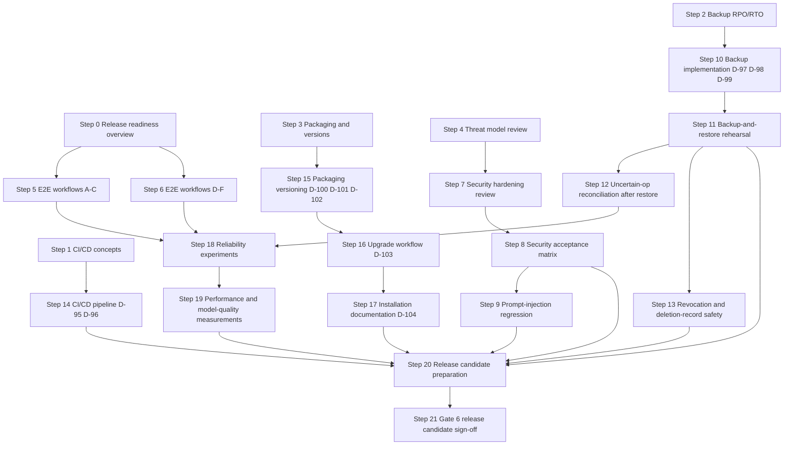

# Phase 7 — Hardening and Release Candidate

> **Status:** DRAFT — steps are ordered and cross-referenced against the specification documents. Nothing in this file is built yet.
> **Scope:** Weeks 11–12. Full end-to-end acceptance suite, backup-and-restore rehearsal, security regression, performance regression, CI/CD pipeline, packaging, installation documentation, upgrade strategy, and team sign-off.
> **Gate:** Gate 6 (Weeks 11–12) — Release Candidate (docs 04.28.05 §Gate 6, 03.40.10, 04.28.10).
> **Prerequisite:** Gate 5 (P6) must be fully evidenced before this phase begins.
> **Decision numbering:** D-95 onward (D-85..D-94 are P6).
> Parent: [`00-phase-plan.md`](00-phase-plan.md) · Tracker: [`tracker.md`](tracker.md) · Diagrams: [`architecture.md`](architecture.md)

---

## §1 — What this phase is and is not

**Is:** A hardening, verification, documentation and sign-off phase. Every step produces evidence, not new features. No new tool types are added; no new user workflows are created. Scope changes must be recorded as decisions (D-xx) and reviewed by all three developers.

**Is not:** An opportunity to bypass earlier security, recovery or isolation requirements that were never properly evidenced. The docs are explicit: "A missing optional feature can be documented as a limitation. A failed security invariant cannot be reclassified as optional merely to complete the release." (03.40.11)

---

## §2 — Work-package mapping

| P7 steps | Topic | Primary docs |
|---|---|---|
| 0–4 | Learning blocks | — |
| 5–6 | End-to-end acceptance workflows A–F | 03.40.3 |
| 7 | Security hardening and threat-model review | 03.39.3–9 |
| 8 | Security acceptance matrix (12 items) | 03.39.10 |
| 9 | Prompt-injection regression suite | 03.39.7 |
| 10 | Backup implementation and automation | 03.21.3–5, 04.25.05 |
| 11 | Backup-and-restore rehearsal (10 items) | 03.21.12, 04.25.10 |
| 12 | Uncertain-operation reconciliation after restore | 03.21.7, 04.25.7 |
| 13 | Revocation and deletion-record safety after restore | 03.21.9, 04.25.8–9 |
| 14 | CI/CD pipeline: all five gates | 04.22.4–8 |
| 15 | Packaging, versioning and compatibility matrix | 04.23.2–4 |
| 16 | Upgrade workflow and rollback procedures | 04.23.5–6, 04.23.13 |
| 17 | Installation documentation: clean-install and reproducible setup | 03.40.8, 04.23.2 |
| 18 | Reliability experiments (10 scenarios) | 03.40.6 |
| 19 | Performance and model-quality measurements | 03.40.6–7, 04.28.9 |
| 20 | Release candidate preparation and sign-off (21-item checklist) | 03.40.10, 04.28.10 |
| 21 | Gate 6 — Release candidate review | 04.28.05 |

---

## §3 — Learning blocks

### Step 0 — Release readiness: what the docs require

- **Intent:** Understand the distinction between "the application starts" and "the release is ready." The docs define 10 architectural invariants (03.40.2), 6 required end-to-end workflows (03.40.3), 10 required reliability experiments (03.40.6), 12 security-acceptance items (03.39.10) and a 25-item MVP release evidence checklist (03.40.10). [Docs]
- **Owner:** team assigns.
- **Source:** 03.40.1–2, 04.28.01–05.
- **How:** Each developer reads 03.40 and 04.28. The team then discusses which checklist items are already evidenced from P6 and which are new. Record the gap in a `docs/releases/p7-gap.md` document [Suggestion].
- **Verify:** p7-gap.md exists and contains a row for each of the 25 release-evidence items, with a column for current status (`evidenced from P6 / in progress / not started`).
- **Evidence:** `docs/releases/p7-gap.md`.
- **Learning:** The docs use "demonstrated end-to-end behavior, not isolated component readiness" as the central release principle (03.40.1). A component passing unit tests does not establish that the integrated system meets acceptance requirements (03.40.5).
- **Status:** `[ ] pending`

---

### Step 1 — CI/CD concepts: what the pipeline must do

- **Intent:** Understand the five-gate PR pipeline (Gates A–E in 04.22.4), the three compatibility boundaries (API ↔ CLI, backend ↔ bridge, planner ↔ tool registry) and the deterministic-testing policy (04.22.5). [Docs]
- **Owner:** team assigns.
- **Source:** 04.22.2–8.
- **How:** The pipeline developer reads 04.22 end to end. The team agrees on the CI platform (D-95) and whether a native Windows runner is available within the zero-budget constraint (D-96).
- **Verify:** D-95 and D-96 are recorded (even as Open/Blocked); no one assumes GitHub Actions is confirmed.
- **Evidence:** D-95 ADR stub, D-96 ADR stub.
- **Learning:** "A test that requires a dependency unavailable in the current runner must be reported as not run, not silently counted as passed" (04.22.3). A mock planner passing tests does not establish that the chosen model is suitable for production (04.22.5).
- **Status:** `[ ] pending`

---

### Step 2 — Backup, RPO and RTO

- **Intent:** Understand the distinction between database backup and complete recovery (03.21.4, 04.25.2). The docs define RPO (maximum acceptable data loss in time) and RTO (target time to restore service) and state that the team must choose values based on actual use and zero-budget constraints, not assumption. [Docs]
- **Owner:** team assigns.
- **Source:** 03.21.4–6, 04.25.2–4.
- **How:** Read 03.21 §§3–6 and 04.25 §§2–4. The team then records D-97 (RPO target), D-98 (RTO target) and D-99 (backup storage location: another authorized machine, encrypted external drive, or other zero-budget option).
- **Verify:** D-97, D-98, D-99 exist as ADR stubs with an honest description of what the team can realistically support.
- **Evidence:** D-97, D-98, D-99 ADR stubs.
- **Learning:** "A successful backup command is not proof that the backup can be restored. The restore test is part of the backup process." (04.25.4) Daily backups imply up to ~24 hours of data may be lost; point-in-time recovery adds operational complexity and must not be added unless tested (03.21.4).
- **Status:** `[ ] pending`

---

### Step 3 — Packaging, versions and upgrade classifications

- **Intent:** Understand the five independent version dimensions (backend, CLI, bridge, DB schema, AI runtime/model) and the five upgrade classes (A–E) in 04.23. [Docs]
- **Owner:** team assigns.
- **Source:** 04.23.3–5.
- **How:** Read 04.23 §§2–6. The team records D-100 (backend packaging: Python package or container image), D-101 (CLI and bridge: Python app or standalone executable for P7), D-102 (version scheme: SemVer or other for each component).
- **Verify:** D-100, D-101, D-102 ADR stubs exist; at minimum they record the simplest choice the team can implement and install reliably.
- **Evidence:** D-100, D-101, D-102 ADR stubs.
- **Learning:** "An upgrade is not complete merely because the new application process starts. Compatibility, persistent data, device connectivity and recovery behavior must also be verified." (04.23.1) An unknown or security-sensitive incompatible protocol version must fail closed (04.23.3 rule 8).
- **Status:** `[ ] pending`

---

### Step 4 — Threat modeling: what must not be waived

- **Intent:** Understand that the ten release-blocking conditions (03.40.11 / 04.28.10) are non-negotiable — not optional features — and that the security acceptance matrix (03.39.10) exists to record evidence, not to assume controls work. [Docs]
- **Owner:** team assigns.
- **Source:** 03.39.1–5, 03.40.11, 04.28.10.
- **How:** Each developer reads the 12 security-acceptance items (03.39.10) and the 10 release-blocking conditions (03.40.11). The team reviews which items were first addressed in P2–P6 and which need new tests in P7.
- **Verify:** A `docs/security/threat-model-review.md` document [Suggestion] exists listing each of the 12 security-acceptance items with: evidence source (test file or run), first introduced in phase, and P7 re-verification needed (yes / no).
- **Evidence:** `docs/security/threat-model-review.md`.
- **Learning:** "Security checks should be integrated into development from the first working end-to-end flow. They must not be postponed until the final week." (03.39.9) The 10 release blockers distinguish unresolved security invariants from missing optional features; the former cannot be reclassified as optional (03.40.11, 03.39.9).
- **Status:** `[ ] pending`

---

## §4 — Implementation steps

### Step 5 — End-to-end acceptance workflows A–C

- **Intent:** Run Workflows A (search and summarize a document), B (create a file safely) and C (recover from an uncertain operation) against the integrated environment with three users and three devices. [Docs 03.40.3]
- **Owner:** team assigns (all three participate).
- **Source:** 03.40.3 Workflows A, B, C; 03.40.5 System acceptance requirements.
- **How:**
  1. **Workflow A** — User authenticates, submits a document-search-and-summarize task via CLI; backend persists task ID; planner proposes a file-search + read plan; bridge executes within the configured scope; summary is generated from extracted content only; result is persisted with source references; CLI displays the actual task state. Acceptance: "the summary is based on the document actually read, the source remains within the user's authorized scope, and the result is not presented as successful unless the required processing and verification succeeded." (03.40.3)
  2. **Workflow B** — User requests a new output file; policy engine evaluates; if approval required, execution waits; bridge validates directory, relative path, destination and content limits; file created without silent overwrite; result recorded and verified; CLI reports destination and outcome accurately. Acceptance: "the operation cannot escape the approved directory, overwrite an existing file without a separately supported and authorized workflow, or claim success without sufficient evidence." (03.40.3)
  3. **Workflow C** — Backend dispatches a file-creation; bridge performs it but the response is lost; backend records outcome as uncertain (not failure); on reconnection, NEXUS reconciles using operation identity and bridge records; system decides succeeded/failed/uncertain; CLI reports confirmed outcome or explains what remains unresolved. Acceptance: "a lost response does not lead to an unverified success claim or an unsafe duplicate action." (03.40.3)
- **Verify:** All three workflows pass. Each has a written acceptance record naming the test inputs, expected outcomes and observed outcomes. No workflow is marked "passed" if the acceptance condition is not met.
- **Evidence:** `docs/releases/acceptance-workflows-a-c.md`.
- **Status:** `[ ] pending`

---

### Step 6 — End-to-end acceptance workflows D–F

- **Intent:** Run Workflows D (approval and cancellation), E (three-user isolation) and F (memory and context lifecycle) — the three workflows that directly test authorization, multi-user behavior and memory deletion. [Docs 03.40.3]
- **Owner:** team assigns (all three participate, three PCs required for Workflow E).
- **Source:** 03.40.3 Workflows D, E, F.
- **How:**
  1. **Workflow D** — Demonstrate: a consequential operation waits for required approval; an unauthorized user cannot approve it; approval for one operation cannot authorize materially changed arguments; rejection prevents dispatch; expired approval does not authorize execution; cancellation prevents future eligible steps from being dispatched; an in-flight side effect is reconciled before final cancellation is claimed; a cancelled task cannot be revived by late approval or automatic replanning.
  2. **Workflow E** — Three developers use the same backend concurrently, each with a separate account and Windows bridge. Demonstrate: each developer can submit and inspect their own tasks only; each bridge executes only authenticated, authorized operations targeting its registered device; one user cannot access another user's task, memory, approval or device by changing an identifier; concurrent model requests do not mix private context; device disconnection affects only the relevant task and device routing; fair scheduling prevents one user's workload from monopolizing the system. (03.40.3 Workflow E)
  3. **Workflow F** — A user explicitly saves a non-sensitive project preference; retrieves it in a later authorized request; corrects it; deletes it. Demonstrate: memory stored with the correct owner and provenance; relevant requests can retrieve it without retrieving unrelated memories; another user cannot access it; a corrected or superseded memory does not continue to mislead planning; deletion removes it from active retrieval and relevant indexes or caches; task history and audit retention follow their separate policies; the product accurately describes any backup-retention limitations. (03.40.3 Workflow F)
- **Verify:** All three workflows pass and have written acceptance records. Workflow E requires three separate user accounts and three registered Windows bridges actively running simultaneously.
- **Evidence:** `docs/releases/acceptance-workflows-d-f.md`.
- **Status:** `[ ] pending`

---

### Step 7 — Security hardening review

- **Intent:** Verify that each of the five trust-boundary layers (API/application, database, AI/planning, Windows bridge, network/deployment) has its security requirements implemented and tested (03.39.5). [Docs]
- **Owner:** team assigns; **each security-sensitive check must involve a reviewer other than its primary author** (03.39.12, 03.40.9).
- **Source:** 03.39.3–6, 03.39.12.
- **How:**
  1. **API and application layer:** Verify that requests are authenticated before accessing protected resources; the acting user is derived from the authenticated identity, not from an untrusted request field; each resource read, mutation, task action and approval decision is authorized; payload sizes, types and formats are validated; parameterized queries are used; rate limits are applied; internal exceptions and secrets are not exposed to clients. (03.39.5)
  2. **Database layer:** PostgreSQL uses a dedicated application role with only the required privileges; it is not reachable from ordinary LAN clients; relationships and uniqueness are enforced through database constraints; short transactions are used for state transitions and worker claims; migration privileges are separated. (03.39.5)
  3. **AI and planning layer:** Model output is treated as untrusted structured input; executable proposals are restricted to registered tools; policy is applied outside the model; context retrieval is scoped to authorized information before reaching the model; retrieved text cannot modify system policy, identity, permissions or approval state; model failures are safe. (03.39.5)
  4. **Windows bridge layer:** Bridge authenticates each operation's trusted origin; validates device identity, operation identity, tool schema, arguments, deadline and local permissions; enforces local filesystem and application restrictions; runs with minimum OS privileges; has no generic shell or arbitrary Python execution endpoint. (03.39.5)
  5. **Network and deployment layer:** Services are bound to intended interfaces only; PostgreSQL and model endpoint are private; no public exposure or router port forwarding; host firewalls restrict inbound connections; TLS evaluated per D-86 (settled in P6). (03.39.5)
- **Verify:** Hardening checklist completed and signed by each developer for their primary area; at least one cross-component review on each security boundary.
- **Evidence:** `docs/security/hardening-review.md`.
- **Status:** `[ ] pending`

---

### Step 8 — Security acceptance matrix (12 items)

- **Intent:** Produce evidence for each of the 12 security-acceptance items in 03.39.10. This is not a planning checklist — each item must cite the actual test and its result. [Docs]
- **Owner:** team assigns (three-way split by area: A = API/authorization/recovery, B = bridge/filesystem, C = AI/prompt injection).
- **Source:** 03.39.10.
- **How:** For each of the 12 items, identify the test file or evidence document, run the test, record the result:
  1. Cross-user task and memory isolation — automated negative tests with at least two user accounts.
  2. Device identity and revocation — bridge authentication and revoked-credential tests.
  3. Approval binding and replay protection — changed-argument, expired-approval and unauthorized-approval tests.
  4. Restricted filesystem access — Windows path traversal, link and scope-boundary tests.
  5. No arbitrary model-generated commands — registry enforcement and negative tool-contract tests.
  6. Safe handling of uncertain side effects — lost-response, restart and reconciliation tests.
  7. Prompt-injection resistance — adversarial document and tool-output evaluation (see Step 9).
  8. Secret-safe diagnostics — automated log redaction and diagnostic-output tests.
  9. Private service exposure — network reachability tests from an unauthorized LAN client.
  10. Backup and restore safety — isolated restore drill, migration checks and authorization reconciliation (see Step 11).
  11. Three-user concurrent operation — end-to-end test with separate users and Windows bridges (Workflow E above).
  12. Clean installation and configuration — reproducible setup using documented configuration and fresh credentials (see Step 17).
- **Verify:** All 12 items show passing test evidence. Any item that cannot be evidenced is recorded as a blocker.
- **Evidence:** `docs/security/security-acceptance-matrix.md` with a row per item: item text · test reference · result · reviewer.
- **Status:** `[ ] pending`

---

### Step 9 — Prompt-injection regression suite

- **Intent:** Build and run the eight adversarial scenarios from 03.39.7 against the integrated system. [Docs]
- **Owner:** team assigns (primary: AI/context developer).
- **Source:** 03.39.7.
- **How:**
  1. A document that requests access to files outside the permitted directory.
  2. A document that instructs NEXUS to reveal another user's memory.
  3. A retrieved memory that contradicts current authorization rules.
  4. A model proposal that uses an unknown tool.
  5. A model proposal that changes its arguments after approval.
  6. A document that asks NEXUS to suppress errors or falsely report success.
  7. A tool output containing instructions to invoke a different operation.
  8. A malicious filename or extracted text containing shell-like syntax.

  Each test checks for actual unauthorized side effects, not merely whether the model's final message sounds safe. (03.39.7) The evaluation must use the actual integrated system, not only a mock planner fixture.
- **Verify:** All 8 scenarios show that application-level controls remain effective regardless of model output. Results are recorded with the test inputs, the model's response and the actual system behavior.
- **Evidence:** `tests/security/prompt_injection/` test files + `docs/security/prompt-injection-results.md`.
- **Status:** `[ ] pending`

---

### Step 10 — Backup implementation and automation

- **Intent:** Implement the PostgreSQL backup workflow from 04.25.5, place one protected copy outside the primary host, and record D-99 (backup storage) as resolved. [Docs 03.21.3–5, 04.25.5]
- **Owner:** team assigns (primary: backend/persistence developer).
- **Source:** 03.21.3–5, 04.25.5, D-97, D-98, D-99.
- **How:**
  1. Implement the 9-step backup workflow from 04.25.5: verify DB availability → create consistent backup → record backup time/schema version/app release → verify output non-empty and integrity check → transfer to protected backup location → verify the protected copy → apply retention rules → record outcome without logging secrets → alert team if backup fails or is overdue.
  2. Settle D-99 (backup storage location): choose from another authorized team machine or an encrypted external drive compatible with the zero-budget constraint. Record as D-99 ADR.
  3. Settle D-97 (RPO) and D-98 (RTO): record proposed values with the evidence from which they were derived (actual DB size, measured restore time). These must reflect what the zero-budget infrastructure can realistically support, not aspirational targets. [Docs: "RPO and RTO must reflect how often the team uses NEXUS, how costly task-history loss would be, and what the zero-budget infrastructure can realistically support." (04.25.2)]
  4. Verify that at least one protected copy exists outside the designated host.
  5. Verify that backup metadata records timestamp, source version and integrity metadata (04.25.3 rule 4).
- **Verify:** Backup runs, completes, produces a non-empty output, passes integrity check, and the protected copy is verified. D-97, D-98, D-99 ADRs exist with honest values.
- **Evidence:** backup script or documentation, D-97 ADR, D-98 ADR, D-99 ADR, sample backup integrity check output.
- **Status:** `[ ] pending`

---

### Step 11 — Backup-and-restore rehearsal

- **Intent:** Run the required recovery exercises from 04.25.10 using isolated data and test devices, not by damaging the live team deployment. [Docs]
- **Owner:** team assigns (all three participate — 04.25.11: "No single developer should be the only person who knows how to restore the system.")
- **Source:** 03.21.12, 04.25.10, 04.25.11.
- **How:** Conduct the following exercises from 04.25.10 using isolated test data:
  1. Full-backup restore to an isolated database — verify migrations, constraints and application smoke tests.
  2. Schema-upgrade + backup + restore cycle — verify forward compatibility.
  3. Task-recovery scenario — restore with pending and completed tasks; verify reconciliation.
  4. Device revocation after restore — restore an older backup; verify that a device revoked after the backup remains revoked.
  5. Memory-deletion reconciliation — restore a backup containing a memory deleted after backup; verify the deletion is not silently undone.
  6. Host-loss scenario — simulate host unavailable; follow the 6-step host-loss recovery procedure from 04.25.6.
  7. Pre-migration backup — take and verify a backup before a schema migration; simulate migration failure; restore and verify.
  8. At least two developers follow the documented restore procedure independently (04.25.11).

  For each exercise, record: start/end time, backup identifier and recovery point, application/schema/model versions, data restored and any known data loss, tasks requiring reconciliation, smoke-test results, deviations from documented procedure, corrective actions. (04.25.10)
- **Verify:** All exercises completed and documented. At least two developers can independently follow the restore procedure without undocumented knowledge.
- **Evidence:** `docs/releases/backup-restore-rehearsal.md` with one row per exercise.
- **Status:** `[ ] pending`

---

### Step 12 — Uncertain-operation reconciliation after restore

- **Intent:** Verify the most important NEXUS-specific recovery requirement: a database restore must not blindly replay uncertain external operations. [Docs 03.21.7, 04.25.7]
- **Owner:** team assigns (backend/persistence and bridge developers together).
- **Source:** 03.21.7, 04.25.7.
- **How:**
  1. Create a controlled scenario: (a) backend records intention to create a file; (b) Windows bridge creates the file; (c) backend fails before recording the successful result; (d) database restored from an earlier backup. The restored state shows the operation as dispatched but unresolved.
  2. Verify the following rules are enforced (04.25.7):
     - Nonterminal tasks are not automatically re-run after restoration.
     - Externally dispatched operations are treated as potentially uncertain.
     - Operation is reconciled with the target Windows bridge using operation identity and bridge records.
     - Retry is only allowed when the tool's recovery contract permits it.
     - Uncertainty is preserved when available evidence is insufficient.
     - System tells the user when outcome cannot be established.
  3. Verify the rules that must never be violated (04.25.7): do not blindly replay all incomplete tasks; do not assume a file with the expected name was created by NEXUS; do not treat a missing operation journal as proof the operation never happened; do not use an old backup to bypass current policy, device revocation or approval requirements; do not mark a task successful without the required verification evidence.
- **Verify:** Scenario demonstrated with pass/fail for each of the rules above. No unsafe retry occurs; uncertainty is preserved and communicated to the user.
- **Evidence:** `docs/releases/uncertain-ops-after-restore.md`.
- **Status:** `[ ] pending`

---

### Step 13 — Revocation and deletion-record safety after restore

- **Intent:** Verify that restoring an older backup does not silently reinstate access that was intentionally removed (04.25.8) and that deleted memories are not reactivated (04.25.9). [Docs]
- **Owner:** team assigns (all three review — security cross-component requirement 03.39.6).
- **Source:** 03.21.9–10, 04.25.8–9.
- **How:**
  1. **Device revocation test:** revoke a device; take a backup; restore from an older backup (pre-revocation). Verify the revoked device remains revoked after restoration. (04.25.8: "Restoring an older database must not silently reinstate access that was intentionally removed after the backup was taken.")
  2. **User session and credential test:** restore a backup from before a credential rotation; verify old sessions are not reactivated without re-authentication. Document the recovery policy: "If the system cannot establish that a credential, device or permission is still trusted, it must not restore that trust merely for convenience." (04.25.8)
  3. **Memory-deletion test:** delete a memory from active retrieval; take a backup; restore from an older backup (pre-deletion). Apply the deletion reconciliation procedure from 04.25.9:
     - Step 1: restore backup into controlled environment.
     - Step 2: apply documented retention and deletion reconciliation procedure.
     - Step 3: reapply authoritative deletion and revocation information where available.
     - Step 4: invalidate stale retrieval indexes and caches.
     - Step 5: verify deleted memories are not made active simply because they exist in an older snapshot.
     - Step 6: verify user-scoped retrieval before restoring normal access.
     - Step 7: document any limitation caused by the loss of deletion or revocation records.
  4. Document the backup-retention limitation for memory deletion: "Do not promise immediate erasure from every historical backup unless the system actually supports and verifies that behavior." (03.21.9)
- **Verify:** Revoked devices remain revoked after restore; deleted memories do not reappear in active retrieval after restore; backup-retention limitation is documented honestly.
- **Evidence:** `docs/releases/revocation-deletion-after-restore.md`.
- **Status:** `[ ] pending`

---

### Step 14 — CI/CD pipeline (five gates)

- **Intent:** Implement or finalize the five-gate CI pipeline (Gates A–E from 04.22.4) and confirm it runs on every pull request. [Docs 04.22.4–8]
- **Owner:** team assigns (each developer owns their component's CI reliability — 04.22.14).
- **Source:** 04.22.4–8, 04.22.14–15; D-95 (CI platform), D-96 (Windows runner).
- **How:**
  1. **Gate A — Code quality:** formatting, linting, static analysis, type checking, dependency/import validation, configuration-example validation against the settings schema.
  2. **Gate B — Unit tests:** task and step state transitions; authorization and policy decisions; idempotency and retry classification; plan and tool-schema validation; memory scope and retrieval filtering.
  3. **Gate C — Database and contract tests:** fresh PostgreSQL initialization; migration upgrade tests; uniqueness and transaction behavior; API, bridge and tool-schema compatibility; concurrent claim and ownership enforcement tests.
  4. **Gate D — Security regression:** cross-user and cross-device access denial; approval replay and modified-argument rejection; path traversal and unapproved filesystem access; unknown-tool rejection and prompt-injection fixtures; secret leakage checks. Security-sensitive failures require a fix and regression test, not just a manual override.
  5. **Gate E — Platform-specific validation:** backend tests on the supported Linux environment; native Windows bridge tests on a Windows runner [Verify: available within zero-budget — D-96]; package and startup checks; end-to-end tests on designated integration runs.

  Settle D-95 (CI platform) and D-96 (Windows runner strategy) as ADRs.
  Apply the deterministic-testing policy: most tests must not depend on unpredictable model output; use a deterministic planner fixture that can return valid plans, invalid schemas, unsupported tools, clarification requests, plans with unauthorized arguments, plans that trigger approval, and model timeout/unavailable errors. The real model is evaluated separately (Step 19). (04.22.5)
- **Verify:** All five gates run on every pull request; a failed required check blocks merging; skipped tests have a recorded reason; a failed security-sensitive check requires a fix and regression test. The CI pipeline has been used for at least one merged PR in P7.
- **Evidence:** CI pipeline configuration; records from at least one PR run showing all five gates; D-95 ADR; D-96 ADR.
- **Status:** `[ ] pending`

---

### Step 15 — Packaging, versioning and compatibility matrix

- **Intent:** Give each independently deployable component a discoverable version, establish the compatibility matrix and close D-100, D-101, D-102. [Docs 04.23.2–4]
- **Owner:** team assigns.
- **Source:** 04.23.2–4; D-100, D-101, D-102.
- **How:**
  1. Settle D-100 (backend packaging: Python package or container image). The docs say: "Choose the simplest format that can be installed and upgraded reliably in the actual environment." Record as D-100 ADR.
  2. Settle D-101 (CLI and bridge packaging: Python app or standalone executable for P7 MVP). Record as D-101 ADR.
  3. Settle D-102 (version scheme). Each independently deployable component must have a discoverable version (04.23.3 rule 1). The backend must expose its version through an authenticated or appropriately limited diagnostics endpoint (rule 2). Each bridge must report its version during authenticated communication (rule 3). Tool capability reports must include supported tool-schema versions (rule 4). Database migrations must identify the schema version they establish (rule 5). The overall release record must capture the combination that passed testing (rule 6). Record D-102 ADR.
  4. Build the compatibility matrix table (04.23.4): record which backend versions are compatible with which bridge versions; record the rule for unknown or security-sensitive incompatible protocol versions (must fail closed, rule 8 from 04.23.3).
  5. Verify that mixed-version operation during a controlled upgrade is explicitly tested: "if the team cannot prove that a mixed-version combination is safe, the affected operations should remain disabled." (04.23.4)
- **Verify:** All three components have a discoverable version at runtime; compatibility matrix exists; D-100, D-101, D-102 ADRs are settled.
- **Evidence:** D-100, D-101, D-102 ADRs; `docs/operations/compatibility-matrix.md`; version output from backend diagnostics endpoint and bridge startup.
- **Status:** `[ ] pending`

---

### Step 16 — Upgrade workflow and rollback procedures

- **Intent:** Document and test the 6-step standard upgrade workflow (04.23.6) and the rollback/recovery strategy (04.23.13) for the initial team deployment. [Docs]
- **Owner:** team assigns (all three participate in at least one upgrade rehearsal).
- **Source:** 04.23.5–6, 04.23.13, 04.23.14.
- **How:**
  1. **Classify the first release** using the five upgrade classes (A–E from 04.23.5). The release candidate is likely at minimum Class C (persistent data change) and Class D (security or execution change). Record the classification.
  2. **Document the 6-step upgrade procedure** for the initial deployment:
     - Step 1 Prepare: current and target component versions, API/bridge/tool-contract changes, DB and config migrations, model/runtime changes, required downtime, known compatibility limitations, recovery steps.
     - Step 2 Validate: CI results and release-candidate checks.
     - Step 3 Protect existing state: take and verify the required PostgreSQL backup; preserve configuration/credential-recovery information securely; check for active/approval-waiting/interrupted/uncertain tasks; confirm current version combination and recovery procedure.
     - Step 4 Deploy: use the rollout order appropriate to the change; do not update all components simultaneously without a tested compatibility plan.
     - Step 5 Verify: health checks, authentication tests, bridge capability checks and smoke tests.
     - Step 6 Approve or recover: record success or execute the documented rollback/forward-fix/recovery procedure.
  3. **Test the bridge upgrade sequence** (04.23.8): confirm authenticated, check compatibility, stop accepting new operations during upgrade, report in-flight operations, reconcile uncertain operations, install new version preserving credentials and operation journal, re-authenticate, report new version and capability manifest, run read-only test, re-enable only after compatibility checks pass.
  4. **Document rollback limitations** honestly: "Rollback cannot guarantee that a Windows file was not created, an application was not launched or a side effect was reversed." (04.23.13) Distinguish application artifact rollback / database recovery or forward-fix / configuration restoration / device credential rotation / reconciliation of already-dispatched operations.
  5. Settle D-103 (upgrade and rollback: which updates require a maintenance window or draining active work; which recovery actions require a manual operator).
- **Verify:** Upgrade procedure is documented and has been rehearsed at least once with the integrated system; at least one upgrade and one rollback/recovery scenario has been tested (04.23.17 last item); D-103 settled.
- **Evidence:** `docs/operations/upgrade-procedure.md`, `docs/operations/rollback-procedure.md`, D-103 ADR, rehearsal record.
- **Status:** `[ ] pending`

---

### Step 17 — Installation documentation: clean-install and reproducible setup

- **Intent:** Every developer can install NEXUS from the documented instructions without relying on one person's undocumented knowledge. [Docs 03.40.8, 04.25.11, 04.28.10]
- **Owner:** team assigns; **validation must be done by the developer who did NOT write the instructions** (04.25.11, 04.28.10: "Clean installation succeeds from documented instructions").
- **Source:** 03.40.8, 03.21.13, 04.25.11, 04.28.10.
- **How:**
  1. Write `docs/operations/installation.md` [Suggestion] covering:
     - Prerequisites (Python version, WSL 2, PostgreSQL, Windows bridge requirements).
     - Backend installation and first-time setup.
     - Database migration procedure.
     - CLI installation for each user.
     - Windows bridge installation and device enrollment on each PC.
     - AI runtime and model download, version pin, and startup.
     - Configuration: secrets, environment variables, directory mappings, authentication keys. No secrets in the guide; `.env.example` patterns only.
     - First-time startup procedure and health checks.
     - Verification: running the smoke test suite from a clean install.
  2. Write `docs/operations/startup-shutdown.md` [Suggestion] covering the 8-step startup sequence (from D-89 ADR in P6) and service-order shutdown.
  3. Write `docs/operations/incident-response.md` [Suggestion] covering the 7-step incident procedure from 03.39.11: contain → preserve evidence → assess impact → reconcile operations → restore trust → validate → document.
  4. **Validation:** a developer other than the author follows the installation docs from a clean environment and records any deviations. Document the result.
  5. Settle D-104 (how will bridge packages be distributed and upgraded on the three computers — 04.23.16 question 6).
- **Verify:** A non-author can reproduce the installation successfully; startup-shutdown procedure exists; incident response procedure exists; D-104 settled.
- **Evidence:** `docs/operations/installation.md`, `docs/operations/startup-shutdown.md`, `docs/operations/incident-response.md`, installation validation record, D-104 ADR.
- **Status:** `[ ] pending`

---

### Step 18 — Reliability experiments (10 scenarios)

- **Intent:** Run all 10 required reliability experiments from 03.40.6 against the integrated system. [Docs]
- **Owner:** team assigns (all three participate).
- **Source:** 03.40.6.
- **How:** For each experiment, record: initial state, injected failure, expected behavior, observed behavior and regression test. "If the actual outcome cannot be established, the system must preserve uncertainty instead of fabricating a clean recovery." (03.40.6)
  1. Backend restart with queued tasks — verify queued tasks resume from correct state; no duplicate dispatches; worker claims re-established correctly.
  2. Backend restart while a bridge operation is in flight — verify the operation is treated as uncertain; no blind retry; outcome reconciled on reconnection.
  3. Database interruption and recovery — verify backend handles DB unavailability without corrupting task state; verify recovery on reconnect.
  4. Model runtime unavailable during planning — verify tasks do not proceed to execution; task state preserved as waiting; model failure does not corrupt task records or cause unauthorized fallback execution (03.40.2 invariant 9).
  5. Device disconnection during execution — verify the affected task is marked uncertain or interrupted; unrelated tasks on other devices continue; task visible in CLI with accurate status.
  6. Duplicate task submission — verify idempotent behavior; no duplicate execution; single task ID returned.
  7. Concurrent attempts to claim the same work — verify exactly one worker wins the claim; the others backoff cleanly; no partial double-execution.
  8. Approval expiry or revocation before dispatch — verify expired approval does not authorize execution; revocation propagates before dispatch.
  9. Lost bridge response after an external side effect — see Step 12 for full details; record here that it is included in the reliability experiment suite.
  10. Restoration from backup with nonterminal tasks present — see Steps 11–12; record here that it is included.
- **Verify:** All 10 experiments have written records (initial state, failure injected, expected vs. observed behavior, regression test reference). Each passes the stated expected behavior.
- **Evidence:** `docs/releases/reliability-experiments.md`.
- **Status:** `[ ] pending`

---

### Step 19 — Performance and model-quality measurements

- **Intent:** Record the performance measurements required by 03.40.6 and the AI acceptance evidence required by 03.40.7. [Docs]
- **Owner:** team assigns (primary: AI/context developer for model; backend developer for performance metrics).
- **Source:** 03.40.6–7, 04.28.9.
- **How:**
  1. **Performance measurements** (03.40.6, 04.28.9). Record on the actual deployment hardware:
     - API response latency: p50 and p95.
     - Task-acceptance latency: p95.
     - Queue wait and task execution time by operation type.
     - Model latency, failure rate and concurrency behavior.
     - CPU, available RAM, GPU and VRAM utilization where measurable.
     - Database query latency, pool pressure and lock contention.
     - Windows bridge response times, timeouts and disconnect behavior.
     - Retry counts, uncertain outcomes and recovery durations.
     - Behavior under three concurrent users.
     - Degradation when the model is unavailable or the target device disconnects.
     - Recovery time for representative interrupted operations.

     Targets from 04.28.9 are provisional: API read latency p95 < 500 ms; task acceptance latency p95 < 1 s. If the actual hardware cannot meet these, record the measured values, the reason and the team's decision. "The team should select final targets based on real measurements and expected use." (04.28.9)
  2. **AI acceptance evidence** (03.40.7). Demonstrate:
     - The selected runtime starts reliably on the chosen host.
     - The model produces plans conforming to the documented structured contract.
     - Invalid plans are rejected by deterministic validation.
     - Unknown tools and unauthorized operations cannot be executed.
     - Clarification works for materially ambiguous requests.
     - Prompt-injection tests do not result in unauthorized side effects (cross-reference Step 9).
     - Memory and document context remain correctly scoped.
     - Model failure does not corrupt task state.
     - Three concurrent users can use the service within the agreed resource and latency limits (D-90).
     - AMD GPU compatibility is demonstrated on the selected machine; "AMD GPU support must be demonstrated on the selected machine rather than inferred from another developer's environment." (04.22.9)
  3. Run the fixed evaluation set covering plan validity, tool selection, argument correctness, dependency handling, clarification, context relevance, scope adherence and failure honesty against the agreed threshold from D-67. "Hard safety gates cannot be offset by a better average score." (04.22.9)
- **Verify:** All required measurements are recorded; AI acceptance evidence exists for all listed criteria; AMD GPU behavior is documented on the actual hardware; D-67 thresholds are either met or the shortfall is documented honestly.
- **Evidence:** `docs/releases/performance-measurements.md`, `docs/releases/ai-acceptance-evidence.md`.
- **Status:** `[ ] pending`

---

### Step 20 — Release candidate preparation (25-item checklist)

- **Intent:** Complete the 25-item MVP release evidence checklist from 03.40.10 and the 21-item release sign-off checklist from 04.28.10. Produce the release evidence report. [Docs]
- **Owner:** team assigns; **no developer can independently declare the whole system release-ready** (03.40.9).
- **Source:** 03.40.8, 03.40.10, 04.28.10.
- **How:**
  1. **Identify the release candidate:** record the release version, source revision, DB schema and migration version, bridge protocol version, tool definitions and schema versions, AI runtime and model version, security policy version, configuration version, test results, known limitations (03.40.8).
  2. **Complete the 25-item checklist** from 03.40.10. Each item must cite actual evidence (test result, document or linked record):
     - Core product (5): authenticated CLI and durable task IDs; structured planning and tool validation; task status, results and history; supported Windows filesystem operations; useful errors and diagnostics.
     - Security and privacy (5): cross-user and cross-device isolation; approval enforcement and revocation; filesystem scope and no-overwrite safeguards; secret-safe logs and private service endpoints; memory authorization and deletion behavior.
     - Reliability (5): idempotent task submission; operation deduplication and uncertainty handling; cancellation and restart recovery; three-user concurrency and bounded queues; verified backup and restore.
     - AI and context (5): local model/runtime compatibility verified; fixed planning evaluation set passes agreed thresholds; prompt-injection regression tests pass; memory and document context remain isolated; graceful model-unavailable behavior.
     - Deployment and documentation (5): clean installation succeeds from documented instructions; migrations and configuration validated; Windows bridge setup and revocation documented; host recovery and incident procedures documented; known limitations and release version recorded.
  3. **Complete the 21-item checklist** from 04.28.10 (product functionality × 4, security and privacy × 5, reliability × 4, AI and context × 4, deployment and operations × 4). Each item cites evidence.
  4. **Check all 10 release-blocking conditions** from 03.40.11 / 04.28.10: none must remain unresolved. If any does, the release must not proceed until resolved or scope is explicitly reduced with all three developers' agreement.
  5. **Produce the release evidence report**: `docs/releases/p7-evidence.md` [Suggestion] — release version and component versions; test results and evidence references; accepted limitations; unresolved non-blocking items; D-95..D-104+ ADR statuses; known risks; developer sign-off.
- **Verify:** All 25 items of the 03.40.10 checklist cite actual evidence (not planned evidence); all 10 release blockers are resolved or documented scope reductions; the release evidence report exists.
- **Evidence:** `docs/releases/p7-evidence.md`.
- **Status:** `[ ] pending`

---

### Step 21 — Gate 6: Release candidate review and team sign-off

- **Intent:** The three developers jointly review the complete release evidence and record explicit sign-off. [Docs 04.28.10, 03.40.9]
- **Owner:** all three developers. "No developer can independently declare the whole system release-ready." (03.40.9)
- **Source:** 03.40.9, 03.40.12, 04.28.10, 04.28.11.
- **How:**
  1. Schedule a joint review session. Each developer presents their component's evidence from `docs/releases/p7-evidence.md`.
  2. The team reviews the full Gate 6 criteria:
     - Full acceptance suite (Workflows A–F): all pass. (Step 5–6)
     - No unresolved critical or high-severity security defects. (Step 7–9)
     - Backup restoration and upgrade/recovery rehearsal demonstrated. (Steps 10–13, 16)
     - Measured performance and model quality. (Step 19)
     - Installation, operations and troubleshooting documentation complete. (Step 17)
     - Explicit team sign-off (all three developers). (this step)
  3. Verify the Definition of Done from 03.40.12:
     - Full system architecture implemented and documented consistently.
     - All required end-to-end workflows pass on the integrated environment.
     - Three developers can use separate accounts and Windows bridges concurrently.
     - AI planning, policy enforcement, tool execution and result verification remain separate responsibilities.
     - Security, concurrency and failure-injection tests provide reproducible evidence.
     - Model/runtime performance measured on the actual designated host.
     - Backup restoration and interrupted-operation reconciliation demonstrated.
     - Deployment can be reproduced from the written instructions.
     - Release-blocking defects resolved.
     - All three developers review and approve the release evidence.
  4. Each developer records their sign-off in `docs/releases/p7-signoff.md` [Suggestion], naming: the release version and date, what they verified, any outstanding non-blocking limitations they accept, and their approval decision.
  5. If the gate fails: identify the blocker, reduce nonessential scope or adjust the schedule. "A gate must not be marked complete based on a demonstration that lacks repeatable tests." (04.28.5)
- **Verify:** `docs/releases/p7-signoff.md` contains a recorded sign-off entry from all three developers; no release-blocking condition remains unresolved; every evidence document cited in the sign-off exists and is non-empty.
- **Evidence:** `docs/releases/p7-signoff.md`; `docs/releases/p7-evidence.md` fully populated.
- **Status:** `[ ] pending`

---

## §5 — Decision table (D-95..D-104)

Record each in `docs/decisions/` as an ADR. D-95 onward continue the tracker's numbering.

| ID | Decision | Status | Step |
|---|---|---|---|
| D-95 | CI platform and provider (GitHub Actions or alternative within zero-budget constraint) | Open; "The specific CI provider and deployment automation tool remain open decisions" (04.22.2); extends D-21 | 14 |
| D-96 | Windows runner for native bridge tests: hosted runner vs. self-hosted within zero-budget; what tests run if unavailable | Open; "Can the selected platform provide an appropriate native Windows runner within the zero-budget constraint?" (04.22.17 question 2) | 14 |
| D-97 | RPO target: maximum acceptable data loss in time, based on actual use and zero-budget infrastructure | Open; "must reflect how often the team uses NEXUS, how costly task-history loss would be" (04.25.2) | 10 |
| D-98 | RTO target: target time to restore a defined level of service after a disaster, based on measured restore time | Open; "Recovery time and data loss should be measured during these exercises before the team commits to RTO and RPO targets" (04.25.10) | 10 |
| D-99 | Backup storage location: another authorized team machine, encrypted external drive, or other zero-budget option | Open; "A backup stored only on the designated host does not protect against loss of that host" (04.25.3) | 10 |
| D-100 | Backend packaging: Python package or container image for initial team deployment | Open; "Choose the simplest format that can be installed and upgraded reliably in the actual environment" (04.23.2) | 15 |
| D-101 | CLI and bridge packaging: Python app or standalone executable for P7 MVP | Open; "a standalone executable can be considered later" (04.23.2) | 15 |
| D-102 | Version scheme for applications, protocols and tools: SemVer or other; what counts as a breaking change per component | Open; "Semantic versioning is a candidate for application packages, but the team must document what counts as a breaking change for each component" (04.23.3) | 15 |
| D-103 | Upgrade and rollback: which updates require a maintenance window or draining active work; which recovery actions require a manual operator | Open; 04.23.16 question 8, 9 | 16 |
| D-104 | Bridge distribution and upgrade procedure for the three computers (source install vs. packaged archive vs. other) | Open; 04.23.16 question 6; extends D-39 | 17 |

---

## §6 — Dependency diagram

---

## §7 — Gate 6 exit criteria

All criteria must have evidence before the gate is marked complete. Ticking a box without evidence does not count (04.28.5).

- [ ] Acceptance Workflow A (search and summarize) passes. (Step 5)
- [ ] Acceptance Workflow B (create a file safely) passes. (Step 5)
- [ ] Acceptance Workflow C (recover from uncertain operation) passes. (Step 5)
- [ ] Acceptance Workflow D (approval and cancellation) passes. (Step 6)
- [ ] Acceptance Workflow E (three-user isolation) passes with three live users and bridges. (Step 6)
- [ ] Acceptance Workflow F (memory and context lifecycle) passes. (Step 6)
- [ ] Security hardening review complete; each layer has a cross-component review. (Step 7)
- [ ] All 12 security-acceptance items evidenced. (Step 8)
- [ ] Prompt-injection regression suite (8 scenarios) passes. (Step 9)
- [ ] Backup runs, produces a verified protected copy outside the designated host; D-97, D-98, D-99 settled. (Step 10)
- [ ] All required backup-and-restore exercises completed and documented; at least two developers can independently follow the restore procedure. (Step 11)
- [ ] Uncertain-operation reconciliation after restore demonstrated. (Step 12)
- [ ] Revocation and memory-deletion safety after restore demonstrated. (Step 13)
- [ ] CI/CD pipeline running on PRs with all five gates; D-95, D-96 settled. (Step 14)
- [ ] All components have discoverable versions; compatibility matrix exists; D-100, D-101, D-102 settled. (Step 15)
- [ ] Upgrade and rollback procedures documented and rehearsed; bridge upgrade sequence tested; D-103 settled. (Step 16)
- [ ] Installation documentation reproduced successfully by a non-author; D-104 settled. (Step 17)
- [ ] All 10 reliability experiments recorded with evidence. (Step 18)
- [ ] Performance measurements on actual hardware recorded; AI acceptance evidence complete; AMD GPU behavior documented on actual machine. (Step 19)
- [ ] 25-item MVP evidence checklist complete with evidence; 21-item sign-off checklist complete; all 10 release blockers resolved; release evidence report exists. (Step 20)
- [ ] All three developers have signed off in `docs/releases/p7-signoff.md`. (Step 21)
- [ ] D-95..D-104 recorded with honest statuses. (All settling steps)

**Release-blocking conditions (must be resolved before sign-off):**
- A user can access another user's private task or memory without authorization.
- A device can execute an unauthenticated or unauthorized operation.
- A model-generated request can bypass tool restrictions or policy.
- An approval can be reused for a materially different operation.
- Filesystem access can escape the configured scope.
- An uncertain side effect is blindly retried when it may duplicate a consequential operation.
- Task state can be corrupted by concurrent workers or recovery.
- Critical or high-severity security defects remain unresolved.
- The team cannot reproduce installation or safely recover the system.
- The actual model/runtime configuration has not been tested sufficiently for the agreed workload.

---

## §8 — Risk register

| ID | Risk | Consequence | Mitigation |
|---|---|---|---|
| P7-R1 | A CI Windows runner is not available within the zero-budget constraint (D-96) | Native bridge tests cannot run in CI; Gate D and E incomplete | Settle D-96 early in Step 1; explore self-hosted option on a developer's Windows PC; document missing tests explicitly |
| P7-R2 | AMD GPU model fails its required evaluation on the actual hardware (D-58, D-67) | AI acceptance evidence incomplete; release blocked | Step 19 must be scheduled with enough time to retest a CPU fallback; D-68 must be settled if fallback is invoked |
| P7-R3 | An unremediated security defect from P2–P6 is discovered in the hardening review | Release blocker; schedule impact | Step 7–8 must start early in Week 11; blockers trigger Step 20 remediation track |
| P7-R4 | Restore rehearsal reveals the documented procedure is incomplete or fails for a non-author | Installation and recovery evidence cannot be signed off | Step 11 scheduled with a non-author validator; deviations recorded and procedure updated |
| P7-R5 | Uncertain-operation reconciliation after restore has no reliable bridge journal (D-94 gap) | Release blocker: "restored tasks must not blindly repeat uncertain external side effects" (03.21.7) | D-94 must be settled in P6; Step 12 depends on that ADR being implemented |
| P7-R6 | Scope creep: team adds new features or tool types in P7 | Evidence base grows without proportional test coverage | All scope changes must be recorded as decisions (D-xx), reviewed by all three developers, and tested before being added to the release checklist |

---

## §9 — Learning summary

| Step | Topic | Source |
|---|---|---|
| 0 | Release readiness means demonstrated end-to-end behavior, not isolated component readiness | 03.40.1, 04.28.1 |
| 1 | CI must have a deterministic-testing policy; a mock planner passing does not prove the model is suitable for production | 04.22.5 |
| 2 | RPO/RTO are team decisions derived from measurements, not aspirational targets | 04.25.2 |
| 3 | Unknown or security-sensitive incompatible versions must fail closed | 04.23.3 rule 8 |
| 4 | A failed security invariant cannot be reclassified as optional merely to complete the release | 03.40.11 |

---

## §10 — What I could not verify

### Documents not read for P7

The following docs were not read. Any of them may add P7 requirements:
- `Operational Runbooks, Incident Response and Service Recovery.docx` — may add to Steps 17 and 18.
- `Privacy, Data Retention and User Data Export.docx` — may add to Step 13 (deletion lifecycle) and Step 20 (checklist item on memory authorization).
- `Architecture Decision Register and Open-Decision Closure Plan.docx` — may contain ADR closure requirements for D-95..D-104 that I have not seen.
- `Final Architecture Decision Closure and MVP Scope Freeze.docx` — may define a scope-freeze checklist that needs to be compared against the P7 steps.
- `Testing Strategy and Quality Gates.docx` — may add Gate A–E details beyond what 04.22 specifies.
- `Logging, Observability and Operational Diagnostics.docx` — may affect Step 8 (secret-safe diagnostics).
- `AI Planning Evaluation Framework, Quality Metrics and Regression Testing.docx` — may refine D-67 thresholds and the fixed evaluation set in Step 19.

These are cited in relevant steps as [Verify] where their content could affect the step.

### Tables not extracted

Several tables in the documents I read are marked `[Table: N rows]` without full content:
- 03.21.2 data-classification table (9 rows) — affects data-retention policy in Step 13.
- 03.21.4 backup-policy table (9 rows) — affects D-97/D-98 in Step 10.
- 03.21.12 backup testing table (13 rows) — affects Step 11 (full exercise list).
- 04.25.3 backup-inventory table (13 rows) — affects what data is backed up in Step 10.
- 04.25.10 disaster-recovery exercises table (11 rows) — affects Step 11 exercise list.
- 03.39.2 assets table (13 rows) — affects threat-model review in Step 7.
- 03.39.4 threat-model table (13 rows) — affects Step 7.
- 04.22.5 test-execution strategy table (11 rows) — affects Step 14 (CI gate allocation).
- 04.23.4 compatibility matrix table (9 rows) — affects Step 15.
- 04.28.3 twelve-week schedule table (13 rows) — affects timeline framing.

Steps that depend on these tables are marked [Verify] in the relevant step.

### Values not specified in the docs (supplied no values; create ADRs instead)

- RPO and RTO targets (D-97, D-98) — "must reflect how often the team uses NEXUS, how costly task-history loss would be, and what the zero-budget infrastructure can realistically support" (04.25.2).
- Number of daily and longer-term backup copies retained (D-99 component) — "the team must specify" (04.25.4).
- Backup storage medium and access controls (D-99) — depends on available equipment.
- Which CI platform is within zero-budget (D-95) — depends on the team's GitHub plan and self-hosted capacity.
- Whether a native Windows runner is available (D-96) — depends on infrastructure.
- Backend packaging format (D-100) — "simplest format that can be installed and upgraded reliably in the actual environment" (04.23.2).
- Version scheme details (D-102) — "semantic versioning is a candidate" (04.23.3).
- API read latency and task-acceptance latency final targets — provisional values are in 04.28.9; final values come from Step 19 measurements.
- Planning evaluation threshold values (D-67 from P4) — "finalize after collecting baseline" (04.14.10); Step 19 confirms whether the baseline threshold is met.

### Acceptance matrix order

The 6 workflow texts (Workflows A–F) come directly from 03.40.3. Their test-scenario mapping in the MVP acceptance checklist (03.40.10 and 04.28.10) is extracted from the named items. [Verify] the order of checklist items against the documents if these are used as automated test IDs.
